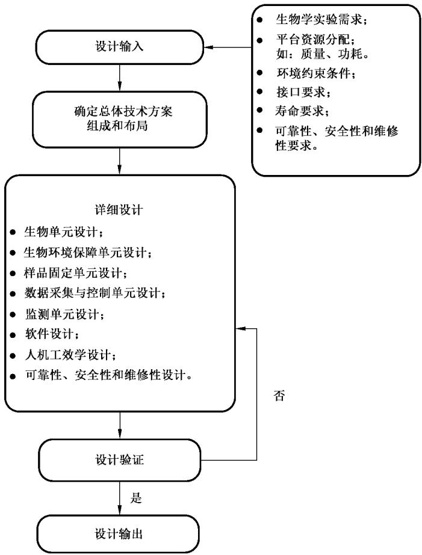
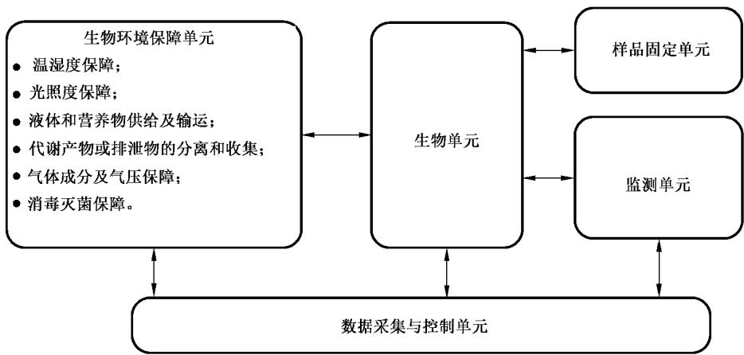

# 中 华 人 民 共 和 国 国 家 标 准

GB/T32700—2016

# 空间生物学实验装置通用设计规范

# Generaldesignspecificationforbiologicalexperimentfacilityinspace

2016-06-14发布

2016-09-01实施

## 目 次

前言 …… III
1 范围 …… 1
2 规范性引用文件 …… 1
3 术语和定义 …… 1
4 设计原则 …… 1
5 设计流程 …… 2
6 实验装置设计 …… 2
6.1 基本构成 …… 2
6.2 生物单元 …… 3
6.3 生物环境保障单元 …… 3
6.4 样品固定单元 …… 5
6.5 数据采集与控制单元 …… 5
6.6 监测单元 …… 6
6.7 软件设计 …… 6
6.8 可靠性、安全性和维修性设计 …… 6
6.9 人机工效学设计 …… 7
7 设计验证 …… 7
7.1 任务功能和性能指标符合性验证 …… 7
7.2 匹配试验验证 …… 7
7.3 临射前安装和回收分解验证 …… 8

## 前 言

本标准按照 / — 给出的规则起草。

本标准由全国空间科学及其应用标准化技术委员会( / )归口。

本标准起草单位:中国科学院上海技术物理研究所。

本标准主要起草人:张涛、章美敏、童广辉、郑伟波、王晨飞。

# 空间生物学实验装置通用设计规范

## 1 范围

本标准规定了空间生物学实验装置(以下简称实验装置)的设计原则、设计流程、设计方法和设计验证。

本标准适用于在空间飞行器上使用的生物学实验装置的设计 其他空间生物学实验使用的实验装置设计可参照使用。

## 2 规范性引用文件

下列文件对于本文件的应用是必不可少的。凡是注日期的引用文件,仅注日期的版本适用于本文件。凡是不注日期的引用文件,其最新版本(包括所有的修改单)适用于本文件。

装备可靠性通用要求

系统安全性通用大纲

航天员系统对飞船应用系统的技术要求

航天员系统对飞船工程设计的工效学要求与评价方法

卫星可靠性设计指南

航天产品维修性设计与验证指南

航天产品安全性分析指南

## 3 术语和定义

下列术语和定义适用于本文件。

## 3.1

空间生物学实验装置 biologicalexperimentfacilityinspace

为完成任务规定的空间生物学实验而研制的成套空间实验设备。

## 3.2

## 生物单元 experimentunitsforbiological

装载生物样品和生物材料、提供生物实验所必需的结构空间以及具备与外界进行物质、能量交换通道的实验部件。

## 4 设计原则

实验装置设计应遵循以下原则:

) 根据科学家拟定的空间生物学实验方案和流程,对生物单元、生物环境保障单元、数据采集与控制单元进行优化设计;

) 应方便实施生物样品的临射前安装和回收分解;

) 满足人机工效学的要求;

) 满足对航天员、地面操作人员的安全性保障;

) 在进行生物单元设计时,宜采用模块化、标准化的组件和部件;

) 生物单元的材料应满足生物相容性的要求;

) 应考虑发射时生物单元中装载的生物样品和生物材料的力学环境适应性;

) 应考虑生物单元中装载的生物样品和生物材料在微重力环境下的物质运动或形变、气液流动、界面运动、材质运动、流体输运和传热对空间实验结果的影响。

## 5 设计流程

设计流程如图 所示。

  
图1 设计流程图

## 6 实验装置设计

## 61 基本构成

611 实验装置应满足规定的空间生物学实验需求 提供适合生物样品的生物环境保障条件

612 实验装置应满足飞行器平台功耗、尺寸、质量的约束条件。

613 实验装置研制应经过多种可行性方案论证和权衡,确定总体技术方案。

614 根据空间生物学实验需求与流程 空间在轨运控模式和实验 任务 剖面确定实验装置组成和布局。实验装置通常应具备图 的组成部分。

  
图2 实验装置组成

615 确定生物单元、生物环境保障单元、监测单元、样品固定单元和数据采集与控制单元的种类、数量和组合模式 必要时可采用冗余配置

616 根据实验任务剖面和实验流程安排 确定实验装置的运控模式 合理设计实验控制系统

一般应包括以下几种模式:

) 发射前自测;

b) 在轨实验;

) 返回与回收或留轨。

## 62 生物单元

## 621 设计原则

实验装置内,可有一个或多个不同功能种类的生物单元,应根据不同的生物学对象,开展生物单元设计。

## 622 配置及功能设计要素

生物单元配置及功能设计要素如下:

) 具有一定空间的密闭或非密闭容器、内置式各类传感器以及不可分离的各种附件和配件;

直接与生物样品接触的部件 所选用的材料应具有良好的生物相容性

液体培养或气体培养单元中部件及附件连接应采用密封工艺措施防止气液体介质泄漏 有换液需求的生物单元应考虑空间微重力条件下液体输运问题并采取技术措施予以保障

同一实验装置内 有多个生物单元时 根据生物单元对生物环境保障单元的要求 生物单元与生物环境保障单元在结构上可以是相互独立的模块,也可以一体化设计。

## 63 生物环境保障单元

## 631 组成

实验装置的设计应围绕为生物样品提供全程生物环境保障开展。生物环境保障单元组成如下:

) 温湿度保障;

) 光照度保障;

) 液体和营养物供给及其输运;

) 代谢产物或排泄物的分离和收集;

) 气体成分及气压保障;

) 消毒灭菌保障。

## 6.3.2 温湿度保障

温湿度保障满足以下要求:

) 当生物样品的生长环境温度、湿度要求与航天器平台所能提供的环境条件不一致时,应从生物样品装入实验装置开始对生物样品提供全程温湿度保障;

) 应考虑整体结构布局、采取温湿度控制系统设计和安装工艺,能够保证在微重力环境下,生物单元内温湿度的均匀性满足所有生物样品的要求;

) 可选用电加热器和半导体制冷器作为温控执行元件;

d) 在实验装置内部设置温湿度采集点,进行在轨监测,为空间实验的结果分析提供依据。

## 633 光照度保障

光照度保障应提供满足生物生长发育或培养所需的光照条件 包括光谱 光照强度和光照周期 照明光源的选择应综合考虑光源的光谱波段范围 照度 显色性 对生物样品的安全性和对空间环境的适应性。光照度保障满足以下要求:

) 优先选用在轨验证过的照明光源和光学系统设计;

) 充分考虑安全性,所选照明光源应不对生物实验活体产生伤害;

) 应选用高发光效率的照明源,在较小的输入电功率条件下,为生物培养提供充足的光照强度;

) 照明光源合理布局,应满足所有实验样品和各实验阶段对光照的需求;

) 在实验装置内部设置光照度采集点,进行在轨监测,为空间实验的结果分析提供依据;

) 应避免影像信息采集需要的照明光源对生物样品的刺激和对空间实验结果产生的影响。

## 634 液体和营养物供给及输运

液体和营养物供给及输运满足以下要求:

) 应采用专用的泵、管路、滤膜和阀实现液体、气体、营养液的供给、收集及输运;

使用的部件或材料应满足生物相容性要求 性能稳定 不发生变性

当对生物单元的密封性有要求时 容器 管路和管路接头的密封性应满足密封要求 不产生液体 或气体 泄漏

) 在装置设计时应充分考虑微重力环境对物质输运的影响;

微重力条件下 传质的交换可通过渗透和扩散实现 气液交换需借助透气膜形成的界面实现可通过毛细现象 疏水或亲水处理等方法对表面张力进行充分利用

对于固态营养物 饲料 饵料等 应有专门的投放 喂食和清理设计

## 635 代谢产物或排泄物的分离和收集

代谢产物或排泄物的分离和收集满足以下要求

) 应结合营养物供给及输运模式,进行代谢产物的分离和收集设计;

) 根据生物实验种类和实验周期的不同,可采用不同的代谢产物的收集和储存模式;

可采用专用的泵 管路 滤膜和阀实现代谢产物的分离 交换 输运和流动

## 636 气体成分及气压保障

气体成分及气压保障满足以下要求:

应提供满足生物样品培养所需的气压和气体组分根据科学实验的需求 可采取直接或间接的气体组分供给系统 同时可设置相应的气体组分检测传感器;

) 可采用密封设计或采取强迫对流措施,保证生物培养所需的气体成分及气压。

## 637 消毒灭菌保障

生物单元中与生物样品盒和生物材料直接接触的所有材料应采用生物相容性材料 为了满足生物样品对实验环境的无菌要求 生物单元宜设计为密闭结构 并能经受灭菌操作

应制定生物单元灭菌操作和检测方法 以确保生物实验满足规定的无菌环境要求

## 64 样品固定单元

641 样品固定单元可分为低温固定和化学固定两种。

642 应根据不同类别的固定方式和生物学需求开展样品固定单元的设计。

643 应进行液体管理和执行机构设计

## 6.5 数据采集与控制单元

## 651 工程参数类别和工程参数采集、数据处理及信息传输设计

## 6511 工程参数类别

空间生物学实验中工程参数主要有:

) 供配电参数;

) 活动部件运动状态参数;

) 执行部件开关状态参数;

) 工位、工作模式、工况、热、光照等状态参数;

) 关键部件或组件的温度状态;

) 实验装置的密封性参数。

## 6512 工程参数采集、数据处理及信息传输设计

工程参数采集 数据处理及信息传输设计满足以下要求

) 应根据每项生物学实验的要求和工程实施可行性,确定工程参数类型和检测方法;

实验装置设计时应进行特性分析 充分识别关键特性 应对与关键特性相关的工程参数优先进行采集,并确保数据采集、储存、处理及传输的准确性和可靠性,必要时可采取冗余设计措施;

) 根据需要和关键程度,工程参数的获取、传输可选择不同的途径,或进行不同途径的冗余。工程参数传输途径如下:

) 通过航天器平台的直接遥测通道下传地面;

) 由实验装置完成采集处理后,通过传输通道下传地面;

) 在实验过程中进行实时采集,并标注时间码,在储存介质中保存,返回地面后读取。

## 652 科学参数类别和科学参数采集、数据处理及信息传输设计

## 6521 科学参数类别

空间生物学实验中的科学参数主要有:

) 温度;

) 湿度;

c) 照度;

d) 压力;

e) 气体组分;

f) 流量;

g) 酸碱度;

h) 溶解氧;

i) 葡萄糖、乳酸等含量;

) 生物实验过程的图像、光谱、视频。

## 6522 科学参数采集、数据处理及信息传输设计

科学参数采集、数据处理及信息传输设计应满足以下要求:

) 突出该项生物学实验关注的重点,在航天器平台限定的条件下具有工程可实现性;

采用传感器和数据采集电路对环境温度 湿度 照度等科学参数按不同的采样周期进行采样和缓存;

) 对科学参数传感器进行标定。

## 653 遥操作

应根据不同的实验需求,设计人机交互方式,实现地面人员对空间科学实验进程的交互式观测、操作与控制。

## 66 监测单元

监测单元满足以下要求:

) 根据生物学实验的需求,选择合理的实时图像、光照度或视频数据获取方式;

) 可采用自动搜索捕获目标和对目标自动聚焦成像的技术手段,选取合适的光学视场、感光度和放大倍率 获取在轨生物样品实验过程的图像或视频影像

) 可采用工位切换装置用于满足多组目标观察的需要。

## 67 软件设计

软件设计应满足以下要求:

可灵活 方便地调整实验参数 适应生物实验需求的变化

) 满足在轨生物样品更换的实施;

满足人机交互操作的需求

## 68 可靠性、安全性和维修性设计

## 681 可靠性设计

实验装置的可靠性设计应与生物单元 生物环境保障单元 样品固定单元 数据采集与控制单元及软件设计同步进行 除满足 和 的要求外 还应满足以下要求

) 对活动部(组)件、液体和营养物供给及输运单元和样品固定单元进行专项可靠性设计;

) 冗余设计以提高可靠性为目的,在满足功能和性能要求的前提下力求组成简单;

) 通过可靠性试验和评估对实验装置的可靠性设计进行验证。

## 682 安全性设计

安全性设计除满足 和 的要求外 还应满足以下要求) 为保证航天员的安全,在地面和在轨飞行期间,装有生物样品的生物单元,应将其与周围环境及航天员密封隔离;

采用密闭结构与周围环境进行隔离 保证内部活性生物样品 各种气态 液态工质不渗漏

) 需要航天员操作,以及有可能与航天员接触的设备应有符合要求的防划伤、防磕碰设计和处理;

) 实验装置不向舱内空间排放或泄漏对航天员有害或有影响的液体、气体。

## 683 维修性设计

维修性设计除满足 的要求外,还应满足以下要求:

) 在轨可更换单元应首选生物单元,方便实施生物样品的取出和更换的操作;

) 满足营养物、食物和气体的补给;

) 避免维修时产生生物污染和工质泄漏。

## 69 人机工效学设计

人机工效学设计除满足 的相关要求外,还应满足以下要求:

根据航天员在轨操作的需求 如安装 拆卸 取出和更换样品 回收 控制实验进程和观察 确定航天员操作方案,结合实验装置外形、功能和飞行任务设计人机操作、观察界面;

) 需在轨更换的实验装置或部件(在轨可更换单元)在功能、结构、电子电气接口方面具备可操作性;

观察界面的设计需考虑航天员的相对操作距离 操作位置 操作角度

) 通过航天员系统的人机工效学评价。

## 7 设计验证

## 71 任务功能和性能指标符合性验证

应对实验装置的任务功能和性能指标符合性进行以下验证:

) 实验装置的功能和性能指标对预期空间科学实验要求的满足度;

) 实验装置的光、机、电、热特性接口;

) 实验装置的可操作性、整合能力;

) 遥操作的可实现性;

) 人工干预、人机功效学的合理性;

) 临射前安装和回收分解的可行性;

) 科学参数标定的准确性。

## 72 匹配试验验证

721 匹配试验应在实验装置的各项功能和性能参数合格的基础上进行 在进行子系统匹配试验之前应完成子系统规定的各项匹配试验的预试验

722 通过匹配试验应验证:

) 实验装置对预定的空间生物实验的适用性;

) 预定实验方案及生物样品选取的合理性以及对实验装置和飞行试验环境的适应性;

生物样品和生物材料加载及生物样品实验数据采集的匹配性 有关设计技术文件 如操作规范、流程、细则等的可操作性。

723 可通过多次匹配试验来验证 装置设计对生物学实验方案的不确定性 实验流程的修正或实验

样品变化等的适应性。

724 以保持总体技术状态为前提,在正式实施飞行试验任务之前,应允许进行为适应生物实验需求对生物单元作局部改进后的进一步匹配试验验证。

## 73 临射前安装和回收分解验证

731 进行实验装置设计时,应对临射前安装和回收分解的操作流程合理性、生物保障的可行性、可操作性及有效性进行验证。

732 应确定生物实验装置转场,实验样品和生物材料的转运、现场制备和检测方法并形成作业指导文件。

733 应充分考虑生物样品对发射场环境(温湿度、大气压、水质)的适应性问题。