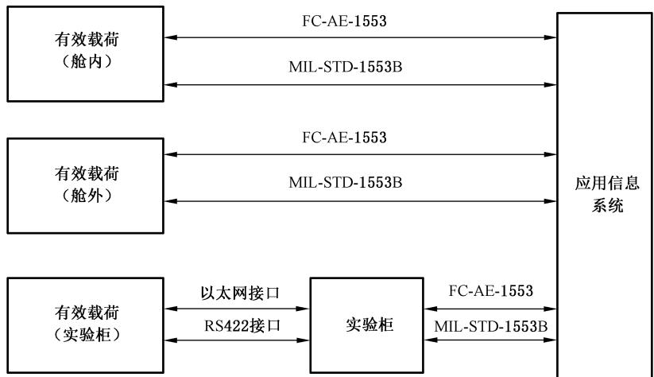
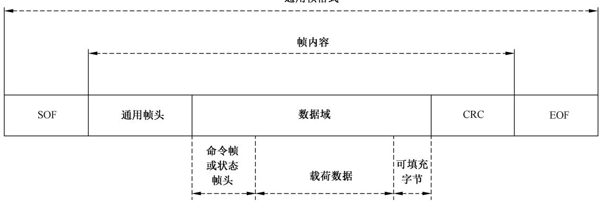

# 中华人民共和国国家标准

GB/T 34829—2017

# 空间站应用有效载荷数据通信规范

# Space station specification of utilization payload data communication

2017-11-01 发布

2018-05-01 实施

## 目次

前言 …… I
1 范围 …… 1
2 规范性引用文件 …… 1
3 术语、定义和缩略语 …… 2
3.1 术语和定义 …… 2
3.2 缩略语 …… 3
4 总则 …… 3
5 MIL-STD-1553B 接口 …… 4
5.1 协议结构 …… 4
5.2 协议分层 …… 4
6 FC-AE-1553 接口 …… 5
6.1 协议结构 …… 5
6.2 协议分层 …… 5
7 以太网接口 …… 8
7.1 协议结构 …… 8
7.2 协议分层 …… 8
8 RS422 接口 …… 9
8.1 协议结构 …… 9
8.2 协议分层 …… 9
9 测试 …… 10

## 前言

本标准按照 GB/T 1.1—2009 给出的规则起草。

本标准由中国科学院提出。

本标准由全国空间科学及其应用标准化技术委员会(SAC/TC 312)归口。

本标准起草单位:中国科学院空间应用工程与技术中心。

本标准主要起草人:闫蕾、曹素芝、宫永生、吴少俊、房亮。

# 空间站应用有效载荷数据通信规范

## 1 范围

本标准规定了空间站应用有效载荷数据通信过程中各类型接口从物理层到应用层各层的数据规范，并规定了 MIL-STD-1553B 接口、FC-AE-1553 接口、以太网接口、RS422 接口相关内容。本标准仅规定有线传输数据通信规范，不规定无线数据通信规范。

本标准适用于空间站应用有效载荷与应用信息系统之间以及应用有效载荷与实验柜之间的数据通信。应用有效载荷之间的数据通信参照本标准。

## 2 规范性引用文件

下列文件对于本文件的应用是必不可少的。凡是注日期的引用文件，仅注日期的版本适用于本文件。凡是不注日期的引用文件，其最新版本(包括所有的修改单)适用于本文件。

GJB 289 数字式时分制指令/响应型多路数据传输总线

GJB 727 航天测控系统术语和缩略语

GJB 1198.6 航天器测控和数据管理 第 6 部分: 分包遥测

GJB 1198.7 航天器测控和数据管理 第7部分:分包遥控

GJB 5186.1—2003 数字式时分制指令/响应型多路传输数据总线测试方法 第1部分:远程终端有效性测试方法

GJB 6410.1—2008 光纤通道 物理和信号接口 第1部分:FC-PH

GJB 6410.2—2008 光纤通道 物理和信号接口 第2部分:FC-PH-2

GJB 6410.3—2008 光纤通道 物理和接口信号 第3部分:FC-PH-3

ANSI INCITS 450-2009 信息技术 光纤通道 物理接口 4(FC-PI-4)[Information technology—Fiber Channel—Physical Interface—4(FC-PI-4)]

ANSI INCITS TR-42-2007 信息技术 光纤通道 航空电子环境 上层协议(FC-AE-1553) [INCITS technical report for information technology—Fiber channel—Avionics environment—Upper layer protocol(FC-AE-1553)]

ANSI/TIA/EIA-422-B RS422 电气协议标准 (Electrical Characteristics of Balanced Voltage Digital Interface Circuits)

IEEE std 802.3 $^{TM}$ -2005 以太网协议标准[IEEE Standard for Information technology—Telecommunications and information exchange between systems—Local and metropolitan area networks—Specific requirements—Part 3: Carrier sense multiple access with collision detection (CSMA/CD) access method and Physical layer specifications]

IEEE std 802.3ab-1999 4 对 5 类平衡铜缆传输千兆以太网物理层标准 [Information technology—Telecommunications and information exchange between systems—Local and metropolitan area networks—Specific requirements—Supplement to Carrier Sense Multiple Access with Collision Detection (CSMA/CD) Access Method and Physical Layer Specifications—Physical Layer Parameters and Specifications for 1 000 Mb/s Operation Over 4-Pair of Category 5 Balanced Copper Cabling, Type 1 000 BASE-T]

IEEE std 802.3av $^{TM}$ -2009 接入网技术要求:10 Gbits/s 以太网无源光网络(10G-EPON)[IEEE Standard for Information technology—Telecommunications and information exchange between systems—Local and metropolitan area networks—Specific requirements Part 3: Carrier Sense Multiple Access with Collision Detection (CSMA/CD) Access Method and Physical Layer Specifications Amendment 1: Physical Layer Specifications and Management Parameters for 10 Gb/s Passive Optical Networks]

RFC 768 用户数据报协议(User Datagram Protocol)

RFC 791 互联网协议(Internet Protocol)

RFC 792 因特网控制消息协议(Internet Control Message Protocol)

RFC 793 传输控制协议(Transmission Control Protocol)

RFC 826 以太网地址解析协议(An Ethernet Address Resolution Protocol)

RFC 1918 私有网络地址分配(Address Allocation for Private Internets)

## 3 术语、定义和缩略语

## 3.1 术语和定义

GJB 289、GJB 727、GJB 1198.6 以及 GJB 1198.7 界定的以及下列术语和定义适用于本文件。

## 3.1.1

## 应用有效载荷 utilization payload

装载于空间应用技术平台上,用于执行特定科学实验、科学探测与应用研究任务的仪器及设备系统。

## 3.1.2

## 应用信息系统 information system for utilization

应用任务中负责系统级的有效载荷数据采集、存储、处理与传输等在轨信息支持工作的电子学系统。

## 3.1.3

## 实验柜 experiment rack

在飞行平台资源约束下，有统一机、电、热接口的，适用于支持一定学科范围开展不同实验任务的通用技术设施。

## 3.1.4

## 总线指令 bus command

总线控制器发给各有效载荷的命令消息。

## 3.1.5

## 数据注入 data uploading

通过通讯信道,把一个或多个运行参数、管理控制命令以编码形式发送,并装订到实验系统中的运行控制管理过程。

## 3.1.6

## 科学数据 experiment data

通过有效载荷运行获取的科学与应用信息。

## 3.1.7

## 有效载荷工程数据 payload house-keeping data

表征有效载荷运行工作状态的测量参数。

## 3.1.8

## 时间码 time code

时间码采用 6 字节数据, 其中秒值占 4 个字节, 亚秒值占 2 个字节。排列顺序为高字节在最前, 低字节在最后。第 5 字节为秒值最高字节, 第 2 字节为秒值最低字节。第 1 字节为亚秒值高字节, 第 0 字节为亚秒值低字节。亚秒值的分辨率为 $25 \mu s$ , 即亚秒值为 1 时表示 0.025 ms。时间码格式见图 1。

<table><tr><td>秒值最高字节</td><td>......</td><td>......</td><td>秒值最低字节</td><td>亚秒值高字节</td><td>亚秒值低字节</td></tr></table>

图 1 时间码格式定义

## 3.2 缩略语

下列缩略语适用于本文件。

ARP: 地址解析协议 (Address Resolution Protocol)

EOF: 帧尾(End of Frame)

FC: 光纤通道(Fiber Channel)

ICMP: 因特网控制消息协议 (Internet Control Message Protocol)

IP: 因特网协议(Internet Protocol)

NC: 网络控制器(Network Controller)

NT: 网络终端(Network Terminal)

SOF: 帧头(Start of Frame)

TCP:传输控制协议(Transmmination Control Protocol)

UDP: 用户数据报协议 (User Datagram Protocol)

## 4 总则

空间站应用有效载荷(简称有效载荷)与应用信息系统及实验柜进行数据通信。有效载荷与应用信息系统及实验柜之间的接口见图2。有效载荷数据通信接口符合以下规定：

a）接入应用信息系统的舱内有效载荷可选FC-AE-1553接口和/或MIL-STD-1553B接口；

b) 接入应用信息系统的舱外有效载荷可选 FC-AE-1553 接口和/或 MIL-STD-1553B 接口；

c) 实验柜内的有效载荷可选 RS422 接口和/或以太网接口；

d) MIL-STD-1553B 接口传输总线指令、数据注入以及数字量遥测。只具有 MIL-STD-1553B 接口的载荷也可通过此网络传输有效载荷工程数据和科学数据；

e) FC-AE-1553 接口传输总线指令、数据注入、数字量遥测、有效载荷工程数据和科学数据；

f) 同时具有 MIL-STD-1553B 接口和 FC-AE-1553 接口的有效载荷，通过 FC-AE-1553 接口传输有效载荷工程数据和科学数据。MIL-STD-1553B 接口作为备份，在 FC-AE-1553 接口不工作时传输总线指令、数据注入和数字量遥测；

g）RS422接口传输总线指令、数据注入、数字量遥测以及实验柜内部控制指令；

h）以太网接口传输有效载荷工程数据和科学数据；

i) 响应时间要求小于 1 ms 的载荷,一般不宜采用以太网和 RS422 接口;

j）可靠性要求高的安全关键设备一般不宜采用单一通道的以太网接口和RS422接口。

  
图2 有效载荷数据接口

## 5 MIL-STD-1553B 接口

## 5.1 协议结构

有效载荷的MIL-STD-1553B网络采用总线型拓扑结构，总线采用双冗余结构。采用分层通信模型，主要包括物理层、链路层和应用层。

## 5.2 协议分层

## 5.2.1 物理层

MIL-STD-1553B 接口物理层通讯协议符合以下规定：

a）MIL-STD-1553B 物理层接口遵循 GJB 289 的规定；

b) 总线终端与电缆间采用变压器耦合；

c) 总线接口支持带电插拔。

## 5.2.2 链路层

MIL-STD-1553B接口链路层通讯协议符合以下规定：

a）MIL-STD-1553链路层接口遵循GJB289的规定；

b) 总线控制规则采取静态总线控制, 只有一个固定的总线控制器对总线控制;

c）对于重要消息推荐采取多次重发的策略，防止丢失和误发。

## 5.2.3 应用层

应用层协议符合以下规定：

a）应用层数据包符合图3所示数据包格式规定；

<table><tr><td rowspan="2" colspan="2">主导头</td><td colspan="6">包数据区</td><td rowspan="2">CRC校验</td></tr><tr><td colspan="3">副导头</td><td colspan="3">有效数据区</td></tr><tr><td colspan="2">6字节</td><td colspan="3">可变长度</td><td colspan="3">可变长度</td><td>4字节</td></tr><tr><td rowspan="2">版本号</td><td colspan="4">包ID</td><td colspan="2">包序列控制</td><td rowspan="2" colspan="2">包数据长度</td></tr><tr><td>包类型</td><td>副导头标志</td><td colspan="2">应用进程ID</td><td>序列标志</td><td>包序列计数</td></tr><tr><td>3b</td><td>1b</td><td>1b</td><td colspan="2">11b</td><td>2b</td><td>14b</td><td colspan="2">16b</td></tr></table>

说明：

版本号——3位二进制；

包类型 ——1位二进制；

副导头标志 —— 1 位二进制；

应用进程 ID —— 11 位二进制, 各有效载荷应用进程 ID;

序列标志 ——2位二进制，b“00”：代表用户数据的连续块；b“01”：代表用户数据起始块；b“10”：代表用户数据结束块；b“11”：代表不分块数据；

序列计数 ——14 位二进制,为当前包在全部包序列中的顺序;

包数据长度 ——16 位二进制,单位为字节,值等于包数据长度(包含副导头和有效数据区)-1;

副导头——可变长度；

有效数据区——十六进制数据内容,数据长度应为偶数;

CRC 校验 ——4 字节,校验范围包括整个源包,即对主导头和包数据区进行校验。

图 3 应用层数据包格式

b) 数据传输时,高字节在前,按数值递减的次序跟着较低字节。

## 6 FC-AE-1553 接口

## 6.1 协议结构

有效载荷FC-AE-1553接口有两种网络拓扑结构：采用星型拓扑结构的交换式网络以及总线式拓扑结构网络。舱外有效载荷接入总线式拓扑结构的网络，舱内有效载荷可接入交换式网络或总线式拓扑结构网络。采用分层通信模型，主要包括FC-0层、FC-1层、FC-2层、FC-3层、FC-4层以及应用层。

## 6.2 协议分层

## 6.2.1 FC-0

FC-0 层协议符合以下规定：

a）交换式接口：

1）光纤光缆：使用OM3 $50 / 125\mu \mathrm{m}$ 多模光纤光缆，波长 $850~\mathrm{nm}$

2）接口速率：4.25 Gbps（兼容 2.125 Gbps、1.0625 Gbps）；

3）光模块：符合 ANSI INCITS 450—2009 规定。

b) 总线式接口：

1）光纤光缆：使用G.652.B9/125 $\mu \mathrm{m}$ 单模光纤光缆，波长 $1270\mathrm{nm} / 1330\mathrm{nm}$

2）接口速率：4.25 Gbps(兼容 2.125 Gbps、1.062 5 Gbps)；

3）光模块：符合 IEEE std 802.3av $^{TM}$ —2009 中 10G EPON 标准的规定。

## 6.2.2 FC-1

编码机制符合 GJB 6410.1—2008 中第 11 章的规定。

## 6.2.3 FC-2

FC-2 层协议符合以下规定：

a）链路同步符合以下规定：

1）交换式接口：NC与NT设备通过FC端口状态机实现与交换机的链路同步，链路同步后NC或NT才能发送FC-AE-1553协议帧，FC端口状态机符合GJB6410.1—2008中第16章要求；

2）总线式接口：NC到NT方向采用广播机制，属于连续模式发送；NT到NC方向采用时分复用机制，属于突发模式发送，NT发送FC-AE-1553协议帧前首先通过原语实现与NC链路同步。

b) 流量控制机制符合以下规定：

1）交换式接口：采用缓存到缓存的流量控制，帧发送需 R\_RDY 原语配合，符合 GJB 6410.1—2008 中第 26 章的规定；

2）总线式接口：帧可以连续发送，无需 R\_RDY 原语应答。

c) 帧格式符合以下规定：

1) FC-AE-1553 的协议帧分为命令帧、数据帧、状态帧三种类型。所有 FC-AE-1553 帧宜符合图 4 所示的通用 FC 帧格式，包括 4 字节的 SOF 帧起始界定符、帧内容与 4 字节的 EOF 帧结束界定符。帧内容由 FC 通用帧头、数据域与 CRC 组成。对于 FC-AE-1553 的命令帧，数据域包含 24 字节 FC-AE-1553 命令帧头，0 字节～2048 字节的载荷数据，0 字节～3 字节的填充；对于 FC-AE-1553 的状态帧，数据域包含 8 字节的 FC-AE-1553 状态帧头，0 字节～2048 字节的载荷数据，0 字节～3 字节的填充；对于 FC-AE-1553 数据帧，数据域包含 0 字节～2048 字节的载荷数据与 0 字节～3 字节的填充；

通用帧格式  
  
图4FC-2通用帧格式  
2）FC通用帧头结构符合图5的规定；

<table><tr><td>Bits Word</td><td>31 ... 24</td><td>23 ... 16</td><td>15 ... 08</td><td>07 ... 00</td></tr><tr><td>0</td><td>R_CTL</td><td colspan="3">D_ID</td></tr><tr><td>1</td><td>CS_CTL/Priority</td><td colspan="3">S_ID</td></tr><tr><td>2</td><td>TYPE</td><td colspan="3">F_CTL</td></tr><tr><td>3</td><td>SEQ_ID</td><td>DF_CTL</td><td colspan="2">SEQ_CNT</td></tr><tr><td>4</td><td colspan="2">OX_ID</td><td colspan="2">RX_ID</td></tr><tr><td>5</td><td colspan="4">Parameter</td></tr></table>

说明：

R\_CTL ——标识传输帧类别；

D\_ID, S\_ID ——地址标识, 标识源端地址与目的地址;

CS\_CTL/Priority ——类型特殊控制；

TYPE ——帧类型标识；

F\_CTL ——帧控制,符合 GJB 6410.1—2008 中 18.5、GJB 6410.2—2008 中 18.5 和 GJB 6410.3—2008 中 18.5 的规定;

SEQ\_ID ——序列 ID, 序列在当前交换中的顺序;

DF\_CTL ——数据控制字段；

SEQ\_CNT ——序列计数,帧在当前序列中的顺序;

OX\_ID ——发送交换标识；

RX\_ID ——接收交换标识；

Parameter ——在 FC-AE-1553 数据帧代表相对偏移量。

## 图 5 FC 帧头结构

3）FC-AE-1553命令帧头与状态帧头，符合ANSI INCITS TR-42—2007中4.4.4的有关规定。

d) 服务类别要求：

服务采用第三类服务，符合 GJB 6410.1—2008 中第 22 章的规定。

## 6.2.4 FC-3

登录方式采用隐式登录机制。

## 6.2.5 FC-4

FC-AE-1553 的协议规范符合 ANSI INCITS TR-42-2007 的规定。

## 6.2.6 应用层

FC-AE-1553 接口应用层协议符合 5.2.3 的规定。

## 7 以太网接口

## 7.1 协议结构

空间应用有效载荷以太网采用星型拓扑结构，通过交换机互联。采用分层通信模型，主要包括物理层、链路层、网络层、传输层和应用层。

## 7.2 协议分层

## 7.2.1 物理层

物理层协议符合以下规定：

a) 除特殊说明外,物理层协议遵循 IEEE std 802.3ab-1999 中 1 000 Base-T 的规定;

b) 支持传输速率自动协商机制,传输速率向下兼容,兼容接口遵循 10 BASE-T、100 BASE-T 的规定;

c) 宜使用满足航天应用要求的连接器, IEEE std 802.3ab-1999 中 40.8.1 规定的内容不适用于本标准。

## 7.2.2 链路层

数据链路层协议符合以下规定：

a）除特殊说明外，链路层协议宜遵循 IEEE std 802.3 $^{TM}$ -2005 链路层相关规定；

b) MAC 地址应符合全球唯一性要求；

c) MAC 帧格式采用 IEEE std 802.3 $^{TM}$ -2005 中 MAC 帧格式要求，不使用 LLC 子层。数据格式见图 6。

<table><tr><td>前序(7字节)</td><td>帧起始定界符(1字节)</td><td>目的地址(6字节)</td><td>源地址(6字节)</td><td>长度/类型(2字节)</td><td>数据内容(46字节~1 500字节)</td><td>帧校验序列(CRC)(4字节)</td><td>扩展(......)</td></tr></table>

图6 以太网MAC帧格式

## 7.2.3 网络层

网络层协议符合以下规定：

a）网络层协议遵循标准 RFC 791 的规定；

b) ARP 协议遵循标准 RFC 826 的规定；

c) ICMP 协议遵循 RFC 792 的规定；

d) IP 地址采用统一编址、统一分配的原则,地址分配宜使用 RFC 1918 中 C 类 IP 地址,通过子网掩码区分网络地址和设备节点地址;

e) IP 地址分配采用静态分配方式, 不使用 DHCP 协议;

f) IP 地址选择应避开行标规定地址；

g）采用冷备份设计有效载荷，主备份产品共用一个IP地址。

## 7.2.4 传输层

传输层协议符合以下规定：

a） UDP 协议遵循 RFC 768 的规定；

b) TCP 协议遵循 RFC 793 的规定；

c) 宜使用 UDP 协议进行点对点传输, 不支持广播传输;

d) 宜在 UDP 协议之上自定义协议进行流量控制和差错重传操作。

## 7.2.5 应用层

应用层协议符合以下规定：

a）应用层数据包格式符合图7的规定；

<table><tr><td>2字节</td><td>2字节</td><td>1字节</td><td>1字节</td><td colspan="2">2字节</td><td>6字节</td><td>2字节</td><td>可变长度</td><td>2字节</td></tr><tr><td>同步字</td><td>标识符</td><td>源地址</td><td>目的地址</td><td>序列标志</td><td>包序号</td><td>时间码</td><td>长度域</td><td>数据域</td><td>CRC</td></tr></table>

说明：

同步字 ——用于进行数据包同步；

标识域 ——表示不同的数据类型；

源地址 —— 发送数据包设备自身地址；

目的地址——接受数据包设备地址；

序列标志——2位二进制，B“00”：代表用户数据的连续块；B“01”：代表用户数据起始块；B“10”：代表用户数据结束块；B“11”：代表不分块数据；对于间断的分块数据，应按“01”“00”“10”对序列进行标志；对连续不间断的输出数据，应按“11”对序列进行标志；

包序号 ——14位二进制，为当前包在全部包序列中的顺序；

时间码 ——采用3.1.8的时间定义；

长度域 ——表示有效数据域的实际长度；

数据域 —— 数据的具体内容；

CRC 校验——16 位 CRC 校验码,校验范围包括同步头第一个字节开始到数据域字段最后一个字节。

图 7 以太网应用层数据包格式

b) 数据传输时,高字节在前,按数值递减的次序跟着较低字节。

## 8 RS422 接口

## 8.1 协议结构

空间应用有效载荷的 RS422 接口采用点对点传输模式。采用分层通信模型，主要包括物理层、链路层和应用层。

## 8.2 协议分层

## 8.2.1 物理层

RS422 物理层符合以下规定：

a) RS422 接口采用双工或者单工通信, 数据传输速率宜采用 115 200 bps 或 9 600 bps;

b) 电气特性符合 ANSI/TIA/EIA-422-B 的相关规定；

c) 信号电平(差分)符合以下要求:高电平(空载)3.0 V\~5.0 V、低电平0 V\~0.5 V;

d）接口互连时应当使用金属导体的双绞线电缆，必要时可以使用屏蔽线；

e）在发送端和接收端应提供一条信号地通路。

## 8.2.2 链路层

链路层协议符合以下规定：

a）RS422接口数据符合图8规定的格式：

<table><tr><td>1比特</td><td>8比特</td><td>1比特</td><td>1比特</td></tr><tr><td>起始位</td><td>数据位</td><td>停止位</td><td>校验位(奇校验)</td></tr></table>

图8 RS422链路层格式

b) 数据传输时,最高有效位在先,按照数值递减的次序跟着较低的有效位。

## 8.2.3 应用层协议

RS422 接口应用层协议符合 7.2.5 的规定。

## 9 测试

各接口测试符合以下规定：

a）MIL-STD-1553B接口测试宜采用GJB5186.1—2003相关方法；

b) FC-AE-1553 接口 FC-0 层测试符合 ANSI INCITS 450-2009 中第 6 章眼图相关规定；

c) FC-AE-1553 接口 FC-1 层、FC-2 层、FC-3 层和 FC-4 层测试帧格式符合 6.2.1～6.2.5 的规定；

d) 以太网物理层测试宜采用 IEEE std 802.3ab-1999 中 1 000 Base-T 测试相关方法；

e) 以太网链路层、网络层、传输层应用层测试帧格式符合7.2.1～7.2.5的规定；

f) RS422 接口宜进行传输速率测试、数据误码率测试、协议通信测试。