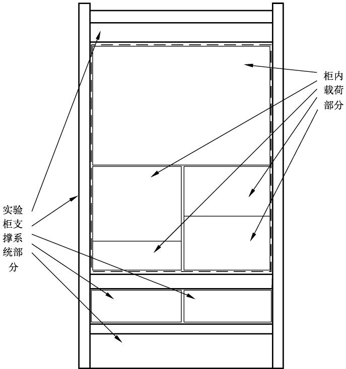

# 中华人民共和国国家标准

GB/T 35435—2017

# 空间站科学实验柜通用设计规范

# General design specification of science experiment rack in space station

2017-12-29 发布

2018-04-01 实施

## 目次

前言 …… I
1 范围 …… 1
2 规范性引用文件 …… 1
3 术语和定义 …… 1
4 科学实验柜系统组成 …… 2
5 设计原则 …… 2
6 设计要求 …… 2
6.1 设计输入 …… 2
6.2 机械设计 …… 3
6.3 热设计 …… 4
6.4 供配电设计 …… 5
6.5 电磁兼容设计 …… 7
6.6 测控与通信设计 …… 7
6.7 专用气体接口设计 …… 8
6.8 安全性设计 …… 8
6.9 可靠性与维修性设计 …… 10
6.10 工效学设计 …… 12
7 设计验证要求 …… 14
7.1 功能和性能指标验证 …… 14
7.2 安全性、可靠性与维修性验证 …… 14
7.3 工效学验证 …… 14

## 前言

本标准按照 GB/T 1.1—2009 给出的规则起草。

本标准由中国科学院提出。

本标准由全国空间科学及其应用标准化技术委员会(SAC/TC 312)归口。

本标准起草单位:中国科学院空间应用工程与技术中心。

本标准主要起草人: 张立宪、席隆、施建明、刘颖、刘悦、李楠、廖胜蓝。

# 空间站科学实验柜通用设计规范

## 1 范围

本标准规定了空间站科学实验柜通用的系统组成、设计原则、设计要求和设计验证内容。

本标准适用于空间站密封舱内开展空间科学研究与应用实验的科学实验柜设计,其他舱内机柜可参照执行。

## 2 规范性引用文件

下列文件对于本文件的应用是必不可少的。凡是注日期的引用文件，仅注日期的版本适用于本文件。凡是不注日期的引用文件，其最新版本(包括所有的修改单)适用于本文件。

GB/T 3805 特低电压(ELV)限值

GB/T 7247(所有部分) 激光产品的安全

GB 18871 电离辐射防护与辐射源安全基本标准

GB/T 28876.1 空间实验设备使用材料的可燃性 第1部分:要求

GB/T 28876.2 空间实验设备使用材料的可燃性 第2部分:测试方法

GB/T 30114.1 空间科学及其应用术语 第1部分:基础通用

GB/T 35439 空间站应用有效载荷安全性、可靠性与维修性保证通用要求

GJB/Z 35 元器件降额准则

GJB/Z 91 维修性设计技术手册

GJB 151 军用设备和分系统电磁发射和敏感度要求与测量

GJB 450 装备可靠性工作通用要求

GJB 2072 维修性试验与评定

GJB 2496 载人航天工程术语

GJB 6789 空间用锂离子蓄电池通用规范

HB 7066 民机机舱内部非金属材料燃烧产生毒性气体的测定方法

QJ 10014.3 空间材料安全性与相容性 第3部分:材料和装配件放气产物测定方法

## 3 术语和定义

GJB 2496、GB/T 30114.1 界定的以及下列术语和定义适用于本文件。

3.1

科学实验柜 science experiment rack

在飞行器平台资源约束下，有统一机、电、热、气等接口，适用于支持一定学科范围开展不同实(试)验任务的通用技术设施。

3.2

柜内载荷 payload inside rack

科学实验柜内用于实现特定科学实验目标的实验装置。

## 4 科学实验柜系统组成

科学实验柜(简称实验柜)由实验柜支撑系统和一个或多个柜内载荷组成。实验柜支撑系统包括柜体主结构、实验柜控制器、实验柜热控系统及管路组件等，一方面为实验柜连接外部提供各种标准接口，并同时为实验柜柜内载荷部分提供基础的机械、电、热等支持接口。实验柜组成示例见图1。

  
图 1 实验柜组成示例

## 5 设计原则

设计应遵循以下原则：

a）不应引起载人航天器的故障或危及航天员的安全和健康；

b) 满足空间科学应用任务的需求；

c) 权衡可靠性和维修性指标,分级分类开展设计;

d) 具有良好的工效学设计。

## 6 设计要求

## 6.1 设计输入

在实验柜设计阶段,应完整识别设计输入,包括:

a）利用实验柜开展空间实验任务的需求；

b) 研制技术要求,主要包括研制技术条件、功能要求和性能要求;

c) 适用的国家法规、研制规范及相关专业技术文件。

## 6.2 机械设计

## 6.2.1 实验柜外部机械接口

实验柜安装在载人航天器密封舱内,实验柜外部机械接口应满足研制技术要求的规定,主要包括以下方面:

a）实验柜本体尺寸、包络尺寸；

b) 实验柜发射质量、在轨质量、质量特性；

c) 实验柜与空间站密封舱的连接；

d) 实验柜力学特性。

## 6.2.2 柜内载荷机械接口

柜内载荷的机械接口由实验柜支撑系统提供,接口如下:

a）为柜内载荷提供完整的或分割的空间。

b）为柜内载荷提供不同机械连接方式，包括背板固定、导轨固定、框架固定，要求如下：

1）标准的柜内载荷采用背板固定或者导轨固定方式；

2）非标准的柜内载荷根据需要采用或同时采用背板、导轨和框架固定方式；

3）背部有接插件对接的载荷应有导向设计；

4）有更换要求时，连接用紧固件应选用防脱落紧固件，优先选用快拆紧固件。

c) 为柜内载荷提供风冷机械接口。

## 6.2.3 在轨凸出体

在轨期间超出实验柜本体尺寸之外的凸出物称为实验柜在轨凸出体，分为永久凸出、临时凸出，均应纳入实验柜接口管理。凸出不允许超出研制技术要求规定的包络尺寸。

在轨永久凸出应适应地面运输、试验验证、发射上行、在轨运行、在轨维护的要求。

在轨临时凸出在不使用时，应能够便于在轨拆除或复原。

## 6.2.4 力学设计

科学实验柜力学设计要求如下：

a) 应具有足够的强度和刚度,能够经受环境试验、地面操作、飞行入轨、在轨运行、在轨维修中的力学载荷作用;

b) 设计载荷为极限载荷与安全系数的乘积, 安全系数选取如下:

1）对于屈服载荷，安全系数宜不小于1.2；

2）对于破坏载荷，安全系数宜不小于1.35；

3）在静载荷条件下，紧固件设计安全系数一般应大于6。

c) 在应力集中敏感处,需采取如下措施减小应力集中:

1）宜尽量选择对应力集中不敏感的材料；

2）宜尽量避免横截面急剧突变，截面尺寸和形状有改变的地方应尽可能用较大圆角光滑过渡；

3）在设计铆钉孔和螺钉孔时，应通过合理排列形式减小峰值应力；

4）零件上宜尽可能少开缺口，特别是在受拉表面尽量不开缺口；

5）在焊接件设计时，合理布置焊缝，尽量避免焊缝交汇和过分密集，应使焊缝避开应力集中部位、加工面和表面热处理面；

6）零件表面打标记部位应选择在低应力部位；

7）在应力集中部位附近，可以开槽或沟分散应力。

d) 对于交变温度场引起的循环热应力,设计中需考虑:

1）合理选用线胀系数小、导热系数大的材料，以及高温持久极限高、韧性好的材料，以提高抗热疲劳强度；

2）结构应有热伸缩适应性，不同金属焊接时宜尽可能选择膨胀系数相同或相似的材料。

## 6.2.5 噪声和微重力扰动抑制设计

实验柜应进行柜内噪声源影响分析和微重力扰动源影响分析。根据需要，结合器件选型、机构润滑、外形设计、振动隔离、涂层喷涂、吸声材料使用等措施进行降噪设计和微重力扰动抑制设计，以满足空间站舱内噪声医学要求，满足柜内载荷对微重力水平的要求和对空间站微重力扰动的要求。

## 6.2.6 运动部件设计

运动部件设计应满足以下要求：

a）满足运动活动包络要求。

b) 运动部件应进行锁紧、解锁设计,要求如下:

1）运动部件锁紧应能经受上升阶段振动和冲击要求；

2）运动部件限位与锁紧应能经受在轨振动和冲击要求；

3）运动部件锁紧在经受上升阶段和/或在轨阶段后，应能正常解锁。

c) 运动部件应采取防护设计，避免运动部件和航天员活动的相互间影响。

## 6.3 热设计

## 6.3.1 实验柜外部热接口

实验柜利用外部提供的循环液体工质将柜内产生的热耗带走，通过循环液体回路交换给空间站热控系统。实验柜外部热接口应满足研制技术要求的规定，热接口主要包括以下方面：

a）散热能力；

b) 冷却液体工质入口温度和出口温升限值；

c）冷却液体工质流量、压头及冷却液体工质入、出口间压降要求；

d) 舱内热环境，包括实验柜辐射背景温度、实验柜周围空气温度、导热边界的温度；

e) 漏热要求。

## 6.3.2 柜内载荷热接口

柜内载荷热接口包括实验柜支撑系统提供的风冷接口和液冷接口，以及密封舱舱内热环境。

柜内载荷可根据需要选用液冷、风冷中的一种措施或组合措施，并可通过主动温控设计保证特定的温度范围或温控精度。

## 6.3.3 风冷设计

采用风冷设计时，满足以下要求：

a）对于热负荷较小且对气流扰动不敏感的热源，宜采用风冷进行散热；

b) 实验柜内风冷系统的管道应设计烟雾探测装置,实现烟雾探测与报警功能;

c) 实验柜风冷系统应根据需要设计温度传感器；

d) 采用风冷设计的柜内载荷还需遵循以下规定：

1）柜内载荷内部布局应能形成通畅的气流通道，不能阻塞进、出风口；

2）散热量大的设备宜布置在靠近出风口的位置；

3）柜内载荷内部有局部热风无法排出时，应增加导流风扇；

4）若实验柜支撑系统提供的风量不能满足柜内载荷散热需求，则柜内载荷内部可自带风扇以强化风冷散热效果；

5）与实验柜支撑系统风道相通的柜内载荷风道根据需要进行气隔离设计。

## 6.3.4 液冷设计

采用液冷设计时，应满足以下要求：

a）应保证与液体工质接触的管路、阀门、传感器等与液体工质的相容性；

b) 液冷系统内部应设置适当的流量调节阀、流量传感器、压力传感器、温度传感器等部件，满足对液冷系统的监测和调控要求；

c) 有插拔要求的接头采用快速断接头，应在保证在轨更换的前提下，尽量减少快速断接头的数量；

d) 应能方便快速地开通与关断液冷系统；

e) 液冷系统应进行密封设计，以防止冷却液体工质泄漏，以及防止外部对冷却液体工质的污染；

f) 采用冷板液冷设计的柜内载荷还需遵循以下规定：

1）冷板应由高热导率材料制成；

2）柜内载荷应设计内部传热途径，将热量传输到冷板；

3）与冷板安装接触面之间应添加导热涂层或导热垫；

4）若热源直接安装在冷板上，则热源安装面应保证平面度和接触面积。

## 6.3.5 载荷主动温控设计

载荷主动温控设计应满足以下要求：

a）温控功率应留有余量，能适应低温或高温工况和启动时的需求；

b) 优先选用结构简单、可靠性高、技术成熟、使用范围广的温控措施，以降低设计的复杂性。

## 6.4 供配电设计

## 6.4.1 实验柜外部供电接口

实验柜利用外部提供的直流 $100\mathrm{V}$ 供电开展工作。外部供电接口主要包括以下方面：

a）外部提供的供电路数、供电电压和供电功率；

b) 外部提供供电的电源特性，包括电压范围、纹波和尖峰要求、瞬态特性要求。

## 6.4.2 柜内载荷供电接口

实验柜支撑系统为柜内载荷提供的供电接口如下：

a）电源额定输出为直流 28 V 和直流 100 V:

1）当 28 V 电源在阻性负载上输送最大额定电流时，在 0 MHz 到 10 MHz 的带宽上所测纹波电压的峰峰值应不大于 200 mV；

2）当 100 V 电源在阻性负载上输送最大额定电流时，在 0 MHz 到 10 MHz 带宽上所测纹波电压的峰峰值应不大于 1 V。

b) 在任何情况下(包括部件失效)，电源最高输出电压不超出安全输出电压极限，过压保护值为输出额定电压的 1.2 倍。

c) 输出具有过流保护功能，设置的过流保护值一般应不小于额定电流的 1.4 倍，负载故障消除后电源能够恢复正常工作。

## 6.4.3 负载对电源的适应性要求

## 6.4.3.1 短路保护

直接使用实验柜输入电源时,应采取永久性短路防护措施(熔断器)或可人工恢复短路防护措施(断路器)。

使用实验柜内部电源时,宜采用可恢复供电状态的措施(固态功率控制)或切换到备份的电源保护措施。

## 6.4.3.2 启动电流与浪涌抑制

实验柜和柜内载荷电源输入接口电路应按照研制技术要求采取措施，抑制开机浪涌电流。

电机类负载应视其具体型号和使用条件,采取措施限制启动电流。

## 6.4.3.3 电压的适应能力

实验柜应能够在安全电压下工作，抗过压和欠压能力应符合研制技术要求的规定。

## 6.4.4 配电电缆损耗

从 DC/DC 电源变换器到负载的电缆传输压降，宜不大于 DC/DC 电源变换器额定输出电压的 2%。

## 6.4.5 电源接地与隔离

电源接地与隔离设计应满足以下要求：

a）实验柜应设定专用接地桩与载人航天器的结构地连接；

b) 实验柜电源输入的电源线、电源回线与信号线、机壳隔离；

c）实验柜电源输入的电源回线与电源输出的电源回线隔离；

d) 柜内载荷电源输入的电源回线与所属设备机壳隔离；

e）柜内载荷 DC/DC 电源变换器的输出电源回线与信号地为等电位点；

f) 选用隔离 DC/DC 电源变换器的柜内载荷, 其输出电源回线与机壳的接地点应位于此输出电源回线附近; 采用非隔离 DC/DC 电源变换器的柜内载荷, 地线应与所属设备机壳隔离;

g）柜内载荷如有浮地需求，其内部电路与机壳隔离，由其电源回线作为其内部电路参考电位；

h）其他接地方式按照空间站专业技术文件的规定执行。

## 6.4.6 绝缘要求

## 6.4.6.1 电气间距

涂覆后的导体，电位差为 $50\mathrm{V}\leqslant u\leqslant 100\mathrm{V}$ 时，最小电气间距为 $0.13\mathrm{mm}$ ；电位差为 $100\mathrm{V} < u\leqslant 170\mathrm{V}$ 时，最小电气间距为 $0.4\mathrm{mm}$ 。其他高压电路应通过专门试验确认满足要求。

## 6.4.6.2 绝缘距离

除印制板外，其他导体间电位差为 $50\mathrm{V}\sim 250\mathrm{V}$ 时，圆形导体间的绝缘距离不小于 $0.25\mathrm{mm}$ ，平板导体间的绝缘距离不小于 $1.25\mathrm{mm}$ 。其他高压电路应通过专门试验确认满足要求。

## 6.4.6.3 绝缘措施

电源导线与其附近的金属件宜采用双重绝缘或加强绝缘。

棱边、拐角宜倒圆并加贴绝缘薄膜。

## 6.4.6.4 绝缘寿命

绝缘件设计、绝缘材料选用应根据产品寿命周期，按照最坏工况进行设计。

绝缘材料所承受的电场强度应不小于 $800 \, V/mm$ 。

## 6.5 电磁兼容设计

电磁兼容设计应符合 GJB 151、研制技术要求及空间站专业技术文件的规定，并应与机、电、热等设计同步进行。

## 6.6 测控与通信设计

## 6.6.1 实验柜外部测控与通信接口

通过外部提供的测控与通信接口实现对实验柜的直接测控、数字量遥测、数据注入和科学数据传输。外部测控与通信接口主要包括以下方面：

a）直接测控接口，包括模拟量遥测接口和程控指令接口；

b) 通信接口，包括FC-AE-1553、MIL-STD-1553B。FC-AE-1553可用于传输数字量遥测、注入数据和科学数据。MIL-STD-1553B仅用于传输数字量遥测和注入数据。

## 6.6.2 枢内载荷测控与通信接口

实验柜支撑系统为柜内载荷提供直接测控接口和通信接口。

直接测控接口包括柜内模拟量遥测接口和柜内程控指令接口。通信接口包括以太网接口、RS422通信接口。以太网接口或RS422通信接口可用于传输数字量遥测、注入数据和科学数据，柜内载荷可根据实际情况选用。

## 6.6.3 程控指令

## 6.6.3.1 源特性

源特性应满足以下要求：

a）源类型为集电(漏)极开路门(OC门)开关；

b) 命令作用状态时,集电(漏)极开路门被接通(低电平),指令回路中有电流;

c) 命令非作用状态时,集电(漏)极开路门断开(高电平),指令回路中无电流;

d) 导通时集电极(命令线)电压不大于 $1.5 \, V$ ;

e) 命令作用状态吸收电流能力不小于 200 mA;

f) 负脉冲宽度为 $80 \, ms \pm 10 \, ms$ 。

## 6.6.3.2 负载特性

负载特性应满足以下要求：

a）负载一端接程控命令线，另一端接负载供电电压，电压可选范围为 $3.3 \, V \sim 30 \, V$ ;

b) 负载最大电流不大于 180 mA;

c) 正常运行时负载不应造成开/关命令信号源的过载；

d) 命令信号作用于未加电设备上,用户设备不被损坏;

e）负载电路能抑制遥控开关动作过程中产生的瞬态效应；

f) 负载端需有一条指令回线与源端指令回线相连。

## 6.6.4 模拟量遥测

## 6.6.4.1 模拟量输出要求

模拟量遥测信号输出应满足以下要求：

a）参数输出电平范围为 $0 \, V \sim 5 \, V$ ;

b) 模拟量信号变化率(频率)不大于 0.1 Hz;

c) 信源输出阻抗不大于 $5\mathrm{k}\Omega$ ；

d) 信源端需避免开路，与遥测设备相连的不使用节点需接地。

## 6.6.4.2 采集要求

模拟量遥测信号采集应满足以下要求：

a）模-数变换采集电压范围为 $0 \, V \sim 5 \, V$ ;

b）模拟量信号采集通道输入阻抗不小于 $1 \, M\Omega$ ;

c) 采样率不小于 $2\mathrm{Hz}$ 。

## 6.7 专用气体接口设计

## 6.7.1 专用气体接口

实验柜外提供的专用气体接口主要包括真空接口、排废气接口和氮气接口。根据研制任务书或技术要求规定，实验柜可使用全部或部分专用气体接口。

## 6.7.2 真空和排废气接口设计

使用真空接口或排废气接口时满足以下要求：

a）实验柜应设置截止阀门，控制真空接口或排废气接口的通断；

b) 排放的成分、压力、温度、流量应满足真空接口或排废气接口规定；

c) 应排向舱外的气体不可向舱内排放；

d) 应预先分析排放气体的成分,必要时需增加气份检测仪器;

e) 应通过设计去除或收集不允许排放的成分；

f) 多个实验柜、单个实验柜内多个载荷均不可同时使用排废气接口；

g）多个实验柜、单个实验柜内多个载荷可同时使用真空接口；

h）实验柜内单个载荷不可同时使用真空接口和排废气接口。

## 6.7.3 氮气接口设计

使用氮气接口时应满足以下要求：

a）实验柜内应设置阀门，控制氮气的流量、通断；

b）手动调控装置应设计为从实验柜前面进行操作；

c) 氮气接口应按氮气供应时最大设计压力进行设计；

d) 由氮气接口获得的氮气不可与舱内空气进行交换。

## 6.8 安全性设计

## 6.8.1 结构安全性

结构失效影响安全性时,其结构设计安全系数应不小于1.5。在实验柜加工、测试和使用过程中应

防止由于裂纹或者类似于裂纹缺陷引起结构失效，以避免结构故障引起灾难性危险。

## 6.8.2 压力系统安全性

应按照环境剖面中的极限条件,如温度、压力、振动、冲击等复合作用,选取高安全系数进行压力系统设计。

## 6.8.3 材料安全性

材料选择应符合载人航天工程常用金属材料和非金属材料的选用要求。此外，还应慎重考虑对出气材料和可燃材料的使用，要求如下：

不使用向舱内释放有毒有害气体的材料。目录外的非金属材料，需按照 QJ 10014.3 进行逸出有害气体检测试验，检测合格并经审批可使用。

可使用不燃材料和阻燃性能良好的材料。如须使用可燃材料，需按照 GB/T 28876.1、GB/T 28876.2、HB 7066 和研制技术要求的规定进行检测试验，检测合格并经审批可使用。

## 6.8.4 电气系统

## 6.8.4.1 电源

实验柜电源故障不应影响载人航天器平台电源。

实验柜配电电路的设计应包括电路保护装置。

## 6.8.4.2 电池

电池安全性设计中应通过电池状态监测和防护等措施,避免电池产生如下危险:

a）排放易燃、腐蚀或者有毒的气体和反应物；

b) 电解液泄漏；

c) 电池过热；

d) 短路、电流翻转、电压翻转；

e) 电池接地和过压；

f) 真空环境下失效。

使用锂电池时应遵守 GJB 6789 的要求。

## 6.8.4.3 电连接器

实验柜与空间站平台的电连接器应选用符合平台规定的电连接器，宜从设计上保证在实验柜安装、运行、移动、在轨维护时不需进行盲插，如需盲插应设计防差错措施。

低于安全电压的电源连接器可布置在前面板或者后面板，高于安全电压的电源连接器不应布置在前面板，如有特殊需要需经批准。安全电压限值按 GB/T 3805 或研制技术要求的规定执行。

电连接器在设计时应考虑到误插拔的可能,应从设计上避免对不匹配的电连接器进行操作,对未连接状态的电连接器采用防护盖进行防护。

## 6.8.5 操作安全性

应避免操作实验柜对航天员造成的危害，包括设备的边或角、危险的伸出部件或活动部件。

## 6.8.6 火灾防护

火灾防护安全性设计应实现实验柜火情预防、火情检测和灭火的设计要求：

a）对潜在的火灾危险源应进行控制。摩擦、自燃或其他可确定的潜在火源应可控；

b) 应能够及时检测并确认实验柜内部所有可能的起火位置。探测到火灾或者发出火灾预警后，对外提供相关数据；

c) 实验柜应有迅速控制火情的预防措施，包括断电、断气和断液。存在火情风险的实验柜应有灭火接口。由于火情控制自动断电后，不能再自动加电。

## 6.8.7 生物安全性

实验柜生物安全性设计应符合空间站有效载荷生物安全的要求。

## 6.8.8 激光产品安全性

激光产品的安全性设计按照 GB/T 7247 的相应规定执行。

## 6.8.9 电离辐射防护

电离辐射防护按照 GB 18871 的规定执行。

## 6.8.10 触摸温度

航天员可触的实验柜外表面及内部空间的接触点温度一般应控制在 $10^{\circ}C \sim 45^{\circ}C$ 之间。当超出温度要求时，应有警示性标识和防护措施。

## 6.9 可靠性与维修性设计

## 6.9.1 可靠性设计

## 6.9.1.1 冗余设计

根据可靠性要求,综合考虑实验柜组成部件的关键程度、维修难度、寿命和可靠性水平,确定冗余设计需求。实验柜冗余设计时满足以下要求:

a）安全关键的部组件应考虑冗余设计；

b) 通过维修性设计减少冗余设计,维修难度大的部组件宜考虑冗余设计;

c) 尽量降低冗余的级别,不宜采用单机级的冷备方案。

## 6.9.1.2 降额设计

对实验柜电子元器件开展降额设计。根据元器件的工作应力，主要是电应力和热应力，选取合适的降额因子进行降额设计。降额设计须与元器件应力分析及热设计相结合。

降额等级包括Ⅰ、Ⅱ、Ⅲ三个等级，根据实验柜组成产品的等级来确定相应的降额等级。实验柜组成产品等级划分按 GB/T 35439 的规定执行。四类不同等级产品的元器件降额等级应满足以下要求：a) Ⅰ、Ⅱ类产品的元器件采用Ⅰ级降额；

b) Ⅲ类产品的关键元器件采用Ⅰ级降额，其他Ⅲ等级产品的元器件采用Ⅱ级降额；

c) Ⅳ等级产品的元器件采用Ⅲ级降额。

降额设计按 GJB/Z 35 的规定执行。

## 6.9.1.3 环境防护设计

应根据任务要求对过载、振动、冲击、潮湿、盐雾、高低温、低气压、真空以及辐照等环境进行防护设计，保证正常工作。

## 6.9.1.4 容差设计

关键产品应通过容差分析进行参数设计,确保产品的性能稳定性,例如针对指令电路、高速通信接口电路、时序电路的参数漂移问题进行容差分析与设计。

## 6.9.1.5 裕度设计

关键特性和关键参数的设计指标应留有充分的余量,按照以下要求开展裕度设计:

a）选择裕度设计重点关注的部件、关键参数；

b) 通过仿真、分析、试验等方式量化设计裕度。

## 6.9.1.6 防潜通设计

对于关键电路和接口电路应进行潜在通路分析,避免潜在通路的存在。

## 6.9.2 维修性设计

## 6.9.2.1 维修策略设计

根据对故障影响、载荷设计特点、寿命周期和使用等因素的综合考虑,选用以下不同的维修策略:

a）修复性维修；

b) 定期开展的预防性维修；

c) 视情开展的预防性维修；

d) 基于状态监测的预防性维修。

## 6.9.2.2 模块化设计

模块化设计满足以下要求：

a）应适应实验柜载荷的包络和接口特点；

b）预期需在轨更换的模块应设计成在轨可更换单元；

c) 模块的尺寸、重量应符合空间站的上下行及装卸的能力要求；

d) 应符合 GJB/Z 91 规定的模块化设计要求。

## 6.9.2.3 标准化和互换性设计

标准化和互换性设计满足以下要求：

a）下列情形应采用物理和功能完全互换性设计：

1）设计上要求相同的模块单元；

2）具有相同编号或标识的单元；

3）功能相同应用位置不同的单元，尤其是失效率高的单元。

b) 零部件、紧固件、接头、管路、电缆、电路板等应标准化。

c) 应符合 GJB/Z 91 规定的标准化和互换性设计要求。

## 6.9.2.4 可达性设计

可达性设计满足以下要求：

a）应提供航天员良好的视觉可达和实体可达，以及足够的操作空间；

b) 应符合 GJB/Z 91 规定的可达性设计要求。

## 6.9.2.5 测试性设计

测试性设计应满足以下要求：

a）设计并优化测试点的布局，提高与测试设备的兼容性，便于实验柜的性能测试；

b) 合理设计机内测试(Built-in Test, BIT)功能, 满足故障检测与隔离、状态监测的要求;

c) 标准板卡应包含 BIT 功能,便于故障诊断和功能测试;

d）安全关键电路、控制器及防护装置的设计应便于安全防护功能的测试与验证；

e）从测试程序、技术信息、人员训练、测试设备等方面提高故障诊断能力。

## 6.9.2.6 保障性设计

保障性设计满足以下要求：

a）宜采用空间站的通用工具和保障设备；

b）专用工具和保障设备应与设备同步研制；

c) 备件供应方案应考虑包括全寿命周期备件的需求、准备、运输、上行、在轨存储等事宜。

## 6.10 工效学设计

## 6.10.1 显示器和控制器

显示器和控制器的工效学设计应符合空间站工效学要求的规定。

## 6.10.2 航天员操作的紧固件

航天员操作的紧固件设计满足以下要求：

a）宜采用与载人航天器平台一致的紧固件；

b) 应根据操作负载、紧固件结构荷载、使用频率、操作环境等因素选择通用的紧固件类型，不同类型的紧固件应易于辨别；

c) 选择紧固件时,应考虑到徒手或戴手套对紧固件和工具进行操作;

d）由航天员操作的应为系留紧固件，如需垫圈或其他锁定装置，也应为系留型；

e) 应提供紧固件咬合与否的反馈信息；

f) 紧固件拧紧或松开的过程不宜多于十圈，可快速打开的紧固件宜首选四分之一圈紧固件。

## 6.10.3 线缆与管道

## 6.10.3.1 线缆设计

实验柜线缆设计满足以下要求：

a）在不易断开线缆连接的情况下，其长度应允许柜内载荷移至便于检修的位置。

b) 规划线缆的路径,使其满足以下要求:

1）不应被门、盖子、滑座卡住；

2）不应被用作转移的辅助装置；

3）不应妨碍航天员的作业活动；

4）不应构成安全隐患（如松垂、挂钩）。

c) 长度较大的线缆应设计固定措施。

d) 易损坏的线缆应设计防护措施。

e) 线缆应有明确的标识。

## 6.10.3.2 管道设计

实验柜前部需航天员操作的的气体和液体管道应具有具备弯曲能力,管道的布局和路径不应影响航天员活动。管道连接应便于航天员操作,并设计防插错标识。

## 6.10.4 连接器

## 6.10.4.1 一般要求

实验柜连接器设计满足以下要求：

a）连接器应便于组件和单元的拆卸和更换，连接或卸开一个连接器不应要求拆卸其他连接器；

b) 连接器在连接和拆卸过程中不应使人员和设备受到危险泄露、电击、机械能释放的影响；

c) 优先选用满足单手操作的连接器；

d) 应设计连接器连接的对准措施和连接到位提示；

e）连接器应满足航天员操作力和人体测量学的要求；

f) 宜尽量避免设计多排连接器,如必须设计多排连接器时优先选择错开排列;

g）连接器应满足防差错的要求；

h）连接器之间的距离应符合空间站工效学要求的规定。

## 6.10.4.2 气、液连接器

需在轨断接的气体和液体管路连接器,一般应提供指示说明管路内有压力气体或液体。对于可在压力条件下断接的气体或液体管路连接器,可不提供管路内有压力气体或液体的指示。

## 6.10.4.3 电连接器

电连接器设计时满足以下要求：

a）电连接器宜采用快速接头设计，或拆卸时需旋转的角度不大于 $360^{\circ}$ ；

b）电连接器插头应提供自锁安全锁扣；

c) 电连接器应便于安装，拆卸和安装时不应对线缆和连接器造成损伤；

d) 电连接器接头应设计为拆卸后裸露的插针不带电或可通过保护插头实现电气隔离。

## 6.10.5 报警与通报

报警与通报设计应符合空间站工效学要求的规定。

## 6.10.6 辅助装置

实验柜辅助装置设计满足以下要求：

a) 实验柜应设计与辅助装置(包括限位的软绳、扶手、脚限位器等)的安装接口；

b) 辅助装置不应对航天员的活动、视野、操作方便性造成不利影响，避免造成航天员疲劳；

c) 辅助装置的位置和数量应满足航天员在实验柜上开展所有活动的要求；

d) 限制器应保证舒适性,其对航天员束缚的力应合理地分布在身体上,使用限制器时航天员可自然地保持住束缚状态。限制器应允许航天员不小于4 h连续舒适使用;

e）限制器应该适用于航天员失重状态下的作业姿势，方便可调；

f) 限制器的颜色应与实验柜具有显著区别。

## 6.10.7 标识

需要航天员识别、判断、按程序操作或需避免危险的地方，均应提供标识，标识设计符合空间站的

规定。

实验柜前面板的色彩应与空间站舱内饰色彩协调。

## 6.10.8 环境照明

需要航天员进行识别、操作时应进行相应的环境照明设计。

## 7 设计验证要求

## 7.1 功能和性能指标验证

应对实验柜进行以下验证：

a）实验柜的功能和性能指标；

b) 实验柜外部的机、电、热、气等特性接口；

c) 实验柜支撑系统对柜内载荷的机、电、热、气等接口支持能力；

d) 通过匹配实验检验实验柜与支持实验的匹配性，与实验对象密切相关的功能和性能指标宜结合匹配实验进行验证；

e) 环境适应性试验验证。

## 7.2 安全性、可靠性与维修性验证

安全性、可靠性和维修性验证可采用分析、仿真和试验等方式进行，其中安全性验证优先选用试验方式开展。

按 GJB 450、GJB 2072 规定开展可靠性、维修性试验验证。

## 7.3 工效学验证

实验柜宜通过虚拟仿真初步验证其工效学特性，并基于实物开展实际验证。维修工效学验证宜结合维修性试验开展。