# 中华人民共和国国家标准

GB/T 35436—2017

# 空间站科学实验柜标准模块 接口设计规范

# Interface design specification for standard modules of science experiment rack in space station

2017-12-29 发布

2018-04-01 实施

## 目次

前言 …… III
1 范围 …… 1
2 规范性引用文件 …… 1
3 术语、定义和缩略语 …… 1
3.1 术语和定义 …… 1
3.2 缩略语 …… 2
4 构型及尺寸 …… 2
4.1 分类 …… 2
4.2 标准直装模块构型 …… 2
4.3 标准锁箱模块构型 …… 3
4.4 标准抽屉模块构型 …… 5
5 设计要求 …… 5
5.1 质量 …… 5
5.2 容积 …… 6
5.3 质心位置 …… 6
5.4 材料选取 …… 7
5.5 紧固件 …… 8
5.6 强度和刚度 …… 8
5.7 表面处理 …… 8
5.8 与实验柜接口 …… 9
5.9 人机工效学设计 …… 11
5.10 安全性、可靠性与维修性设计 …… 11
5.11 标识 …… 11
6 验证及试验 …… 12
7 包装及运输 …… 12
附录 A（资料性附录） 科学实验柜与标准模块的关系 …… 13
附录 B（资料性附录） SPU 扩展模块 …… 14
附录 C（资料性附录） 快拆面板 …… 16
附录 D（资料性附录） SDU 扩展模块 …… 17
附录 E（资料性附录） 标准模块与实验柜机械安装接口 …… 20
参考文献 …… 25

## 前言

本标准按照 GB/T 1.1—2009 给出的规则起草。

本标准由中国科学院提出。

本标准由全国空间科学及其应用标准化技术委员会(SAC/TC 312)归口。

本标准起草单位:中国科学院沈阳自动化研究所、中国科学院空间应用工程与技术中心。

本标准主要起草人:周维佳、刘金国、田远征、王珂、杨昇萱、王铁军。

# 空间站科学实验柜标准模块 接口设计规范

## 1 范围

本标准规定了空间站科学实验柜标准模块的构型，与科学实验柜之间的机、电、热接口设计及验证要求。

本标准适用于空间站上使用的科学实验柜标准模块，同时也适用于货运飞船内运输的标准模块。

注：本标准中在不引起歧义时，科学实验柜简称为实验柜。

## 2 规范性引用文件

下列文件对于本文件的应用是必不可少的。凡是注日期的引用文件，仅注日期的版本适用于本文件。凡是不注日期的引用文件，其最新版本(包括所有的修改单)适用于本文件。

GB/T 1804 一般公差 未注公差的线性和角度尺寸的公差

GB/T 35435—2017 空间站科学实验柜通用设计规范

GB/T 35439—2017 空间站应用有效载荷安全性、可靠性与维修性保证通用要求

GB/T34829—2017 空间站应用有效载荷数据通信规范

GJB 151 军用设备和分系统电磁发射和敏感度要求

GJB 450 装备研制与生产的可靠性大纲

GJB 1027 运载器、上面级和航天器试验要求

GJB 1033 航天器热平衡试验方法

GJB 2072 维修性试验与评定

GJB 2706 航天器模态试验方法

GJB 4009 航天员系统对飞船应用系统的要求

GJB 6765 航天员系统对飞船工程设计的工效学要求与评价方法

GJB 7358 航天器吊装、翻转、停放、运输、贮存通用技术要求

QJ 20054 航天型号用紧固件选用指南

## 3 术语、定义和缩略语

## 3.1 术语和定义

下列术语和定义适用于本文件。

## 3.1.1

## 实验柜 experiment rack

在飞行平台资源约束下，有统一机、电、热接口的，适用于支持一定学科范围开展不同实验任务的通用技术设施。

示例：国际空间站上的国际标准有效载荷机柜(ISPR)。

[GB/T 30114.1—2013, 定义 4.7]

## 3.1.2

## 标准模块 standard module

具有一定规格，易于安装、更换、维修，与实验柜对接、有标准的机、电、热接口的装置。

## 3.1.3

## 标准直装模块 standard payload unit

可将后面板与实验柜的背板直接相连的悬挂式模块。

注：标准模块的一种。

## 3.1.4

## 标准锁箱模块 standard payload locker

外观尺寸及接口方式与直装模块相同，但其前面板可在轨开闭，便于有效载荷更换的模块。

注：标准模块的一种。

## 3.1.5

## 标准抽屉模块 standard drawer unit

可通过导轨直接插入实验柜的抽屉式模块。

注：标准模块的一种。

## 3.2 缩略语

下列缩略语适用于本文件。

SDU: 标准抽屉模块(standard drawer unit)

SPL: 标准锁箱模块(standard payload locker)

SPU: 标准直装模块(standard payload unit)

## 4 构型及尺寸

## 4.1 分类

空间站科学实验柜标准模块根据功能及安装方式的不同可以分为3种构型，分别为标准直装模块、标准锁箱模块和标准抽屉模块。标准模块与空间站、实验柜的关系参见附录A。

## 4.2 标准直装模块构型

标准直装模块由后面板、前面板、上下盖板、左右侧板、导向座、手柄和防脱螺栓部件组成，其结构形式和主要尺寸见图1。图中尺寸值应符合GB/T1804中中等m级公差要求。标准直装模块可以进行扩展，参见附录B。

单位为毫米

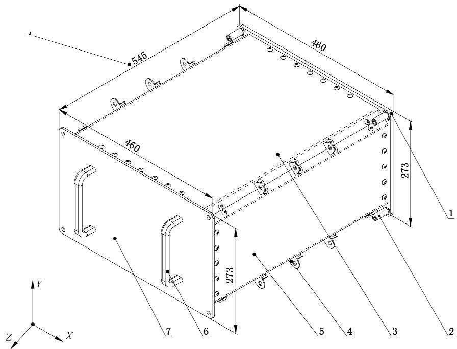

说明：

1——后面板；

2——防脱螺栓部件；

3——上下盖板；

4——导向座；

5——左右侧板；

6——手柄；

7——前面板。

导向座的内孔直径应大于防脱螺栓安装工具的外径。

$^{a}$ 深度尺寸 545 mm 为标准模块深度方向最大尺寸,该尺寸不包括前面板安装的手柄等突出物。

图 1 标准直装模块

## 4.3 标准锁箱模块构型

标准锁箱模块由后面板、前框架、前面板、快拆面板、上下盖板、左右侧板、导向座、防脱螺栓部件、铰链部件、左右锁紧机构组成，其结构形式和主要尺寸见图2，图中尺寸值应符合GB/T1804中中等m级公差要求。

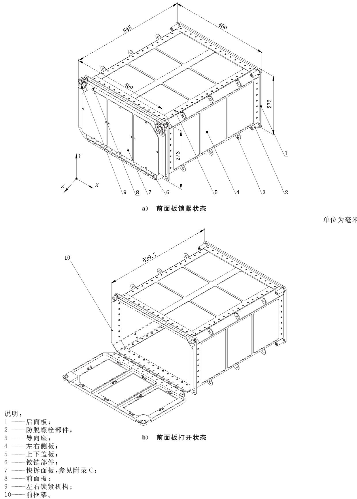

左右锁紧机构的设计应保证前面板可与前框架准确地锁紧与分离；前面板打开角度不小于 $180^{\circ}$ 。

图 2 标准锁箱模块

## 4.4 标准抽屉模块构型

标准抽屉模块由后面板、前面板、上下盖板、左右侧板、左右锁紧手柄、快拆面板、滑道和防脱螺栓部件组成。其结构形式和主要尺寸见图3，图中尺寸425.5公差等级为e9，其余尺寸值应符合GB/T1804中中等m级公差要求。标准抽屉模块可以进行扩展，参见附录D。

单位为毫米

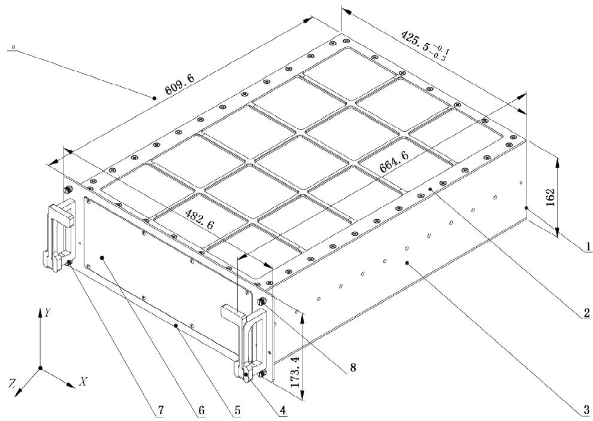

说明：

1——后面板；

2——上下盖板；

3——滑道；

4——左右侧板；

5——左右锁紧手柄；

6——前面板；

7——快拆面板,参见附录 C;

8——防脱螺栓部件。

左右锁紧手柄的设计应保证 SDU 与实验柜准确地锁紧与分离。

$^{a}$ 该尺寸不包括前面板，左右锁紧手柄及滑道。

图 3 标准抽屉模块

## 5 设计要求

## 5.1 质量

各标准模块的质量应满足表 1 的要求。

表 1 标准模块设计质量

<table><tr><td>型式</td><td> $质量^a$ kg</td></tr><tr><td>SPU</td><td>≤33</td></tr><tr><td>SPL</td><td>≤33</td></tr><tr><td>SDU</td><td>≤16</td></tr><tr><td colspan="2"> $^a$ 质量为随实验柜发射最大质量,在轨不受此质量约束。</td></tr></table>

## 5.2 容积

各标准模块的内部有效载荷可用最大有效容积见图 4。

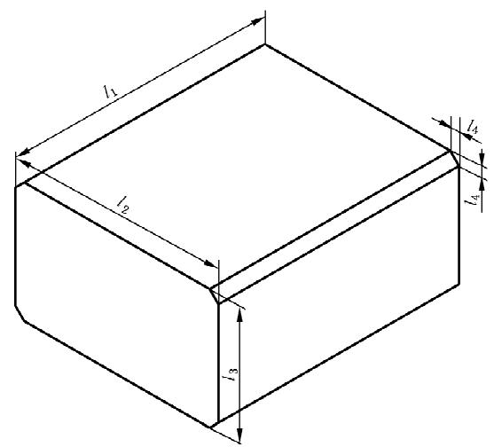  
单位为毫米

<table><tr><td>型式</td><td> $l_{1}$ </td><td> $l_{2}$ </td><td> $l_{3}$ </td><td> $l_{4}$ </td><td>容积L</td></tr><tr><td>SPU</td><td>532</td><td>440</td><td>253</td><td>25</td><td>58.6</td></tr><tr><td>SPL</td><td>516</td><td>440</td><td>253</td><td>25</td><td>56.8</td></tr><tr><td>SDU</td><td>590</td><td>405</td><td>150</td><td>15</td><td>35.6</td></tr></table>

图 4 标准模块最大有效容积

## 5.3 质心位置

标准模块设计时,其质心的位置的最优设计值宜是整体几何中心,见图5。质心允许位置偏差宜不大于 $\phi20\ mm$ 球径;若质心位置偏差值超过该范围,可与总体协调。

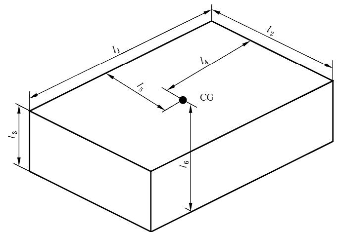

单位为毫米

<table><tr><td>型式</td><td> $l_1$ </td><td> $l_2$ </td><td> $l_3$ </td><td> $l_4$ </td><td> $l_5$ </td><td> $l_6$ </td></tr><tr><td>SPU</td><td>545</td><td>460</td><td>273</td><td>273</td><td>230</td><td>137</td></tr><tr><td>SPL</td><td>545</td><td>460</td><td>273</td><td>273</td><td>230</td><td>137</td></tr><tr><td>SDU</td><td>609.6</td><td>425.5</td><td>162</td><td>305</td><td>213</td><td>81</td></tr></table>

注：此图所示为所有标准模块外包络。

图 5 标准模块最优质心位置

## 5.4 材料选取

标准模块结构的材料选取时应满足以下要求：

——具有高的屈服极限及弹性模量；

良好的塑性和韧性；

无挥发性、无磁性和放射性；

无毒、无害及良好的阻燃性；

——良好的导电性；

优异的导热性能；

\- 接触零件材料应具有相容性，防止电化学反应。

材料宜按照表 2、表 3 及表 4 优先选用航天验证过的材料。

表 2 SPU 优先选用材料

<table><tr><td>零部件名称</td><td>材料</td></tr><tr><td>后面板、前面板、上下盖板、左右侧板、导向座</td><td>铝合金 7A09</td></tr><tr><td>手柄</td><td>铝合金 2A12</td></tr><tr><td>防脱螺栓部件</td><td>钛合金 TC4、铝合金 6061、弹簧钢</td></tr></table>

表 3 SPL 优先选用材料

<table><tr><td>零部件名称</td><td>材料</td></tr><tr><td>后面板、前框架、前面板、快拆面板、上下盖板、左右侧板、导向座</td><td>铝合金 7A09</td></tr><tr><td>铰链部件</td><td>钛合金 TC4</td></tr><tr><td>防脱螺栓部件</td><td>钛合金 TC4、铝合金 6061、弹簧钢</td></tr><tr><td>左右锁紧机构</td><td>钛合金 TC4、铝合金 2A14、铜合金 QSn6.5、弹簧钢</td></tr></table>

表 4 SDU 优先选用材料

<table><tr><td>零部件名称</td><td>材料</td></tr><tr><td>后面板、前面板、上下盖板、左右侧板、快拆面板、滑道</td><td>铝合金 7A09</td></tr><tr><td>左右锁紧手柄</td><td>钛合金 TC4、铝合金 2A14、铜合金 QSn6.5、弹簧钢</td></tr><tr><td>防脱螺栓部件</td><td>钛合金 TC4、铝合金 6061、弹簧钢</td></tr></table>

## 5.5 紧固件

紧固件选用应符合 QJ 20054 的规定,还应满足以下要求:

——使用无磁性材料，并具有防松动功能，各种螺母(含钢丝螺套)应选用锁紧型；

——标准模块内部结构相连可采用 M3、M4、M5 或 M6 的紧固件，优先选用 M4 或 M5；

——标准模块与实验柜连接时,采用 M6 螺钉防脱设计;

——标准模块内部需要航天员经常操作的部件应选用快拆式螺钉或机构。

## 5.6 强度和刚度

标准模块进行强度和刚度设计时,应满足以下要求:

\- 标准模块进行有限元分析,具有足够的刚度和强度;

\- 金属材料设计时其屈服强度安全裕度大于 0，极限强度安全裕度不小于 0.12，稳定度安全裕度不小于 0.25；

\- 标准模块(含有效载荷)基频宜不小于 70 Hz, 小于 70 Hz 可与总体协调;

\- 能够经受住力学环境试验、地面操作作用时不产生破坏或影响功能的弹性变形。

## 5.7 表面处理

根据标准模块不同部位采用材料的不同,表面处理(见图6)应满足以下要求:

——外露表面铝合金部件需进行低发射率表面处理，前面板颜色应与实验柜相统一；

——标准模块内部表面有热控性能要求的零件进行功能性表面处理,可选择本色、光亮或黑色阳极氧化;

——钛合金材料零件可不进行表面处理，若有特殊功能要求的进行脉冲氧化、表面镀镍或有机涂层。

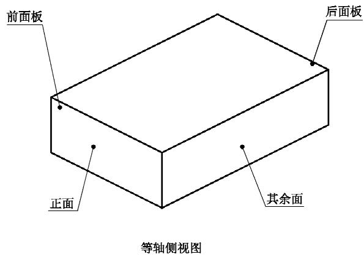  
图 6 标准模块外露面表面处理

## 5.8 与实验柜接口

## 5.8.1 机械接口

标准模块的机械接口应符合以下要求：

——SPU 及 SPL 采取悬挂式安装, 即后面板安装到实验柜的背板, 见图 7;

——SDU 通过前面板防脱螺栓固定到实验柜前梁上, 见图 8;

——SDU 的两个侧板应该预留滑道安装接口,前面板预留手柄安装接口,其机械接口参见附录 E;
——标准模块防脱螺栓规格均为 M6,M6 螺栓的设计数量及间距由标准模块质量及质心位置确定;

——M6 螺栓的数量及螺纹连接的间距根据标准模块的质量设计确定,其机械接口参见附录 E;
——若 SPU 有背部电插头的需求,则应增加单侧导向用导轨,导轨安装到 SPU 的左右侧板上。

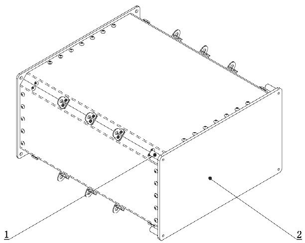

说明：

1——M6 高强度防脱螺栓；

2——后面板背面。

M6 高强度防脱螺栓组件与后面板装配为一体,其端头不突出后面板背面。后面板背面安装到实验柜的背板上。

图 7 标准直装模块及标准锁箱模块机械接口

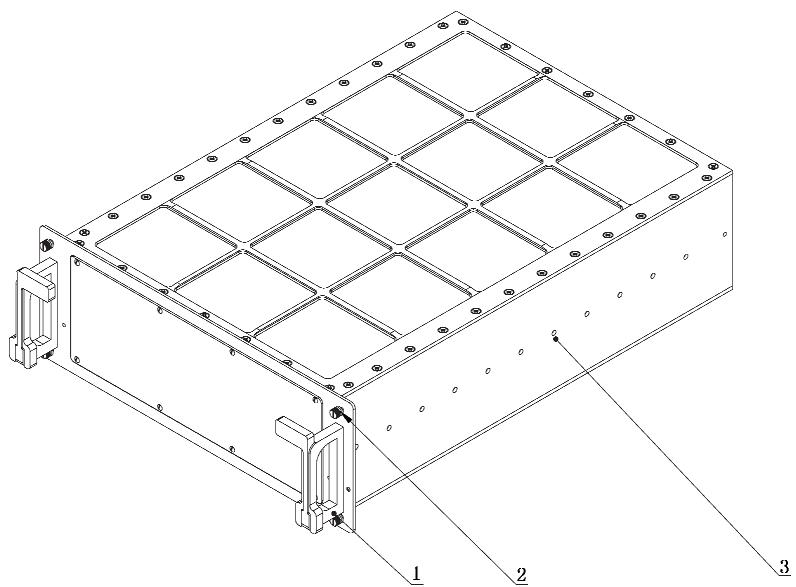

说明：

1——手柄安装接口；

2——M6 防脱螺栓组件；

3——左右侧板滑道安装孔。

M6 高强度防脱螺栓组件与前面板装配为一体，安装到实验柜对应的梁上。左右两侧板可安装滑道，方便模块的插拔。锁紧手柄安装到前面板上，方便在轨锁紧及解锁操作。

图 8 标准抽屉模块机械接口

## 5.8.2 电接口

在进行标准模块与实验柜电接口设计时,应满足以下要求:

——标准模块设计电压为 100 V 时, 其接口应设计到标准模块的背面及 SPU 的后面板; 为 28 V 时, 电源接口应优先设计在前面板; 所选接插件类型应符合功率及电压等要求;

——标准模块内电源系统设计应符合 GB/T 35435—2017 的规定；

\- 标准模块应符合导电要求，与实验柜安装面的搭接电阻小于 $10 \mathrm{~m} \Omega$ ；

\- 标准模块设计时应考虑电磁兼容设计，符合 GJB 151 的规定。

## 5.8.3 热控接口

在进行标准模块与实验柜热控接口设计时,应满足以下要求:

-SPU 及 SPL 的风冷接口应设计在后面板上,同时应考虑密封设计;

——SPU 及 SPL 的液冷接口应设计在前面板,同时为了便于维修,液冷所用工质连接应使用快换接头,快换接头的耐压性能、泄露率应符合热控系统设计参数要求;

——SDU 的风冷接口应设计在后面板上,同时需要考虑密封设计;

——SDU 的液冷接口应设计在前面板,同时为了便于维修,液冷所用工质连接应使用快换接头,选用泄露率符合航天要求的产品。

## 5.8.4 通信接口

标准模块与实验柜通信接口应符合 GB/T 34829—2017 的规定。

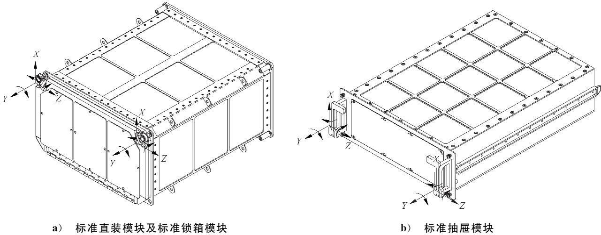  
图 9 标准模块锁紧机构

## 5.9 人机工效学设计

## 5.9.1 一般要求

标准模块的结构与机构应满足以下要求：

——凡是与航天员接触的结构不得有尖角或锐边，应进行倒圆或倒钝处理；

——航天员操作的电气设备应有防止误操作设计；

——航天员操作的机构应有防误操作设计,操作力不超过 GJB 6765 的相关要求;

——标准模块内的仪表显示内容应明确易标示；

——人机工效学设计应符合 GJB 6765 及 GJB 4009 的规定。

## 5.9.2 锁紧机构

SPL 及 SDU 应设计锁紧机构,应满足以下要求:

-SPL左右锁紧机构的设计，保证航天员解锁或锁紧操作时，至少有3个操作动作，推、拉及翻转的组合，见图9；

——SDU 左右锁紧手柄设计时,要求同 SPL,见图 9;

-SPL 和 SDU 的锁紧机构应左右对称，沿 Z 轴的平动操作和绕 Y 轴的翻转操作应相反，即设计左右锁紧机构时，沿 Z 方向的平动和绕 Y 方向的旋转设计成左右反向。

## 5.10 安全性、可靠性与维修性设计

标准模块的安全性、可靠性与维修性设计应满足如下要求：

——标准模块应考虑材料安全性、振动安全性和生物安全性；

\- 标准模块维修性设计时宜将前面板作为主维修面，顶面板作为次维修面；

安全性、可靠性与维修性设计应符合GB/T35439—2017的规定。

## 5.11 标识

标识需满足以下要求：

——标准模块的总体标识应位于标准模块的前面板；

——标准模块内部的电插头、水管路接头、电气操作按钮等应增加清晰的标识；

——标准模块内需要航天员操作的部位增加明确标示。

## 6 验证及试验

标准模块应进行环境试验验证其性能,应满足以下要求:

——标准模块的试验大纲及细则应符合 GJB 1027 的规定；

\- 标准模块的模态试验应按照 GJB 2706 的相关规定执行；

标准模块的热性能应满足有效载荷的要求，热平衡试验应符合GJB1033的规定；

标准模块应按照GJB450、GJB2072规定开展可靠性、维修性试验验证；

——标准模块应基于实物开展人机工效学验证，通过专家评审。

## 7 包装及运输

标准模块应考虑吊装、搬运、包装及运输，应满足以下要求：

——标准模块质量小于 20 kg 时,无需设计吊装螺栓,应设计搬运把手(可拆卸);

——标准模块质量超过 20 kg，应增加吊装螺栓孔。吊装螺栓孔的规格由模块质量确定；

——吊装螺栓孔应对称布置在质心周围；

——标准模块的吊装、翻转、停放、运输、贮存设计应符合 GJB 7358 的规定。

## 附录A

(资料性附录)

科学实验柜与标准模块的关系

科学实验柜与柜内标准模块的关系见图 A.1。标准模块能够容纳不同的实验系统用于多种学科实验，提供具有标准大小和质量（或两者的组合）、接口简单以及资源（电、热、数据等）集中分配的单元设备，为实验系统提供集成、有效以及在轨运行的一体化操作过程和方法。标准模块的使用一方面可最大限度地简化地面及在轨运行的管理（如载荷集成、资源分配、安装程序、运行管理等）；另一方面使科学试验成果最大化，同时最大程度地降低成本。

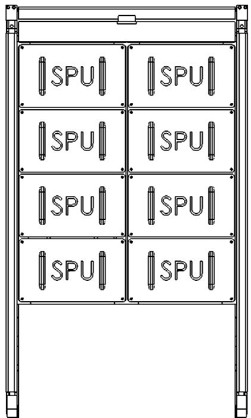  
a）科学实验柜安装标准直装模块

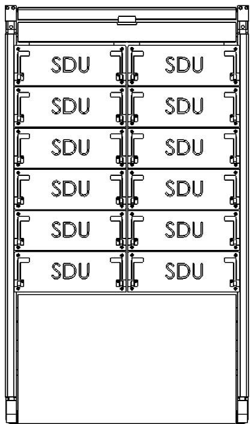  
b) 科学实验柜安装标准抽屉模块  
图A.1 科学实验柜与标准模块的关系图

附录 B

(资料性附录)

SPU 扩展模块

SPU 标准模块可以扩展为 2 倍 SPU 和 4 倍 SPU，其结构形式和主要尺寸见图 B.1 和图 B.2。图中尺寸值应符合 GB/T 1804 中中等 m 级公差要求。

单位为毫米

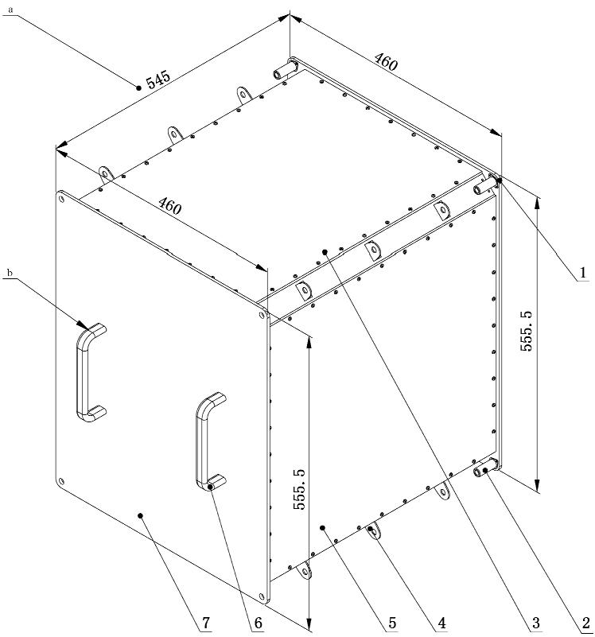

说明：

1——后面板；

2——防脱螺栓部件；

3——上下盖板；

4——导向座；

5——左右侧板；

6——手柄；

7——前面板。

导向座的内孔直径应大于防脱螺栓安装工具的外径。

$^{a}$ 深度尺寸 545 mm 为标准模块深度方向最大尺寸，该尺寸不包括前面板安装的手柄等突出物。

$^{b}$ 手柄规格及所需数量根据实际需要确定。

图 B.1 2 倍标准直装模块

单位为毫米

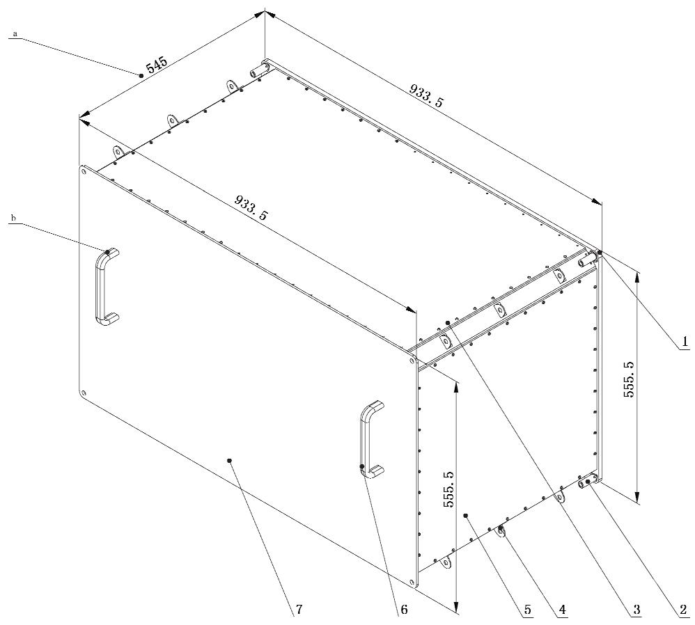

说明：

1——后面板；

2——防脱螺栓部件；

3——上下盖板；

4——导向座；

5——左右侧板；

6——手柄；

7——前面板。

导向座的内孔直径应大于防脱螺栓安装工具的外径。

$^{a}$ 深度尺寸 545 mm 为标准模块深度方向最大尺寸，该尺寸不包括前面板安装的手柄等突出物。

$^{b}$ 手柄规格及所需数量根据实际需要确定。

图B.2 4倍标准直装模块

(资料性附录)

快拆面板

为方便航天员操作标准模块内的实验系统进行科学实验,标准模块应设置快拆面板,应满足以下要求:

\- SPU 快拆面板的尺寸及位置由有效载荷设计方确定；

-SPL 前部设置 3 块快拆面板, 快拆面板为外凸式, 前面板开设便于样品通过的槽孔, 槽孔的形状与快拆面板相同, 见图 C.1;

-SDU前部设置一整体式快拆面板，快拆面板为内凹式，前面板开设便于样品通过的槽孔，槽孔的形状与快拆面板相同，见图C.1。

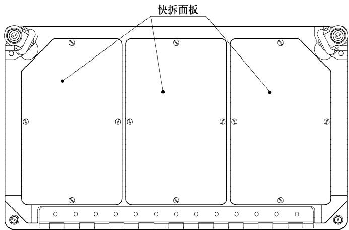

a）标准锁箱模块面板  
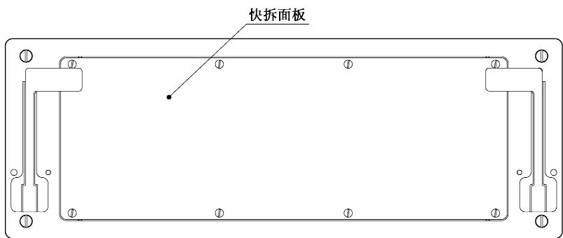  
b）标准抽屉模块面板  
快拆面板数量可以根据载荷需求变化。

图 C.1 标准模块快拆面板

附录 D

(资料性附录)

SDU 扩展模块

SDU 标准模块可以扩展为 2 倍 SDU 和 3 倍 SDU 及缩短型 SDU, 其结构形式和主要尺寸见图 D.1、图 D.2 和图 D.3。

单位为毫米

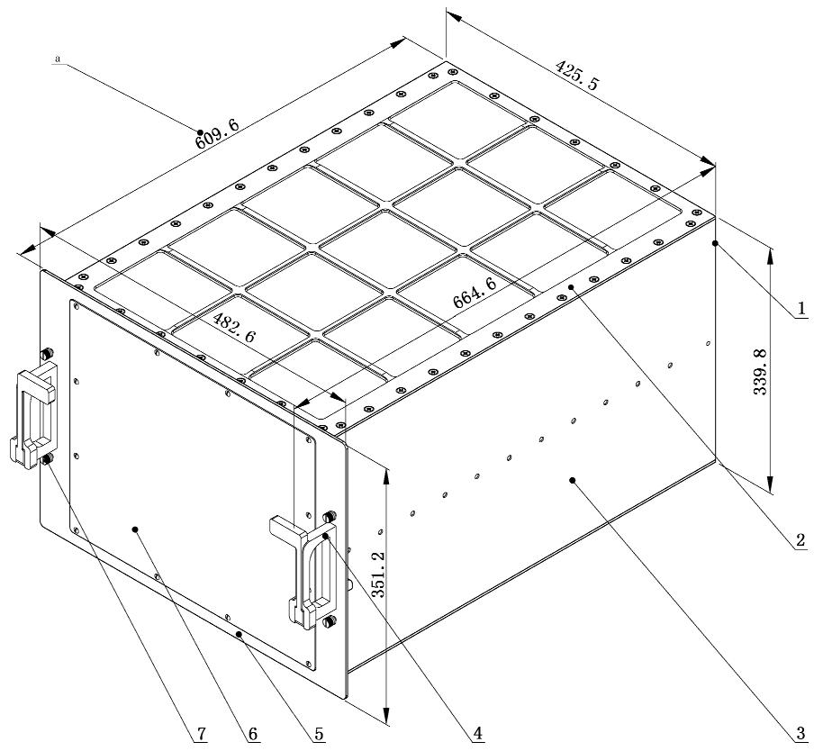

说明：

1——后面板；

2——上下盖板；

3——左右侧板；

4——左右锁紧手柄；

5——前面板；

6——快拆面板；

7——防脱螺栓部件。

图中尺寸 425.5 公差等级为 e9，其余尺寸值应符合 GB/T 1804 中中等 m 级公差要求。

左右手柄机构的设计应保证 2 倍 SDU 与实验柜准确地锁紧与分离。

$^{a}$ 该尺寸不包括前面板，左右锁紧手柄及滑道。

图 D.1 2 倍标准抽屉模块

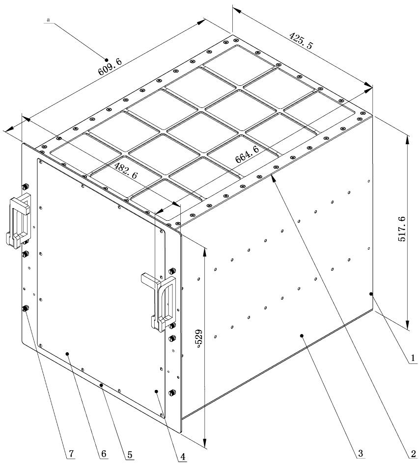

说明：

1——后面板；

2——上下盖板；

3——左右侧板；

4——左右锁紧手柄；

5——前面板；

6——快拆面板；

7——防脱螺栓部件。

图中尺寸 425.5 公差等级为 e9，其余尺寸值应符合 GB/T 1804 中中等 m 级公差要求。

左右锁紧手柄的设计应保证 3 倍 SDU 可与实验柜准确地锁紧与分离。

a 该尺寸不包括前面板，左右锁紧手柄及滑道。

图 D.2 3 倍标准抽屉模块

单位为毫米

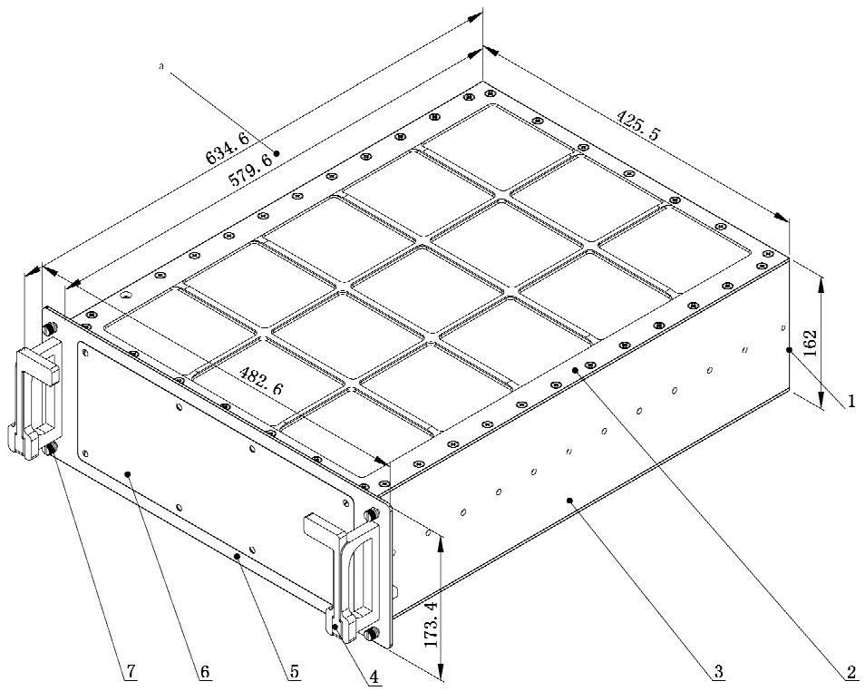

说明：

1——后面板；

2——上下盖板；

3——左右侧板；

4——左右锁紧手柄；

5——前面板；

6——快拆面板；

7——防脱螺栓部件。

图中尺寸 425.5 公差等级为 e9，其余尺寸值应符合 GB/T 1804 中中等 m 级公差要求。

左右手柄机构的设计应保证缩短型 SDU 与实验柜准确地锁紧与分离。

a 该尺寸不包括前面板，左右锁紧手柄及滑道。

图D.3 缩短型抽屉模块

附录E

(资料性附录)

标准模块与实验柜机械安装接口

SPU 及 SPL 与实验柜的安装接口可按照图 E.1 设计。

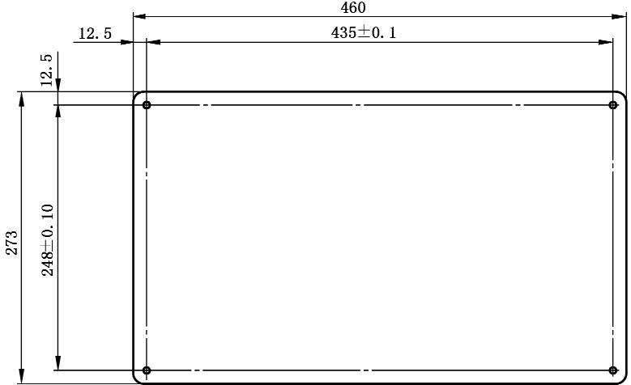  
单位为毫米  
a）标准直装模块及标准锁箱模块  
单位为毫米

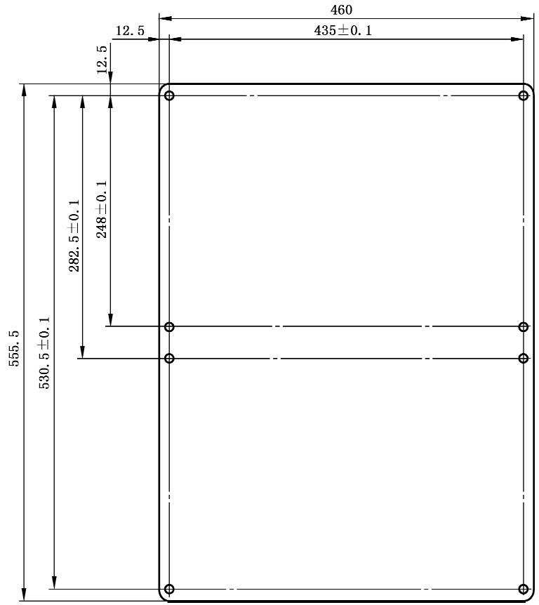  
b) 2 倍标准直装模块  
图 E.1 标准直装模块机械安装接口

单位为毫米

<table><tr><td>955.5</td></tr><tr><td>908.5±0.1</td></tr><tr><td>473.5±0.1</td></tr><tr><td>435±0.1</td></tr><tr><td>12.5</td></tr><tr><td>12.5</td></tr><tr><td>282.5±0.1</td></tr><tr><td>248±0.1</td></tr><tr><td>530.5±0.1</td></tr><tr><td>555.5</td></tr></table>

c) 4 倍标准直装模块

<table><tr><td>型式</td><td>推荐螺钉数量</td></tr><tr><td>SPU</td><td>4</td></tr><tr><td>2倍SPU</td><td>8</td></tr><tr><td>4倍SPU</td><td>12~16</td></tr></table>

2 倍 SPU 及 4 倍 SPU 所需螺钉数量为最大数量,可根据有效载荷具体设计质量值进行缩减。

图 E.1 (续)

SDU 与实验柜的安装接口可按照图 E.2 设计。

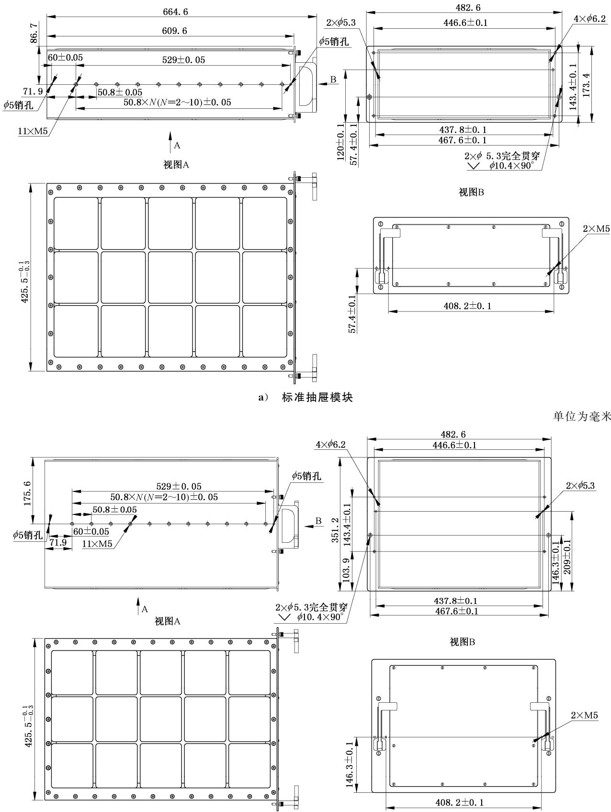  
b) 2 倍标准抽屉模块  
图 E.2 标准抽屉模块机械安装接口

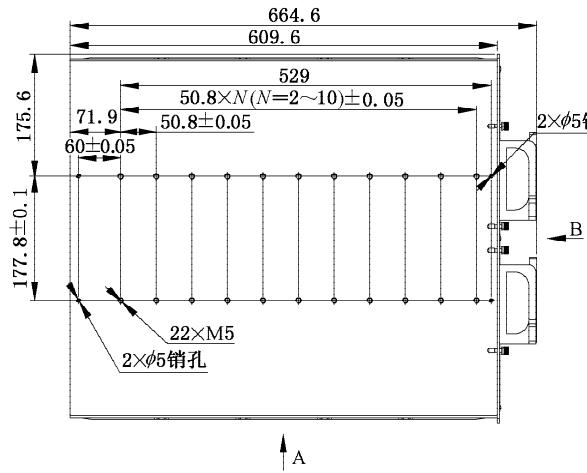

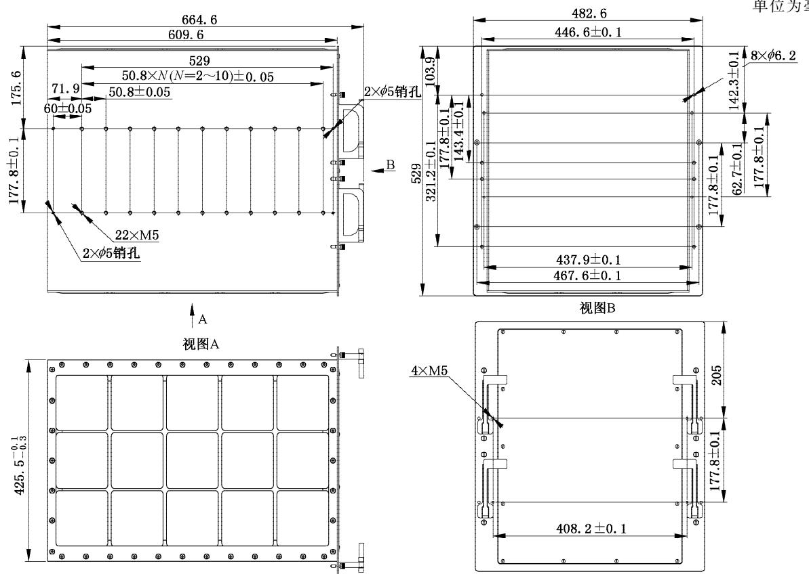

c) 3 倍标准抽屉模块  
单位为毫米  
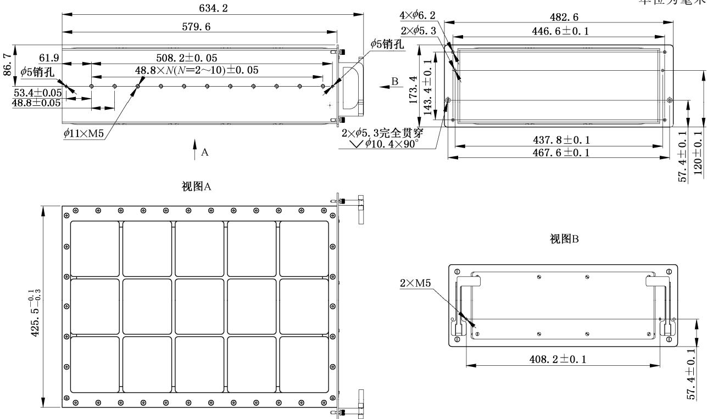  
d) 缩短型标准抽屉模块  
图 E.2 (续)

<table><tr><td>型式</td><td>推荐螺钉数量</td></tr><tr><td>SDU</td><td>4</td></tr><tr><td>2倍SDU</td><td>4</td></tr><tr><td>4倍SDU</td><td>8</td></tr><tr><td>缩短型SDU</td><td>4</td></tr></table>

图 E.2 (续)

## 参考文献

[1] GB/T 30114.1—2013 空间科学及其应用术语 第1部分:基础通用