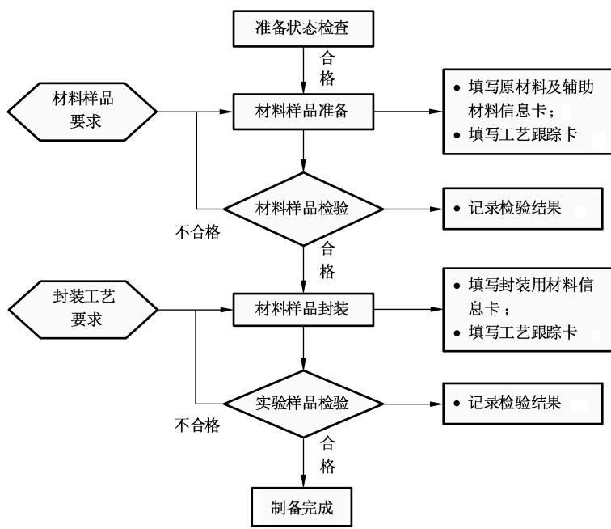

# 中华人民共和国国家标准

GB/T 37844—2019

# 空间材料科学实验 固体实验样品制备规范

# Space materials science experiment— Preparation specification for solid experiment sample

2019-08-30 发布

2019-12-01 实施

## 前言

本标准按照 GB/T 1.1—2009 给出的规则起草。

本标准由中国科学院提出。

本标准由全国空间科学及其应用标准化技术委员会(SAC/TC 312)归口。

本标准起草单位:中国科学院上海硅酸盐研究所、中国科学院物理研究所、中国科学院金属研究所。

本标准主要起草人:温海琴、艾飞、张明辉、潘秀红、汤美波、刘岩、潘明祥、罗兴宏、王彬彬、丁大伟、陈锟、盖立君、邓伟杰。

# 空间材料科学实验 固体实验样品制备规范

## 1 范围

本标准规定了空间材料科学实验用固体实验样品的地面制备流程、准备状态检查、材料样品准备、材料样品检验、材料样品封装以及实验样品检验的要求。

本标准适用于利用空间飞行平台开展的材料科学实验用固体实验样品的地面制备。

## 2 规范性引用文件

下列文件对于本文件的应用是必不可少的。凡是注日期的引用文件，仅注日期的版本适用于本文件。凡是不注日期的引用文件，其最新版本(包括所有的修改单)适用于本文件。

GB/T 30114.1 空间科学及其应用术语 第1部分:基础通用

GB/T 30114.7 空间科学及其应用术语 第7部分:微重力科学

## 3 术语和定义

GB/T 30114.1 和 GB/T 30114.7 界定的以及下列术语和定义适用于本文件。

## 3.1

材料样品 materials sample

从材料实体物质中抽取,或用特定方法合成,能够代表该类材料通性的用作具体实验对象的材料实物。

[GB/T 37469—2019, 定义 3.1]

## 3.2

实验样品 experiment sample

样品单元 sample unit

进行实验研究的材料样品及其封装结构。

[GB/T 37469—2019, 定义 3.2]

## 3.3

固体实验样品 solid experiment sample

进行实验研究的固体材料样品及其封装结构。

## 3.4

样品封装 sample encapsulation

将材料样品安放、固定、封闭到容器中的过程。

[GB/T 37469—2019, 定义 3.3]

## 3.5

## 样品盒 sample cartridge assembly

与实验装置配套,封装材料样品用的具有封闭性的容器。

示例：安瓿是样品盒的一种形式。

## 4 制备流程

空间材料科学实验用固体实验样品的制备应符合下列流程,见图 1。

  
图1 空间材料科学实验用固体实验样品制备流程

## 5 准备状态检查

应包括编制实验样品设计文件和工艺文件。

进行准备状态检查参见附录 A。

## 6 材料样品准备

材料样品准备应满足：

a）对照设计要求对原材料及辅助材料的种类、纯度、等级及性能指标进行核对，进行原材料及辅助材料信息登记参见附录 B；

b) 用于空间实验和地面对比实验的材料样品应同批次准备，且原材料应来自同一生产厂家生产的同一批次产品；

c) 按照工艺文件的要求操作，并填写工艺跟踪卡，工艺跟踪卡的内容参见附录 C；

d) 对于有相同要求的多个样品,制备过程保证其主要特性(如形状与尺寸、组分、结构)的一致性;

e）对准备好的材料样品进行标识，避免混淆；

f) 在存放保管过程中,避免材料样品发生性能与状态的改变,如潮解、氧化或被污染。

## 7 材料样品检验

对照设计要求对材料样品进行检验,至少应包含以下方面:

a）标识、形状与尺寸、重量；

b) 材料样品成分、组分及其组织结构和均匀性: 可采用一种或多种方法, 如化学分析、电子探针分析、光学显微镜观察、扫描电子显微镜观察、X射线结构分析等, 对材料样品进行分析检测;

c) 材料样品表观和内部的缺陷：

1）表观缺陷：可采用目视或借助测量工具的手段对材料样品表面的氧化、污染、孔洞和裂纹等进行检验；

2）内部缺陷：可采用一种或多种无损检测的方式，如 X 光透视、超声波探伤，对材料样品内部的孔洞、疏松、裂纹进行检验。

检验完成后应出具检验证明。经检验合格的材料样品方可进行材料样品封装。

## 8 材料样品封装

## 8.1 封装用材料

封装用材料(如坩埚材料、样品盒材料、填充及辅助材料)，应符合以下要求：

a）无毒、无害；

b) 具有满足实验要求的物理与化学稳定性、抗热冲击和抗力学环境性能；

c) 具有物理和化学相容性；

d) 经过检验达到设计和工艺要求。

## 8.2 封装要求

对有封装需求的材料样品,封装要求如下:

a）封装前，对照设计要求对材料样品和封装材料进行核对，填写封装材料信息卡参见附录B；

b) 对材料样品和封装材料进行必要的清洁处理，以去除其表面残留的杂质和吸附的气体，并对清洁工艺过程进行记录，清洁过程应避免引入新的杂质，如清洁剂残留物；

c) 材料样品与坩埚之间应留有适当间隙，确保坩埚能对材料样品提供稳固可靠的支承，能容纳实验时材料样品的体积变化和可能产生的气体，确保坩埚不破裂，熔体不溢出；

d) 对于有特殊需求或者外表不熔化的材料样品及其组合，在保证稳固可靠支承的情况下，可采用无坩埚的方式封装；

e) 样品盒内各相邻部件之间应保持适当间隙，避免因膨胀或收缩产生较大应力，或因间隙过大引起松动，从而导致材料样品、坩埚或样品盒受损；

f) 必要时，应对坩埚和样品盒进行抽真空、充气及安装辅助部件(如传感器、定位件等)操作，记录封装时坩埚和样品盒内部的压力值；

g）用于空间实验和地面对比实验的材料样品应同批次封装，且封装材料应来自同一生产厂家生产的同一批次产品；

h）封装过程应满足工艺文件的要求，并填写相应工艺跟踪卡；

i) 样品封装应实行双岗双检制度，必要时进行摄像记录；

j) 应对实验样品进行标识,避免混淆。

## 9 实验样品检验

对实验样品进行检验,至少应包含以下方面:

a）标识、外观、尺寸、重量、多余物；

b) 封装状态: 可采用 X 光透视检验材料样品的形态、位置和固定状态, 可采用传感器检验样品盒气密性;

c) 稳固状态: 可采用力学环境模拟试验检验各部件的紧固情况;

d) 适用时,可采用电接口测试检验样品盒中的传感器和电路。

检验完成后,应形成实验样品质量报告,内容包括材料样品准备过程的有关工艺参数、材料样品检验结果、材料样品封装过程的有关工艺参数以及实验样品检验结果。

# 附录 A

(资料性附录)

准备状态检查表

准备状态检查表见表 A.1。

表 A.1 准备状态检查表

<table><tr><td colspan="2">实验样品名称</td><td></td><td>实验样品代号</td><td colspan="3"></td></tr><tr><td colspan="2">研制阶段</td><td></td><td>制备负责人</td><td colspan="3"></td></tr><tr><td>序号</td><td>检查项目</td><td>检查内容</td><td>检查要求</td><td>检查结果</td><td>检验者签字</td><td>日期</td></tr><tr><td>1</td><td>文件</td><td>设计文件、制备工艺文件、检验文件等</td><td>文件齐全有效、签署完整</td><td></td><td></td><td></td></tr><tr><td>2</td><td>原材料</td><td>原材料</td><td rowspan="3">种类齐全、数量足够,标识清晰,有合格证明及复验证明,在有效期内,满足设计文件和工艺文件的要求</td><td></td><td></td><td></td></tr><tr><td>3</td><td>辅助材料</td><td>辅助材料</td><td></td><td></td><td></td></tr><tr><td>4</td><td>封装材料</td><td>封装材料</td><td></td><td></td><td></td></tr><tr><td>5</td><td>设备、工具</td><td>设备、工具</td><td>设备、工具完好</td><td></td><td></td><td></td></tr><tr><td>6</td><td>量具</td><td>量具</td><td>量具有校准标识且在有效期内</td><td></td><td></td><td></td></tr><tr><td>7</td><td>环境</td><td>温度、湿度、压力、洁净度等</td><td>实时监测,满足规定要求</td><td></td><td></td><td></td></tr><tr><td>备注</td><td colspan="6"></td></tr></table>

附录 B

(资料性附录)

材料信息卡

材料信息卡见表 B.1。

原材料为合成材料样品的组分材料。

表 B.1 材料信息卡

<table><tr><td colspan="3">实验样品名称</td><td colspan="4"></td><td colspan="3">实验样品代号</td><td colspan="5"></td></tr><tr><td colspan="3">研制阶段</td><td colspan="4"></td><td colspan="3">实验样品批次/编号</td><td colspan="5"></td></tr><tr><td colspan="3">承制单位</td><td colspan="4"></td><td colspan="3">制备负责人</td><td colspan="5"></td></tr><tr><td>材料类别</td><td>序号</td><td>名称</td><td>分子式/牌号</td><td>性状</td><td>成分</td><td colspan="2">主要性能实测值</td><td>生产厂家</td><td>批次号</td><td>生产日期</td><td>有效期</td><td>用量</td><td>填写人签字</td><td>填写日期</td></tr><tr><td rowspan="3">原材料</td><td></td><td></td><td></td><td></td><td></td><td colspan="2"></td><td></td><td></td><td></td><td></td><td></td><td></td><td></td></tr><tr><td></td><td></td><td></td><td></td><td></td><td colspan="2"></td><td></td><td></td><td></td><td></td><td></td><td></td><td></td></tr><tr><td></td><td></td><td></td><td></td><td></td><td colspan="2"></td><td></td><td></td><td></td><td></td><td></td><td></td><td></td></tr><tr><td rowspan="3">辅助材料</td><td></td><td></td><td></td><td></td><td></td><td colspan="2"></td><td></td><td></td><td></td><td></td><td></td><td></td><td></td></tr><tr><td></td><td></td><td></td><td></td><td></td><td colspan="2"></td><td></td><td></td><td></td><td></td><td></td><td></td><td></td></tr><tr><td></td><td></td><td></td><td></td><td></td><td colspan="2"></td><td></td><td></td><td></td><td></td><td></td><td></td><td></td></tr><tr><td rowspan="3">封装材料</td><td></td><td></td><td></td><td></td><td></td><td colspan="2"></td><td></td><td></td><td></td><td></td><td></td><td></td><td></td></tr><tr><td></td><td></td><td></td><td></td><td></td><td colspan="2"></td><td></td><td></td><td></td><td></td><td></td><td></td><td></td></tr><tr><td></td><td></td><td></td><td></td><td></td><td colspan="2"></td><td></td><td></td><td></td><td></td><td></td><td></td><td></td></tr><tr><td>备注</td><td colspan="14"></td></tr></table>

附录 C

(资料性附录)

工艺跟踪卡

工艺跟踪卡见表 C.1。

表 C.1 工艺跟踪卡

<table><tr><td>实验样品名称</td><td colspan="2"></td><td colspan="2">实验样品代号</td><td colspan="4"></td></tr><tr><td>研制阶段</td><td colspan="2"></td><td colspan="2">实验样品批次/编号</td><td colspan="4"></td></tr><tr><td>承制单位</td><td colspan="2"></td><td colspan="2">制备负责人</td><td colspan="4"></td></tr><tr><td rowspan="2">工艺/工序名称</td><td colspan="2">操作步骤</td><td rowspan="2">工艺或检验参数</td><td rowspan="2">操作者签字</td><td rowspan="2">复核者签字</td><td rowspan="2">检验者签字</td><td rowspan="2">日期</td><td rowspan="2">备注</td></tr><tr><td>序号</td><td>操作内容</td></tr><tr><td></td><td></td><td></td><td></td><td></td><td></td><td></td><td></td><td></td></tr><tr><td></td><td></td><td></td><td></td><td></td><td></td><td></td><td></td><td></td></tr><tr><td></td><td></td><td></td><td></td><td></td><td></td><td></td><td></td><td></td></tr><tr><td></td><td></td><td></td><td></td><td></td><td></td><td></td><td></td><td></td></tr></table>

参考文献

[1] GB/T 37469—2019 空间材料科学实验 样品管理规范