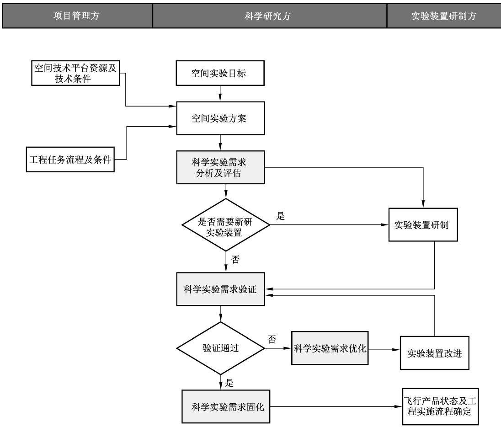

# 中华人民共和国国家标准

GB/T 38255—2019

# 空间科学实验需求分析要求

# Requirements analysis for space science experiments

2019-12-10 发布

2020-07-01 实施

## 前言

本标准按照 GB/T 1.1—2009 给出的规则起草。

本标准由中国科学院提出。

本标准由全国空间科学及其应用标准化技术委员会(SAC/TC 312)归口。

本标准起草单位:中国科学院空间应用工程与技术中心、中国科学院上海生命科学研究院植物生理生态研究所、中国科学院力学研究所、中国科学院金属研究所、中国科学院上海光学精密机械研究所、中国科学院上海技术物理研究所、中国科学院上海硅酸盐研究所、中国科学院物理研究所、中国科学院微生物研究所、清华大学、西北工业大学、浙江大学。

本标准主要起草人：赵黎平、刘伟、陈寅元、蔡伟明、郑慧琼、康琦、罗兴宏、刘亮、袁永春、艾飞、王彬彬、温晓刚、雷晓华、黄英、纪家葵、姚强、仓怀兴、王金福、韩买兴。

# 空间科学实验需求分析要求

## 1 范围

本标准规定了空间科学实验项目开展科学实验需求分析的依据、原则、流程、内容以及 SRD 编制要求。

本标准适用于空间生命科学与生物技术实验、空间材料科学实验、微重力流体物理与燃烧科学实验、微重力基础物理实验等领域。其他领域空间科学实验可参照执行。

## 2 规范性引用文件

下列文件对于本文件的应用是必不可少的。凡是注日期的引用文件，仅注日期的版本适用于本文件。凡是不注日期的引用文件，其最新版本(包括所有的修改单)适用于本文件。

GB/T 28877—2012 空间科学实验通用要求

GB/T 30114.1 空间科学及其应用术语 第1部分:基础通用

## 3 术语、定义和缩略语

## 3.1 术语和定义

GB/T 28877—2012、GB/T 30114.1 界定的以及下列术语和定义适用于本文件。

## 3.1.1

## 空间科学实验需求分析 requirements analysis for space science experiments

通过对空间科学实验项目的实验研究方案,空间技术平台(飞行器或有效载荷)能够提供的实验资源条件,以及发射上行、空间实验操作、下行回收等任务流程分析,提出对实验装置的硬件、软件等技术条件要求和开展飞行实验各阶段的支持条件要求,并对相关要求的合理性进行说明。

## 3.2 缩略语

下列缩略语适用于本文件。

SRD: 科学实验需求文档 (Science Requirements Document)

## 4 实验需求分析依据

空间科学实验项目基于以下依据进行科学实验需求分析：

a）科学实验项目的实验目标及其实验方案，包括实验对象、实验内容、实验手段等；

b) 空间技术平台(飞行器或有效载荷)能够提供的实验资源条件,主要包括飞行任务时间、运行环境条件(舱内/舱外环境条件)、轨道参数和姿态控制精度、微重力环境、有无航天员等内容;

c) 空间技术平台(飞行器或有效载荷)能够为科学实验项目提供的实验支持条件及实验接口等；

d) 与开展空间科学实验相关的工程任务实施流程及其支持条件，包括发射场流程及条件、上行发射流程和条件、下行回收流程和条件等。

## 5 实验需求分析原则

科学实验需求分析遵循如下原则：

a) 项目管理方明确第4章b)～d)中的相关内容，作为科学实验需求分析的输入；

b）科学研究方提出科学实验需求内容，并对需求的合理性进行分析，编写形成 SRD；

c) 实验装置研制方及项目管理方应会签 SRD;

d）科学实验需求应根据地面专项试验的验证情况进行不断的优化；

e) 签署后的 SRD 作为各方科学实验项目实施的基本依据。

## 6 实验需求分析流程

科学实验需求分析在科学实验项目地面研究及研制阶段完成,实验需求分析流程如图 1 所示。

  
图 1 空间科学实验需求分析流程示意图

科学实验需求分析分为如下三个步骤：

a）科学实验需求分析及评估：科学研究方基于科学实验方案、空间技术平台提供的技术资源条件、工程任务流程等，进行任务分析和实验需求研究，形成SRD。科学研究方、项目管理方和实验装置研制方根据科学实验需求的具体情况评估是否需要研制新的实验装置，如果需要，则根据SRD要求研制新的实验装置，否则，利用已有的实验装置开展科学实验需求验证。

b) 科学实验需求验证:科学研究方利用实验装置开展科学实验专项试验(包括匹配试验、安全性试验、流程演练等),验证实验装置对实验需求的满足情况。如果验证通过,则科学实验需求固化;否则,根据专项试验发现的问题对实验需求进行优化,形成新的 SRD,并由实验装置研制方据此进行实验装置的设计改进及研制,并重新开展相关验证试验。

c) 科学实验需求固化: 实验需求验证通过后, 固化科学实验需求的所有内容, 并形成最终版 SRD, 作为实验装置飞行产品研制及科学实验工程实施的最终依据。

## 7 实验需求分析内容

## 7.1 一般要求

科学实验需求分析的内容一般应包括表格和文字说明两部分内容,表格汇总给出科学实验需求,文字对每项需求的合理性进行说明。

## 7.2 实验资源条件

空间技术平台资源条件分析主要包括以下内容：

a）飞行任务时间；

b) 运行环境条件(舱内/舱外环境条件);

c) 轨道参数和姿态控制精度；

d) 重力条件(包括大小、方向和频率范围);

e) 有无航天员；

f) 空间辐照条件；

g) 磁场；

h）科学研究分析所需要的环境要素测量要求：例如温度、压力、微重力、辐射环境等测量要求；

i) 空间技术平台可提供的实验支持功能及性能；

j）空间技术平台可提供的实验支持接口。

## 7.3 实验研究需求

## 7.3.1 实验对象物理、化学及生物特性

对实验对象的物理、化学及生物特性进行逐项分析,具体内容如下:

a) 实验对象的名称及种类,例如实验样品(或实验工质)及实验材料(营养液、化学固定液等)的名称及种类;

b) 实验对象的重量、容积或尺寸；

c) 实验对象的状态(液态、固态或气态)、挥发性等物理、化学及生物特性等。

## 7.3.2 实验检测、控制和图像观测需求

对实验对象的检测、图像观测和控制要求进行逐项分析,具体内容如下:

a) 实验检测和控制要求,包括检测和控制方式、参数名称、范围、检测精度、检测时机及频次等要求。

示例 1: 如果需要对温度、湿度、光照、压力、速度场等进行测量或控制, 则分别给出这几种检测或控制方式的参数范围、精度和灵敏度, 传感器的位置及数目, 采样频率等。

示例 2: 开展空间实验时需要的气液供给与交换等条件要求, 包括需要的气体或者液体类型、名称、流量、速度、时间、频次等内容。

b) 实验图像观测要求: 包括图像类型、帧频、视场和分辨率、景深、观测相机(或者观测仪器)的数

量、方位等。

## 7.3.3 空间实验流程

对空间实验流程进行分析,具体内容如下:

a）空间实验流程要求：提出空间实验流程、实验周期及实验频次；

b) 必要时,可根据实验参数检测和控制要求,给出空间实验测试矩阵表,并根据矩阵表进行实验流程设计。

## 7.3.4 实验对象处置要求

应对实验对象的处置要求进行分析,具体内容如下:

a) 实验过程中对样品(或实验工质)及实验材料的处置需求,如对样品(或实验工质)的处理、更换、样品化学固定、销毁等要求;

b) 实验样品(或实验工质)及实验材料的处置所需要的人、机支持条件等。

## 7.3.5 遥科学或其他天地配合要求

应对科学实验的遥科学或其他天地配合要求进行分析,具体内容如下:

a）空间实验需要的遥科学要求(时机、内容及流程等)；

b) 其他飞行器或地面配合要求(时机、内容及流程等)。

## 7.3.6 数据处理要求

应对空间实验所获得的检测、图像观测数据,以及实验期间的实验条件数据进行分析,具体内容如下:

a）提出对空间实验科学数据的格式、处理及分发要求；

b) 提出科学实验研究分析所需要的空间技术平台(飞行器或有效载荷)环境要素测量数据格式和处理要求。

## 7.4 工程实施需求

## 7.4.1 发射上行需求

## 7.4.1.1 发射场需求

提出科学实验项目在发射场的工作内容及其支持条件要求,具体内容如下:

a）科学研究方应在发射场完成的工作项目、流程及其所需要的时间；

b) 发射场工作项目的保障条件要求，应包括进行发射场样品制备、加载所需要的环境条件及实验室设备清单（包括名称、用途、设备大小、设备供电需求等内容）；

c) 对于时效性要求较高的工作项目(如发射塔架临射前工作项目),应明确提出时间和其他条件约束要求。

## 7.4.1.2 上行需求

提出科学实验项目需要上行的对象和对象的特性,以及需要的支持保障条件,具体内容如下:

a）需上行实验样品(或实验工质)及实验材料的物理、化学、生物学等特性；

b) 实验样品(或实验工质)及实验材料上行保障条件要求,即发射上行期间及在轨存储期间(开始在轨实验前)需要的温度、湿度、光照强度及周期、气液供给与交换等必要条件要求;

c) 实验样品(或实验工质)及实验材料在上行保障条件下的时间要求；

d) 根据 a) 和 b) 的分析结果, 如需单独研制上行实验运输设备, 可参考 7.3, 形成对上行实验运输设备的软件、硬件技术条件要求。

## 7.4.2 空间实验操作需求

提出科学实验项目空间实验开始前后、实验期间以及下行回收前的工作内容及其支持保障条件,具体内容如下:

a）在轨实验开始前，航天员在轨操作要求，如对上行实验样品(或实验工质)及实验材料的预处理（工作项目和工作保障条件）、装载等要求；

b）在轨实验期间航天员的操作要求，如对在轨实验监视及控制等要求；

c) 在轨实验结束后,航天员在轨操作要求,如对需回收实验样品(或实验工质)及实验材料的处理要求(工作项目及工作条件)、存储、废弃物(废弃物名称、状态、安全性、体积重量及处置方式等要求)处置等操作要求;

d) 下行回收前航天员在轨操作要求,如对需回收实验样品(或实验工质)及实验材料的处理要求(工作项目及工作条件)、存储、废弃物处置(废弃物名称、状态、安全性、体积重量及处置方式等要求)等操作要求;

e）对于时效性要求较高的工作项目，应明确提出时间和其他条件约束。

## 7.4.3 下行及回收需求

提出科学实验项目需要下行的对象和对象的特性,以及需要的支持保障条件,具体内容如下:

a) 需下行回收实验样品(或实验工质)及实验材料的化学、物理或者生物学等特性；

b) 实验样品(或实验工质)及实验材料下行保障条件要求,即随飞行器下行期间需要的温度、湿度、光照强度及周期、气液供给(交换)等必要条件要求;

c) 实验样品(或实验工质)及实验材料回收保障条件要求,即下行后回收转运期间需要的温度、湿度、光照强度及周期、气液供给(交换)等必要条件要求;

d) 根据 a)、b) 和 c) 的分析结果, 如需单独研制下行实验运输设备, 可参考 7.3, 形成对下行实验运输设备的软件、硬件技术条件要求;

e) 实验样品(或实验工质)及实验材料在下行及回收保障条件下的时间要求。

## 7.4.4 地面对比实验需求

当需要进行地面对比实验时,根据地面对比实验方案,提出地面对比实验的样品、比对条件、时效性等相关需求。

## 7.4.5 产品配套要求

提出科学实验项目在任务实施的各阶段所需要的飞行或地面产品套量要求,具体内容如下:

a）应统筹考虑并提出地面验证试验、空间飞行、地面对比实验等所需要的实验装置、实验容器等产品套量等要求；

b) 应统筹考虑并提出实验样品(或实验工质)及实验材料上行、下行及回收所需要的运输支持设备要求。

## 7.4.6 安全性保证要求

应说明空间科学实验样品/工质、实验材料及实验产物的成分、危害性等安全性情况，提出安全性保证需求，确保实验样品/工质、实验材料、实验产物及其实验过程不对实验操作人员和航天员身体健康产生危害。

## 7.4.7 其他需求

其他科学实验项目所需要的工程实施要求。

## 8 SRD 编制要求

按照附录 A 给出的编制模板进行 SRD 的编制。

# 附录 A

# (规范性附录)

# 科学实验需求文档模板

## A.1 前言

对本项目的科学实验对象(如实验样品等)、实验目标及研究内容等进行简要介绍。

## A.2 术语和缩略语

介绍文件所使用的术语和缩略语定义。

## A.3 依据和引用文件

列出本文件的主要依据和引用文件，如科学实验需求分析的输入文件、科学实验方案报告等。

## A.4 实验资源条件

## A.4.1 实验资源条件需求汇总表

表 A.1 给出了实验资源条件需求分析评估表格示例,必要时可对影响科学研究目标的部分重要资源条件或者实验支持能力提出更具体的实验资源支持要求。

表 A.1 对空间技术平台实验资源条件需求汇总表

<table><tr><td>项目名称</td><td>空间技术平台支持条件</td><td>需求/指标</td><td>满足情况(满足/不满足)</td><td>备注</td></tr><tr><td>1. 空间技术平台资源条件</td><td></td><td></td><td></td><td></td></tr><tr><td>飞行任务时间</td><td></td><td></td><td></td><td></td></tr><tr><td>轨道参数</td><td></td><td></td><td></td><td></td></tr><tr><td>姿态控制精度</td><td></td><td></td><td></td><td></td></tr><tr><td>运行环境条件</td><td></td><td></td><td></td><td>舱内/舱外环境条件</td></tr><tr><td>重力条件(包括大小、方向和频率范围)</td><td></td><td></td><td></td><td></td></tr><tr><td>有无航天员</td><td></td><td></td><td></td><td></td></tr><tr><td>空间辐照条件</td><td></td><td></td><td></td><td></td></tr><tr><td>磁场</td><td></td><td></td><td></td><td></td></tr><tr><td>环境要素测量要求</td><td></td><td></td><td></td><td>例如温度、压力、微重力、辐射环境等测量要求</td></tr><tr><td>2. 空间技术平台实验支持功能</td><td></td><td></td><td></td><td></td></tr><tr><td>3. 空间技术平台实验支持性能</td><td></td><td></td><td></td><td></td></tr><tr><td>4. 实验支持接口(机、电、热、信息等)</td><td></td><td></td><td></td><td></td></tr><tr><td>5. 其他实验支持需求</td><td></td><td></td><td></td><td></td></tr><tr><td></td><td></td><td></td><td></td><td></td></tr><tr><td></td><td></td><td></td><td></td><td></td></tr></table>

## A.4.2 实验资源条件需求分析

必要时,可针对表 A.1 的某些重要实验支持条件对科学实验需求的满足情况及其合理性进行分析说明,提出更具体的或者新的要求。

## A.5 实验研究需求

## A.5.1 实验研究需求汇总表

表 A.2 给出了空间科学实验研究需求的表格示例,必要时建议给出最优需求指标。

表 A.2 实验研究需求汇总表

<table><tr><td>需求项目名称</td><td>需求/指标</td><td>备注</td></tr><tr><td>1. 实验对象物理、化学及生物特性</td><td></td><td></td></tr><tr><td>种类/名称</td><td></td><td></td></tr><tr><td>大小</td><td></td><td></td></tr><tr><td>重量/容积/尺寸</td><td></td><td></td></tr><tr><td>状态(液态/固态/气)</td><td></td><td></td></tr><tr><td>挥发性</td><td></td><td></td></tr><tr><td>实验样品/实验工质其他需要说明的物理、化学及生物特性</td><td></td><td></td></tr><tr><td>2. 实验控制、检测和观测</td><td></td><td>如在轨需要多种检测方式,则可分别给出各检测方式对应的性能指标、检测时机及频次等要求</td></tr><tr><td>实验检测和控制要求,包括需要监测和控制的参数内容、检测和控制时机及频次</td><td></td><td></td></tr><tr><td>检测和观测方式</td><td></td><td>如可见光显微观测、荧光/显微观测、光谱检测、气体浓度检测等</td></tr><tr><td>性能指标</td><td></td><td>对应观测方式的分辨率等</td></tr><tr><td>时机</td><td></td><td></td></tr><tr><td>频次</td><td></td><td></td></tr><tr><td>3. 实验流程</td><td></td><td></td></tr><tr><td>实验模式</td><td></td><td></td></tr><tr><td>实验流程</td><td></td><td></td></tr><tr><td>实验周期及频次</td><td></td><td></td></tr><tr><td>测试矩阵表(必要时)</td><td></td><td></td></tr><tr><td>4. 实验对象处置要求</td><td></td><td></td></tr><tr><td>处置内容(例如实验样品更换、化学固定等)</td><td></td><td></td></tr><tr><td>样品处置所需要人、机等条件</td><td></td><td></td></tr><tr><td>5. 遥科学或其他天地配合要求</td><td></td><td></td></tr><tr><td>遥科学要求(时机、内容及流程等)</td><td></td><td></td></tr><tr><td>其他飞行器或地面配合要求(时机、内容及流程等)</td><td></td><td></td></tr><tr><td>6. 数据处理要求</td><td></td><td></td></tr><tr><td>科学数据的格式、处理及分发要求</td><td></td><td></td></tr><tr><td>空间技术平台环境要素测量数据要求</td><td></td><td></td></tr><tr><td>7. 其他科学实验需求</td><td></td><td></td></tr><tr><td></td><td></td><td></td></tr><tr><td></td><td></td><td></td></tr></table>

## A.5.2 实验研究需求分析

分小节逐项对表 A.2 提出的科学实验研究需求的合理性进行分析说明。

必要时,对表 A.2 提出的科学实验研究需求进行逐项评估,对是否需要研制或改进实验装置给出明确结论。

## A.6 工程实施需求

## A.6.1 工程实施需求汇总表

表 A.3 给出了科学实验工程实施需求的表格示例,必要时建议给出最优需求指标。

表 A.3 工程实施需求汇总表

<table><tr><td>需求项目名称</td><td>需求指标/指标</td><td>备注</td></tr><tr><td>1. 发射上行需求</td><td></td><td></td></tr><tr><td>1.1 发射场要求</td><td></td><td></td></tr><tr><td>常规工作项目及其时间</td><td></td><td>可按顺序给出应在发射场完成的常规工作项目及其完成该项目所需要的时间</td></tr><tr><td>常规工作项目保障条件</td><td></td><td></td></tr><tr><td>发射塔架工作项目及其时间约束</td><td></td><td></td></tr><tr><td>发射塔架工作项目保障条件</td><td></td><td></td></tr><tr><td>1.2 发射上行及在轨存储要求</td><td></td><td></td></tr><tr><td>上行实验样品/工质名称</td><td></td><td></td></tr><tr><td>上行实验样品/工质状态(固/液/气)</td><td></td><td></td></tr><tr><td>上行实验样品/工质尺寸/重量</td><td></td><td></td></tr><tr><td>上行实验样品/工质保障条件要求,如温度、湿度、光照强度及周期、气液供给(交换)等必要条件及要求</td><td></td><td></td></tr><tr><td>上行实验样品/工质存储时间要求</td><td></td><td></td></tr><tr><td>2. 航天员在轨操作需求</td><td></td><td></td></tr><tr><td>2.1 空间实验开始前航天员操作需求</td><td></td><td></td></tr><tr><td>预处理要求(工作项目、工作条件及时间)</td><td></td><td></td></tr><tr><td>装载要求</td><td></td><td></td></tr><tr><td>2.2 空间实验期间航天员操作需求</td><td></td><td></td></tr><tr><td>实验监视要求</td><td></td><td></td></tr><tr><td>实验控制要求</td><td></td><td></td></tr><tr><td>处理要求(工作项目、工作条件及时间)</td><td></td><td></td></tr><tr><td>2.3 空间实验后航天员操作需求</td><td></td><td></td></tr><tr><td>处理要求(工作项目、工作条件及时间)</td><td></td><td></td></tr><tr><td>存储要求(储存条件及时间)</td><td></td><td></td></tr><tr><td>废弃物处置要求(废弃物名称、状态、安全性、体积重量及处置方式等要求)</td><td></td><td></td></tr><tr><td>2.4 下行回收前航天员在轨操作要求</td><td></td><td></td></tr><tr><td>处理要求(工作项目、工作条件及时间)</td><td></td><td></td></tr><tr><td>存储要求(储存条件及时间)</td><td></td><td></td></tr><tr><td>废弃物处置要求(废弃物名称、状态、安全性、体积重量及处置方式等要求)</td><td></td><td></td></tr><tr><td>3. 下行回收要求</td><td></td><td></td></tr><tr><td>回收实验样品/工质名称</td><td></td><td></td></tr><tr><td>回收实验样品/工质状态(固/液/气)</td><td></td><td></td></tr><tr><td>回收实验样品/工质尺寸/重量</td><td></td><td></td></tr><tr><td>下行实验样品/工质保障条件要求,如温度、湿度、光照强度及周期、气液供给(交换)、时效性等必要条件及要求</td><td></td><td></td></tr><tr><td>回收实验样品/工质保障条件要求,如温度、湿度、光照强度及周期、气液供给(交换)、时效性等必要条件及要求</td><td></td><td></td></tr><tr><td>4. 地面比对实验需求</td><td></td><td></td></tr><tr><td>提出地面对比实验的样品、比对条件、时效性等相关需求</td><td></td><td></td></tr><tr><td>5. 产品配套要求</td><td></td><td></td></tr><tr><td>地面验证试验、在轨飞行(含在轨更换)、地面对比实验等所需要的实验装置、实验容器等产品套量等要求</td><td></td><td>必要时给出计算依据</td></tr><tr><td>上行、下行及回收所需要的支持设备要求</td><td></td><td></td></tr><tr><td>6. 安全性保证要求</td><td></td><td></td></tr><tr><td></td><td></td><td></td></tr><tr><td>7. 其他工程实施需求</td><td></td><td></td></tr><tr><td></td><td></td><td></td></tr><tr><td></td><td></td><td></td></tr></table>

## A.6.2 工程实施需求分析

分小节逐项对表 A.3 提出的科学实验工程实施需求的合理性进行分析说明。

必要时,对表 A.3 提出的科学实验工程实施需求进行逐项评估,对是否能够满足科学实验需求给出明确结论。

## A.7 需要协调落实的问题

可根据实际情况,提出需要协调落实的相关问题:

a）分条款提出尚未落实或者未完全落实的实验需求，适当分析说明这些问题的对于科学目标实现、实验装置研制等方面的影响；

b) 如果存在需要通过进一步实验研究或验证才能确定的问题,也可以列出。