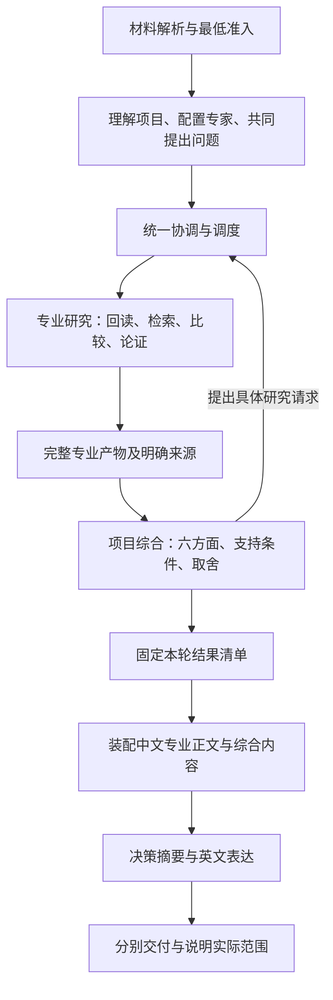

# V4.1：以完整专业产物交接的科学项目评审 MAS

日期：2026-10-07。状态：**待实施的设计方案，不代表当前代码已具备这些能力。** 本次只新增本文，不修改生产代码，不执行模型调用或测试。

本文承接 [V4](v4.md)，落实用户认可的具体项目调研结论：保留问题驱动、多专家和项目整体判断，收敛数据交接、流程控制及报告重写。与 V4 冲突的工程设计以本文为后续实施目标；现有行为仍以代码为准。不使用 OpenSpec，也不在本次生成实施 change。

## 1. 保留的评审目标

系统辅助科学项目立项与资源配置，评价科学价值、创新性、严谨性、可行性、安全性和项目管理，解释支持条件、替代方案及取舍。首批范围仍是 `D:/master/SpaceBioReview/ReviewInfo` 中的科学项目。

专家由项目内容和研究需要动态配置，六方面不是六个固定专家席位，不引入三位专家等测试性业务上限。每位专家都获得整体目标、全部研究路径、关键依赖和完整申请访问入口，可以纠正问题预设、发现正面贡献及新增问题。专业研究可以评价整体首创性或科学性；最终跨专业取舍由综合负责，不能把专家降为孤立事实检索器。

报告继续采用简短决策摘要和深入专业正文，篇幅随项目复杂度变化，提供中英文。未知、未评范围、申请未说明及技术失败必须分别表达。不得用强制共识、固定引用数量、统一字数上限或“重试次数用完就接受”换取流程完成。

## 2. 本次要解决的结构问题

### 2.1 当前事实与本次判断

`mytest7` 的四个研究任务已经完成模型提交，但附带的非空 `ReadingRecord` 没有在持久化前递归转换，导致专业意见保存失败，综合没有可用结果。该具体错误已修复，并通过四份实际产物的离线保存、发布回放；这不代表完整评审已经稳定或科学质量已经通过。

更广泛的问题仍然存在：

- 原文、证据目录、短编号、动态草稿、研究结果、独立论证对象、写作投影之间有多次转换；调用方必须知道太多内部约定。
- 模型字段约束细，但程序内部大量使用开放字典，各阶段追加数据，持久化类型约定不统一。
- 准备、研究、综合、交付和主运行器共同修改共享状态，各自处理部分预算、重做及完成逻辑。
- 已形成的专业内容仍可能在后续模型表达中丢失条件、改变强度或错配出处。
- 之前的局部检查以空阅读记录代替真实接口，真实模型调用也没有覆盖真实保存链。模型调用数量不能替代接口覆盖。

V4.1 的目的，是减少上述交接约定和重复职责。增加日志和必要检查只能辅助定位，不作为主要解决方案。

### 2.2 具体项目的取舍依据

本轮对照的是用户本地 GPT Researcher 下载副本，以及 GitHub 上 STORM、PaperQA 的实现；未运行这些项目，未证明它们在本项目上更可靠。本地副本的行为不自动代表远端最新版。

| 项目与实际机制 | 采用的设计经验 | 不直接采用的部分 |
|---|---|---|
| GPT Researcher 核心：将子查询、检索、读取和相关内容提取封装在研究调用内 | 研究模块对外承担一个完整专业任务，隐藏检索执行细节 | 纯文本报告不能替代本项目对具体论证、来源和条件的关联 |
| GPT Researcher `multi_agents`：并行生成章节，writer 主要生成引言、结论等，publisher 拼接正文 | 尽量直接复用专业正文，程序负责装配 | 草稿和事实检查超限后强制进入接受分支；不能把草稿审阅等同于回查原文 |
| GPT Researcher `deep_agents`：完整章节写文件，子代理返回摘要和路径，主编回读正文 | 完整产物独立保存，摘要只作导航，任务上下文隔离 | 不把文件存在或提示词中的步骤约定当作完成保证，不让模型维护文件身份与版本 |
| STORM：多视角提问、统一资料表、章节取材、局部引用编号统一合并 | 聚焦问题研究、保留材料入口、程序管理引用映射 | 不用删除异常引用或截短正文掩盖缺证，也不照搬百科文章的科学判断要求 |
| PaperQA：搜索、收集证据和回答分工；证据摘要保留对应原文对象 | 稳定的数据结构、问题与依据集中管理 | 相关性分数不等于科学可靠性；证据摘要不能取代关键原文回读 |

本次不预先引入 LangGraph、Deep Agents 或替换百炼与现有科学模型。先在现有执行能力上收敛业务接口；若局部对照证明采用外部运行库可以实际删除现有职责，再单独决策。禁止为了接入框架而保留两套状态机和恢复机制。

## 3. 核心设计决策

1. **一次专业研究交付一个完整产物。** 产物可以保存、读取、引用、修订，并直接作为专业正文的主体。
2. **完整产物是科学内容的权威版本。** 短摘要、目录、Markdown 导出和报告节选都是派生视图，不能各自成为另一份科学结论。
3. **科学表达充分，控制接口简短。** 模型生成专业论证和必要研究请求；身份、版本、路径、来源对象、预算和执行状态由程序管理。
4. **一个协调模块管理流程。** 其他模块返回产物或请求，不自行启动全局补研、改写其他模块状态。
5. **报告主要复用已形成的内容。** 综合增加项目层判断，装配负责组织；不固定增加一遍全篇中文重写。
6. **调用方和回归检查使用同一接口。** 可替换模型与网络响应，不把非空证据、真实类型、持久化和恢复替换为空对象。

## 4. 目标流程与职责



图中的回路由协调模块统一执行，并受共享预算和停止规则限制。交付发现实质科学问题时，也只向同一协调入口提出请求；不会出现第二套写作补研循环。

### 4.1 协调模块

程序协调器负责队列、任务状态、并发、模型调用预算、产物提交、重试与恢复。统筹模型负责专业配置、问题优先级、关联与分歧的语义判断；两者职责不能混同。

协调器接收三种业务产出：准备计划、专业产物、综合产物。研究或综合可以附带后续请求，但只有协调器能将请求变成可执行任务。

一个问题是否获得实质研究，按实际产物与未完成任务导出。计划中列出安全或管理，不等于这些方面已经评审。对适用但未覆盖的方面，有能力且有预算时安排具体研究；缺少能力、资料或预算时保留原因及对决策的影响。

### 4.2 准备与专业研究模块

准备保留 V4 的项目结构理解和专家共同细化。专家首次定位不先接受一份必须认同的批评清单，可以回读原文纠正统筹理解。

研究请求至少说明：需要回答的问题、为什么影响项目判断、项目整体背景、相关完整材料、已有相关产物和可用专业能力。一个任务应能形成有意义的判断，不按关键词或单独一个事实机械切碎；强耦合问题可以共同研究。

研究模块内部承担材料读取、外部文献研究、方法比较、反例与替代解释、论证形成及提交准备。调用方只接收产物引用和技术执行结果，无需了解内部阅读会话、别名转换或提交修复结构。

研究中的所有模型调用仍使用协调器提供的预算接口，委派文献研究不能另开不计数的额度。文献回答只是研究材料，不能自动提升为本项目专业结论。

### 4.3 综合模块

综合读取已提交的完整专业产物、项目结构及实际覆盖，提出跨问题判断：贡献成立的条件、路径组合的价值、共同资源约束、失败情景、支持前提及方案取舍。

它不替每位专家重写专业论证。宏观结论必须指向相关的具体论证块，并解释从局部认识到项目判断的关系。需要新事实时返回研究请求；已有事实足以推理时可以直接形成新的项目层论证。

多名专家研究同一问题时，独立产物分别保存。只有实际冲突或需要新的联合判断才执行整合，整合产物解释采用、修订和保留的意见。不对每个问题强制增加一次共识生成；也不把简单拼接命名为共识。

### 4.4 交付模块

交付接收固定的结果清单：专业产物版本、综合产物版本、必要正文顺序和实际评审范围。程序装配中文主体，再生成决策摘要和对应英文内容。

交付不能新增外部事实、数值门槛或支持条件。发现决定性科学问题时提出请求；若未获执行，则在交付中准确保留限制，不能自行补出答案。

## 5. 完整专业产物的数据设计

### 5.1 一个权威内容结构，多个派生视图

建议保留以下少数稳定对象，不将它们合成一个要求模型填写的大对象树：

| 对象 | 内容与所有权 |
|---|---|
| `ReviewTask` | 程序管理问题身份、责任专家、输入版本、执行状态和预算；专业问题本身由统筹或专家提出 |
| `SourceRecord` | 材料模块管理原文、文献元数据、位置、版本和实际读取范围 |
| `ResearchArtifact` | 专业正文、问题级范围说明、局部论证依据与后续请求；程序补齐身份、作者、版本及引用解析 |
| `AssessmentArtifact` | 六方面和整体评价、支持条件、替代方案、未解决事项；依赖固定专业产物 |
| `DeliveryManifest` | 程序管理本次报告使用的产物版本、正文单元、来源编号及两种语言的交付状态 |

执行日志和模型提交记录独立存储，不进入科学正文对象。可读 Markdown 是 `ResearchArtifact` 的导出视图，不允许模型同时独立维护 Markdown 与 JSON 两份内容再要求它们事后同步。

### 5.2 面向专家的小型固定草稿

以下确定职责与字段语义；实现可采用等价命名，但不能再按每次任务的证据数量改变字段是否存在：

```text
ResearchDraft
  title              当前专业问题的可读标题
  scope_note         本次回答的范围、共同条件及重要未决限制
  blocks[]
    text             一个充分展开、可独立理解的专业论证
    evidence_refs[]  当前任务材料目录中的依据，可为空
    result_refs[]    当前任务已有产物的具体论证块，可为空
  followups[]        必要后续请求；无则为空
```

`text` 包含该论证的认识、理由、适用条件、替代解释和项目影响，不要求每项再拆成固定数量的短句。共同范围放在 `scope_note`，特定条件必须与其限定的认识写在同一块中。块的单位是完整专业论证，不强迫每句话成为一个独立对象或模型任务。

当一块混合互不相关的事实且出处不同，应在研究内容组织时拆开；不能把整份结果的证据并集赋给所有段落。无外部文献也可以讨论申请事实、明确未知或提出有说明的推断，引用数量不是质量指标。

`followups` 只说明问题、缺少的新信息、预期影响和可行获取路径。是否是当前可执行研究、申请方未来工作或应保留的未知，由统筹作语义判断、协调器落实。它不携带运行器内部任务字段。

程序从草稿形成正式产物：绑定本次任务、专家、输入版本和来源；为块分配局部身份；保存规范数据。模型不生成 `artifact_id`、版本哈希、存储路径、完成状态或完整来源对象。

### 5.3 引用解析集中到一个位置

保留两种明确语义：`evidence_refs` 选择材料依据，`result_refs` 选择已有专业论证。请求内可继续使用 E/R 短编号；程序解析为材料版本与位置，或 `产物版本＋块编号`。

字段结构固定；候选目录随实际读取变化。必要的取值约束由当前任务目录提供，但不把原文、整个结果树或全局对象关系复制进 schema。没有候选项时，字段仍存在并填空列表。

材料读取、模型提交和正式保存使用同一任务上下文；正式提交冻结其目录。引用转换只在该接口发生，不在运行器、工具注册器、综合和写作中分别重做一套规则。

V4 的独立全局论证对象树在 V4.1 中收敛为产物内部块和直接版本引用。程序负责从引用取回内容，不递归把全部祖先结果嵌入每份新产物。引用有效只表示位置与版本可解析，不表示科学支持关系已被证明。

### 5.4 完整读取与导航摘要

目录可以返回标题、摘要、专业范围及产物引用。综合正式使用某条结论时，必须取得该完整块及产物的 `scope_note`；不能只用目录摘要或单独抽出的回答句。

默认读取完整产物；材料过长时，可以读取明确的完整块或章节，程序同时附带共同限制和该块的直接依据入口。任务记录实际送入模型的内容，不能因为磁盘上存在全文就宣称下游已经读取。

上下文不足时分批按完整问题或论证组读取，保留必要的跨问题比较。导航摘要不成为不可回读的压缩终点，也不允许截断条件来适应长度预算。

## 6. 单一任务生命周期、持久化与恢复

### 6.1 执行状态只有一个写入者

协调器拥有任务状态转换：`queued → running → committed / failed / deferred`。阶段模块不能直接改写其他任务或整轮运行状态。

`committed` 表示专业产物已经保存并可读。模型返回成功只是执行过程中的事件，不是研究完成状态。科学上“不能确认”“证据不足”“存在分歧”可以是成功提交的专业结果，不能与执行失败混为一谈。

整轮状态由任务、实际覆盖和交付状态导出，不再由多个模块各自拼装。保留研究覆盖与中英文交付的独立信息，但它们是派生结果，不建设多套可独立修改的成功标记。

### 6.2 保存是程序职责

持久化模块统一执行规范化、版本计算、内容保存和读取校验。内部对象必须通过明确的序列化接口转换，包含嵌套阅读记录、日期和来源对象；禁止以 `str(object)` 掩盖不支持的类型。

产物内容采用不可变版本。先写入可完整读取的产物，再提交任务与该版本的关联；中断后按同一提交身份恢复，避免重复发布。内容已写入但任务尚未提交时，恢复应完成登记，而非重复调用模型。

最终模型草稿及对应材料目录、阅读记录应形成可恢复的提交记录。保存失败时保留这些已完成工作；重试持久化不能要求模型重新研究，也不能用新建的空阅读会话替换原有阅读记录。

这是一条保存协议，不要求建设通用事件溯源系统。运行事件只保留定位和恢复所需信息，不复制全部内容对象。异常记录任务、阶段、具体类型、消息及堆栈，不记录凭据和隐藏推理。

### 6.3 失败隔离与版本更新

一个专家或问题失败不删除其他已提交产物。同一问题已经有独立意见时，可保留其有限结论和尚未完成的专业范围；程序不能制造“多人已达成共识”。

修订产生新产物版本，历史版本只读。当前采用版本由协调器显式更新；引用旧版本的综合或交付只在其直接依赖变化时失效。旧意见不默认混入当前科学正文，必要时作为有明确身份的比较材料读取。

报告版本固定其完整依赖清单。更新研究不能在写作过程中静默替换依据。技术请求超时和科学证据不足分别记录，不因一个请求失败停用整个模型端点。

## 7. 统一补充研究与停止规则

准备、专家、综合和交付提出的补研请求都进入同一入口。统筹判断语义重复、问题关联和是否会影响建议，协调器按能力、资料和共享预算安排执行。

只有存在新的信息获取路径或明确的新分析任务时，才重新打开问题。更换措辞、反复要求“再深入一点”不构成新的研究理由。申请方未来实验可以形成支持条件或建议，但不能伪装成 MAS 现在能够完成的研究任务。

所有模型请求、工具委派、正式提交和允许的结构修复使用同一预算计数来源。预算可按任务分配，但总量只有一个权威记录。循环停止后应保存已知、未知与未完成范围，不强行接受仍有问题的意见。

跨问题关系可以成环，关系用于共同阅读和联合分析，不默认建立必须等待所有邻居完成的调度依赖。必须等待的任务依赖由协调器显式管理；无法执行时说明原因，不能无限等待。

## 8. 综合与报告的内容保真

### 8.1 专业内容只形成一个权威版本

专业产物的正文承担充分论证。正常交付直接使用其正文，不再逐块固定调用一次模型“改写成正式中文”。确需改善表达时仅处理选定部分，并保留原内容和依据；若涉及结论、条件或来源变化，应修订专业产物，不能只修改报告副本。

跨专家有实际冲突时，可形成新的整合产物，明确其取舍与保留意见。原始意见仍可读取；报告使用明确选择的当前内容，不能把所有旧版本混排成当前结论。

### 8.2 项目综合不能退化为章节拼接

综合必须回答六方面及跨方面问题，尤其是价值与可行性的关系、失败后仍可获得的认识、资源共享约束、支持前提和方案取舍。其正文作为报告中的综合部分直接复用。

报告装配的基本顺序为：决策摘要、项目理解、深入专业评议、六方面与整体评价、支持条件及可选方案、来源与实际范围。可按项目调整专业部分的顺序和分组，不要求每个问题只能出现一次，也不要求所有专家各写一章。

整体建议、必要支持条件和未解决事项来自固定综合产物。摘要只能压缩表达，不能独立增加新的支持条件或改变判断强度。

### 8.3 来源、未评范围和双语

引用编号由程序从已绑定来源生成，同一来源跨章节统一编号。完整的来源关联仍保存在产物中；不能用格式清理悄悄删掉无效引用后宣称段落有据可查。

未评范围由实际任务生成基本事实说明，例如“本轮未形成安全性专业评审结果”。模型可以解释其对建议的影响，但不能将它改成“申请没有安全材料”或“安全风险不可控”。

英文以已接受中文内容、同一产物版本和来源关系为基础。翻译可以调整句式，不能重新推断科学结论或追加数值。中文和英文分开保存交付状态，英文失败后继续已有工作，不重生成已接受中文。

## 9. 现有实现的保留、替换与退出

下表是职责处置，文件名不是必须照搬的新目录结构。优先在现有模块内替换，不再在旧路径外包一套并存的系统。

| 当前实现 | V4.1 处置及删除条件 |
|---|---|
| 材料解析、`evidence/`、`review/materials.py`、`review/access.py` | 保留获取和阅读能力，对外统一材料接口；消除各阶段自建阅读/引用约定 |
| 专长目录、方法 Skills、最低准入 | 保留；不把能力覆盖简化为固定专家名单或只检查创新性 |
| `v4/context.py`、`v4/contracts.py` | 收敛到固定草稿和一个任务目录；迁移后删除按任务改变字段结构、跨阶段重复转换的分支 |
| `v4/arguments.py` | 将局部论证及条件保留在正式产物内；替换独立全局论证对象和嵌套祖先复制，不失去具体出处关联 |
| `v4/records.py` | 负责统一存储和原子提交协议；阶段模块不再直接修改 `records.state` |
| `v4/research.py` | 封装完整专业任务；向外返回正式产物引用，不暴露内部会话对象 |
| `v4/synthesis.py` | 专注整体判断和补研请求；删除内部执行全局补研的调度职责 |
| `v4/delivery.py` | 以内容装配和英文表达为主；取消默认中文全文重写与独立写作补研循环 |
| `runner.py`、`v4/execution.py`、`v4/budget.py` | 收敛为一个协调入口和统一执行计数；删除重复推导与互相覆盖的状态逻辑 |
| `agents/`、`models/` | 保留模型适配、有限正式提交及必要诊断；不增加修复代理或科学裁判代理 |
| 旧运行与旧流程适配 | 放在明确的只读入口，不进入新运行热路径，不自动回退或假装已迁移 |

每项替换都应记录哪些旧调用和旧字段已退出。新增接口但旧机制仍是生产必经路径，不算完成收敛。目录缓存、历史脚本和仍被复用的模块必须按实际依赖区分，不能只凭目录名称删除。

## 10. 实施顺序与迁移约束

1. **先贯通产物保存和读取。** 固定专业草稿、来源关联与提交记录，在实际研究调用点实现保存、发布和重启读取。包含 `mytest7` 的非空真实类型场景。
2. **收拢任务状态和调度。** 将研究完成、补研、预算、失败隔离及恢复交给协调器；业务模块改为返回产物或请求。
3. **切换综合交接。** 综合直接读取完整块和范围说明，显式选择当前版本；保留跨问题判断、分歧和六方面覆盖。
4. **切换内容交付。** 中文主体复用专业与综合产物，程序装配引用，再生成摘要及英文；删除原有默认重写链。
5. **默认入口切换与清理。** 检查剩余调用，移除被替代路径，更新配置和状态说明；保留明确的历史只读工具。

这五步是依赖顺序，不是本次创建的五份 change。后续可按实际改动边界拆分实施文档。

原 `v4r-2` 检查点不能静默按新协议恢复。新协议使用独立版本标识；需要复用旧产物时执行显式、可核对的导入，保留来源、条件、缺失关系和原始身份。旧模型提交不自动标记成已通过 V4.1 科学验收，原始运行文件不改写。

历史审计文档和运行目录可能已清理。回归材料应从获准保留的样例整理成独立夹具，不能长期依赖临时 `runs/targeted-*` 目录存在。大型原始文件可由显式参数提供，但缺失必须清楚报错，不假装跳过后通过。

## 11. 验证与完成标准

本次仅写设计，不启动验证。后续实施不运行 `tests/`，不运行完整真实评审。离线检查位于独立脚本中；局部真实验证仅在有效授权和明确的当轮预算内执行，不沿用已耗尽额度，也不为刷出成功结果反复抽样。

### 11.1 验证必须覆盖生产交接

离线只替换模型和网络响应，保留实际材料对象、非空阅读记录、目录解析、产物保存、任务发布、依赖读取及恢复逻辑。可用已保存的真实模型产物驱动实际模块，不能把研究接口替成直接写入最终结果的测试捷径。

| 必须覆盖的场景 | 完成证据 |
|---|---|
| 有实际文献读取的研究提交 | 非空嵌套阅读对象、日期和来源可保存；原文与科学正文保持；重启可读 |
| 保存中断发生在模型提交之后 | 重试只完成提交，不调用模型，不丢阅读记录，不重复发布 |
| 一位专家失败、另一位已有结果 | 已保存意见仍可用；未完成范围准确，不宣称共识 |
| 具体论证进入综合 | 实际模型输入含完整论证、局部条件、共同范围和来源入口，而非只有摘要 |
| 管理论据不同于机制或风险依据 | 管理判断仍指向相应申请段落，没有通过来源并集错配 |
| 修订旧意见 | 下游读取新版本；旧错误不作为当前正文复活，实际依赖按需失效 |
| 适用方面没有研究 | 协调器能安排实质任务或记录原因；综合不自由生成已评结论 |
| 科学未知与技术失败 | 未知可正常交付；技术未完成不会被转写为科学否定 |
| 补研请求来自不同阶段 | 使用同一队列、预算和停止规则，不重复循环 |
| 中文完成而英文失败 | 中文不丢失、不重生成；英文可从原固定内容继续 |
| 固定草稿在不同目录规模下运行 | 字段含义与形状不变，候选范围与实际材料一致 |

### 11.2 科学质量必须单独验证

局部真实链应覆盖“专业研究产物 → 项目综合 → 正文与摘要/英文”，不必跑完整项目。优先使用已暴露风险的材料：方法特异性、无依据数值门槛、有限检索下的首创性、管理来源和未评范围。

人工对照原文和每次交接，核对条件是否丢失、结论强度是否升级、来源是否真正支持相应论证、正面贡献是否保留。输出合法、引用可解析、模型任务完成均不能替代这一验收。

与现有流程比较时固定材料和相近预算，记录首次成功率、已完成产物损失、恢复重做次数、科学内容重写次数、总调用量与 tokens。评估须包括所有失败，不只比较最后修好的报告。

### 11.3 收敛必须可观察

完成标准包括：全局任务状态有唯一写入者；引用转换有唯一入口；同一专业内容有唯一权威版本；被替代路径确实退出默认执行；通常不再为专业正文额外调用中文重写模型。

不以代码行数减少、换了框架或增加通过的测试数量作为主要成功指标。若短链仍需调用方了解内部对象类型、重复保存规则或多处状态更新，说明模块接口尚未收敛。

## 12. 参考实现与适用边界

以下链接说明本轮查阅的实现位置，不构成对其运行可靠性或科学正确性的背书。

- 本地 GPT Researcher 核心：[研究流程](D:/shixi/gpt-researcher-main/gpt_researcher/skills/researcher.py)、[相关原文筛选](D:/shixi/gpt-researcher-main/gpt_researcher/context/compression.py)。
- 本地传统多代理：[章节研究](D:/shixi/gpt-researcher-main/multi_agents/agents/editor.py)、[正文装配](D:/shixi/gpt-researcher-main/multi_agents/agents/publisher.py)、[流程及超限路由](D:/shixi/gpt-researcher-main/multi_agents/agents/orchestrator.py)、[事实检查](D:/shixi/gpt-researcher-main/multi_agents/agents/fact_checker.py)。
- 本地文件交接实现：[主编与研究子代理](D:/shixi/gpt-researcher-main/deep_agents/agent.py)、[研究工具](D:/shixi/gpt-researcher-main/deep_agents/tools.py)。这是同一仓库的不同实现路径，不能混合描述成一个默认流程。
- STORM：[多视角研究](https://github.com/stanford-oval/storm/blob/main/knowledge_storm/storm_wiki/modules/knowledge_curation.py)、[章节生成](https://github.com/stanford-oval/storm/blob/main/knowledge_storm/storm_wiki/modules/article_generation.py)、[资料表与引用合并](https://github.com/stanford-oval/storm/blob/main/knowledge_storm/storm_wiki/modules/storm_dataclass.py)。
- PaperQA：[研究工具及状态](https://github.com/Future-House/paper-qa/blob/main/src/paperqa/agents/tools.py)、[证据与回答对象](https://github.com/Future-House/paper-qa/blob/main/src/paperqa/types.py)。PaperQA 是科学文献问答参考，不是完整立项评审系统。

V4.1 的成效仍需本项目短链验证。文件交接可能遗漏回读，正文复用可能保留原有科学错误，统一调度也不能替代专业判断。设计分别通过完整读取、明确修订和有限专业研究处理这些问题，不再用增加一个通用事后裁判来兜底。
