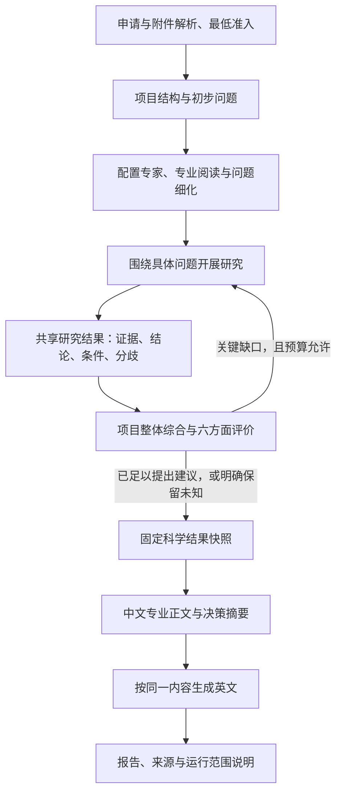

# V4：围绕关键问题研究的科学项目评审 MAS

日期：2026-10-07。状态：**初版六份 change 后已按五份 v4r 文档修正并接入代码；离线检查通过，局部真实验收尚未全部通过。** 具体证据及保留项见 `todo/v4r-01-*.md` 至 `todo/v4r-05-*.md`，不得据此宣称科学质量已全面验证。

本文落实本轮已确认的重构方向，承接 [V3](v3.md)，依据当前实现及 [局部真实调用审计](../runs/targeted-20261007-todo-audit.md)确定需要替换的职责与信息流。冲突时，V4 是后续实现目标；判断现有行为仍以实际代码为准。方案提出时仅新增本文；随后依据 `todo/v4-01-*.md` 至 `todo/v4-06-*.md` 实施。历史运行产物保留原样。

## 1. 目标、范围与设计决策

系统用于辅助科学项目立项和资源配置：评价科学价值、创新性、严谨性、可行性、安全性及项目管理，说明支持条件、替代方案与取舍。报告采用简短决策摘要和深入专业正文，篇幅取决于项目复杂度及关键问题，不设统一中文字数目标。

首批专业范围继续面向 `D:/master/SpaceBioReview/ReviewInfo` 中的空间生命、物理、材料与技术项目。保留可扩展的专家能力目录与方法 Skills，由项目内容决定本轮专家组合。六方面不是六个固定专家席位，也不设“三位专家”的业务上限。

本方案确定以下结构调整：

1. 以项目中的**评审问题及其研究结果**组织工作，专家是执行研究的专业角色，而非下游信息的主要分桶方式。
2. 先理解整体，再由统筹和专家共同细化问题；研究中可新增、合并和修订问题。
3. 原始材料、研究结果及其条件直接传递，取消以多轮自由摘要作为主要交接方式。
4. 六方面是贯穿研究的覆盖视角和最终评价视角，共用同一批研究结果，不各自重建科学事实。
5. 综合负责跨问题的项目判断；发现决定性证据缺口时发起有限补充研究，不能在写综合文本时悄悄补出新事实。
6. 科学综合完成后固定结果版本，先形成中文正文，再逐节形成英文；写作不再承担研究、裁决和全记录集合分配。
7. 程序管理身份、版本、来源、依赖、调度和装配；模型集中完成问题提出、专业论证和取舍判断。

这不是增加一套事后科学裁判。结构与引用检查仍是基本工程约束，但正确性主要来自职责、研究单位和证据传递方式。字段合法、来源位置存在均不能证明科学结论成立。

## 2. 当前故障指向什么结构问题

| 已观测现象 | 结构原因 | V4 的对应改变 |
|---|---|---|
| “待核实的首创性”变成“国际首次” | 专家、方面评价、贡献和报告可分别重写同一认识，条件没有形成共同使用的结论单元 | 首创性进入共享问题；取用结论同时取得条件、分歧与检索范围；综合新增推断单独留痕 |
| 相互冲突的原判断未共同研究 | 当前按共享 concern_id 组织关系，不能识别不同事项中的同一科学主张 | 按主张对象、实验过程和影响关系提出问题关联；统筹及专家作语义合并，保留原始不同意见 |
| 预算、组织管理已读但报告引用错位 | 方面评价可新增事实，却没有给主体评价提供同等的直接证据交接机制 | 新事实在问题研究中形成带证据的论证；综合通过该结果使用事实，报告沿论证继承来源 |
| 同名 argument_refs 在内外层允许不同对象 | 下游认识类型和引用语义重复扩展，接口约束不一致 | 材料证据与评审结论分开；同一种选择字段始终保持同一种含义 |
| 章节规划重复、遗漏并阻断正文 | 模型同时承担分章、唯一归属、全记录覆盖、依赖分配 | 固定基本章节，由问题生成专业评议单元；背景和依赖由程序装配，允许合理复用 |
| 准入引文空格变化导致失败 | 模型抄录程序本来持有的原文，再按字符检查 | 延续已修改的准入契约：选择已读位置，由程序提取原文 |

“给模型更长上下文”“换更强模型”可以改善部分表现，但不能替代这些职责调整。当前审计已证明：原始条件在输入中存在，也可能在后续重述时被忽略。

## 3. 目标流程



### 3.1 材料与准入

保留主文件、附件、段落、表格、图页及解析缺口。保留现有最低可评审性判断：有可辨认目标与基本方案即可进入专业评审；科学薄弱不构成准入拒止。

文本依据由模型选择已读位置，程序提取原文。读取失败、实际未读、申请没有说明分别记录。后续任何阶段都不能把“未读到”直接改写为“申请未提供”。

### 3.2 重建项目结构

统筹直接读取申请目标、方案、预期产出、资源和相关附件，形成 ProjectMap。核心是活动与认识之间的联系，不是一篇替代原文的长概述。

每条项目路径至少回答：

- 申请想研究什么对象、问题或技术能力？
- 拟开展什么活动，可能取得什么观测或产物？
- 申请认为这些产物能支持什么认识？
- 与其他活动、样品、设备、人员或资源有什么依赖？
- 上述描述分别来自哪里，哪些连接只是当前解释？

所有“首次”“国际领先”“可直接用于防护”等表述首先保留为申请主张。描述来源与结论可信程度分开，不能因为内容出现在计划书里就记成已证实事实。

准备阶段检查全部材料的章节目录和可读性，按自然章节分批理解长材料；不得只阅读摘要后宣称已掌握全部方案。对尚未理解的章节标记缺口，并为专家保留完整访问入口。

### 3.3 专家配置与共同细化问题

统筹根据 ProjectMap 选择互补专长和方法。专家首次定位获得整个项目结构、完整材料目录及相关原文章节，暂不注入既有批评清单；之后的规划阶段统一比较已有问题与专业提案。问题研究再获得当前问题及相关认识。

专家先形成专业定位，再开展问题研究：可纠正项目结构、增加统筹遗漏的问题、合并过碎问题、指出不成立的预设。无需事先分配的 concern_id 才能提出重要判断。

问题更新采用带来源的提案：程序分配身份，统筹确认合并、关联和责任分配。旧问题保留映射，不丢弃已有证据。未获研究预算的新问题仍作为未覆盖问题记录，不能静默删除。

### 3.4 问题研究

一个问题应能形成有意义的专业结论，说明其对项目的作用。它不是一个章节标题、关键词或单独待查事实。

例如，“科学性如何”应细化为“现有对照能否区分微重力与流动条件变化的影响”；“创新性如何”应细化为“与最接近先例相比新增什么，以及当前证据允许多强的首创性判断”。

每个研究任务处理一个问题或一组紧密耦合的问题。同一实验设计、测量体系或样品链中的问题优先在共同上下文中研究。问题数不等于专家数，也不等于必须发起的模型请求数。

研究包括回读申请、查找与阅读外部材料、比较先例、分析方法及替代解释。专家可以委派有限的文献研究；文献回答是证据研究产物，不自动等于本项目的评审结论。

问题的研究结果必须包含正面贡献与局限的解释。没有形成资助建议的权限不等于不能评价价值，不能把专家缩减成事实检索器。

### 3.5 跨专业问题和分歧

不再对所有专家固定执行一次“接口计划—接口回应”。发现实际依赖或分歧时，创建或更新一个共同问题，由相关专家补充意见。

例如“固定和返回是否保留目标信号”可能需要细胞、测量和在轨操作能力共同研究。它的产物仍是一份问题研究记录，其中保留各项论证和未解决分歧。

是否在讨论同一个问题不能仅靠 ID 相等判断。关联依据包括同一主张、同一实验过程、同一资源约束，以及对相同结论的支持或反对。模型提出语义关系，程序管理经过确认的关系；不建设通用学科本体，也不以向量相似度直接宣布结论等价。

两个意见冲突时，比较证据、前提和适用范围。可以补充研究，也可以明确保留分歧；禁止以多数票、置信度平均或强制达成共识代替论证。

### 3.6 项目综合与有限补充研究

综合读取问题结果、ProjectMap 和覆盖情况，回答局部研究不能单独回答的整体问题：路径组合的价值、共同资源约束、可替代方案、失败情景、支持条件及取舍。

综合可以提出新的跨问题推断，但须说明依赖哪些研究结果及其前提。以下情况要返回问题研究：

- 需要新查申请或外部证据才能成立的关键事实；
- 现有结果明显冲突且会改变支持建议；
- 新发现的工程或样品链依赖改变了科学解释；
- 六方面存在影响决策的实质覆盖缺口。

综合提出的是具体研究请求，包含待解问题、缺少什么信息、可能影响哪项判断。调度程序决定是否还有预算。不得在综合自由文本中读完一段新材料就新增事实而绕开证据记录。

预算不足时，综合保留未知，并解释可提出何种有限建议；若连方向性建议也缺乏依据，明确“当前不足以形成支持建议”。不因流程需要完成而强行下结论。

### 3.7 结果固定与双语交付

综合形成可交付结果后，固定所使用的问题结果版本和证据版本，生成科学快照。报告只使用该快照。任何后续研究更新都应产生新快照，不能在生成过程中悄悄替换依据。

先写中文正文，再基于正文形成中文决策摘要；英文按相同章节和科学内容生成，可查看原始术语与引用材料。英文摘要对应中文摘要的决策内容，不单独重新决策。

## 4. 专家上下文与宏观视角

每个专家研究上下文由程序装配为三层：

| 层次 | 内容 | 使用规则 |
|---|---|---|
| 项目整体 | 目标、全部路径简图、主张来源、关键依赖、评审语境 | 每次任务可见；不只提供分配路径，也不把统筹解释伪装为申请原文 |
| 当前研究 | 当前问题、相关完整原文片段、证据、需改变的判断 | 优先放入；不截断单条条件或完整论证 |
| 关联认识 | 有依赖关系的问题结果及分歧 | 结论与条件成组取用；完整研究记录可继续读取 |

完整申请与附件始终可访问。研究任务记录实际读过的范围；“获得完整目录”和“实际完整阅读”不是同一状态。

对长方案按有意义的章节、实验或过程组织阅读，保留表格表头、单位、图注和相邻限定。不能用纯固定字符切片替代专业上下文。

专家定位时应看到项目结构及本专业相关完整方案，而非仅定位若干支持预设问题的句子。六方面覆盖用于发现缺口，不要求所有专家重复阅读全文、重复作六方面总评。

## 5. 核心数据结构与生成契约

### 5.1 六类内部对象

以下是程序存储模型，不是一次请求中要求模型填写的大 schema。

| 对象 | 主要内容 | 程序承担的内容 |
|---|---|---|
| SourceMaterial / Evidence | 原文、位置、读取范围、来源属性和可用性 | 稳定 ID、保留副本、时间范围、精确定位、证据句柄 |
| ProjectMap | 目标、活动、产物、申请主张、路径及依赖 | 路径身份、原文定位解析、修订历史 |
| ReviewQuestion | 问题、影响范围、六方面标签、需要的专业能力、关联关系 | 问题身份、责任人、状态、预算、父子与合并映射 |
| QuestionResult | 当前回答、完整论证、证据、条件、替代解释、未知、项目影响 | 结果版本、提交作者、来源解析、依赖快照 |
| ProjectAssessment | 六方面评价、整体推断、贡献情景、建议、条件及方案取舍 | 对问题结果的固定版本引用、覆盖与技术范围 |
| ReportContent | 已选科学内容、正文段落、章节、双语表达 | 内容身份、引用标记、章节装配、交付状态 |

保存原专家意见和当前问题认识两者。问题负责人对整合后的回答负责，但不能覆盖掉异议原文。当前认识是可追溯、可修订的工作结论，不是程序宣布的科学真理。

### 5.2 面向模型的契约要小

模型交互按认知任务划分，不让模型维护整个对象树：

| 操作 | 模型生成 | 程序装配 |
|---|---|---|
| 提议问题 | 问题、重要性、相关项目位置、需要的专业能力 | question_id、状态、默认责任、后续调度 |
| 提交问题研究 | 当前回答、论证段、条件/未知、项目影响、必要补充问题 | 当前任务对应的问题和专家、证据展开、版本与依赖 |
| 提出综合判断 | 判断、依据结果选择、权衡、条件或待研究问题 | 来源继承、版本快照、覆盖统计 |
| 表达报告内容 | 指定内容的标题或正文 | 科学内容身份、来源编号、章节顺序、完整性范围 |

单次正式研究提交只处理一个问题，或一个由程序给定问题键的小批次；身份已在任务中固定，不再让模型自由重写 expert_id、question_id、contract/version 等字段。复杂度高时拆为相关问题，不能靠截断科学论证适应输出预算。

初始可采用如下研究草稿形状，实施时须保持职责而非拘泥字段拼写：

```text
answer                     当前可成立的回答
arguments[]                充分展开的新论证，各自选择具体依据并保留局部必要限定
adopted_arguments[]        直接采用的已有论证，不复制改写为新验证结果
qualifications[]           条件、替代解释、未知及其影响
project_implications[]     对目标、可得认识与价值的影响，选择所依据的论证
follow_up_questions[]      真正需要进一步研究的问题，可为空
disputes[]                 需要比较的实际冲突；不据空列表宣布科学共识
```

这些字段不规定固定数量的短句：arguments 允许充分专业论证，长度随问题变化。所有记录都不强制有外部文献；申请事实、解释性推断和明确未知是不同性质。

### 5.3 引用只有两种科学语义

- `evidence_handles`：选择当前任务已读且允许使用的材料证据。程序决定 source_id、位置、原文、申请或外部来源属性。
- `result_handles`：选择当前任务可用的固定版本具体论证，用于解释依赖或综合推断；不再以整份问题结果的来源并集支持一个新陈述。

请求内使用 E/R 短别名，程序绑定稳定身份与版本；读取工具、输入投影与正式提交共用映射。没有可选对象的引用字段不要求模型填写空列表。完整档案和单次生成输入分开，同一依赖在输入中去重，条件仍与论证关联。

同名字段在所有嵌套层保持相同语义与取值域，不能在外层允许方面评价、内层突然只允许专家判断。不同任务的可见目录可以不同，但必须与实际输入一致。

原文引用由程序提取；模型解释“证据支持什么、不能支持什么”。程序不会因为句柄有效就标记“论证已证实”。申请自述的来源性质由来源记录确定，其可信程度由研究论证确定。

补读后刷新当前可选证据目录。形成正式请求时冻结该次契约和目录快照，使候选、解析、修复与装配使用同一版本。不要把全部证据正文重复塞进 schema 或目录；正文在任务材料中，目录提供简短位置说明。

### 5.4 结论与条件整体取用

对外读取一个 QuestionResult 时，默认同时返回回答、关键论证、条件、分歧及证据入口。目录可以展示短标题帮助选择，但短标题不能成为正式综合唯一的依据。

使用结果产生进一步推断时，程序保存完整依赖版本；重要前提自动进入综合和写作输入。模型可以解释某个条件为何与当前推断无关，但不能仅删除条件来强化结论。

科学不确定性和执行状态分开：成功研究可以得到“无法确认”；模型任务失败不能转写成科学上“不成立”；存在真实分歧也不等于任务失败。

不引入缺乏校准的统一置信度打分，不让数字替代证据和适用范围。

## 6. 六方面、整体判断和支持条件

六方面继续使用 scientific_value、innovation、rigor、feasibility、safety、management，作为问题的多选标签和覆盖矩阵。

每个方面记录：适用性、已研究的问题、尚未覆盖的问题、总体解释及其依赖结果。一个问题可同时影响多个方面。例如样品固定既影响可行性，也影响终点解释和科学价值。不要为了六栏齐全重复创建六份事实判断。

ProjectAssessment 中的宏观认识由综合 agent 提出：

- 哪些贡献在现有认识下较有依据，哪些依赖未验证条件？
- 哪些问题改变项目方向，哪些仅降低精度或实施效率？
- 不同结果情景下还能获得什么知识或能力？
- 哪些问题必须在支持前解决，哪些可以作为实施里程碑？
- 原方案、调整范围或分阶段支持之间如何取舍？

模型可以综合出超出单个问题的认识，但不能凭已有引用就跳过推断说明。条件记录其目的、依据、影响范围和解决时点；没有证据的数值不能升级为强制门槛。示例技术路径与唯一合格实现应明确区分。

在“首创性”例子中，当前结论若是“已有初步差异，检索不足以确认全球首次”，创新性评价可讨论潜在增量，科学价值可讨论所得数据用途，支持建议可提出补充先例比较。三处都不能重新生成一个没有新增依据的“已确认国际首次”。

## 7. 调度、版本与恢复

### 7.1 两类关系，分别管理

问题间的“相关、互相影响、存在分歧”关系可以成环。执行调度只对当前明确的输入依赖排序；强耦合或循环依赖的问题合并为同组研究，不能因图成环永远等待。

结果版本的依赖必须指向已存在的固定版本，构成可追溯的有向无环关系。新结论替代旧结论时保留旧版本，不回写历史记录。

### 7.2 有界研究循环

实现提供独立配置：整轮模型调用/时间预算、每个问题的研究预算、补充研究轮数、并发数、输入输出预算。具体数值由后续实施根据已有运行开销设定，不把人数或字数当科学充分性的替代指标。

优先级由“是否影响支持建议、能否解除关键依赖、预期可获取证据、预计成本”共同解释，包含正面价值核实和风险研究。程序执行预算，模型提出必要性。

当问题已经能形成有边界的结论，或进一步研究无法在预算内改变建议时，可以停止。停止不等于所有问题解决，报告必须保留未完成范围。

### 7.3 局部提交和恢复

每个问题研究结果独立保存，单个问题失败不使同批已完成结果消失。只恢复失败或明确需要更新的问题；被影响的综合结果及报告标记为需要重新生成。

运行保存材料版本、项目结构版本、问题版本、依赖结果版本、生成契约及模型配置摘要。依赖变化后不得把旧综合作为新结果继续发布。恢复只使用可核对版本的产物，不凭文件存在就跳过任务。

沿用现有局部产物保留、请求调度和提交诊断能力；连接中断的外部原因不纳入此次研究模式重构。

## 8. 报告交付设计

### 8.1 固定骨架、动态专业正文

基本组织为：

1. 决策摘要：总体建议、主要理由、关键支持条件和取舍。
2. 项目理解：目标、研究路径和贡献逻辑。
3. 关键专业评议：按问题或相关问题组深入展开。
4. 六方面综合：引用已经展开的研究，说明整体评价。
5. 支持条件、可选方案及未解决问题。
6. 来源与实际评审范围。

专业正文标题和问题顺序可由综合阶段提出，报告程序根据已选问题生成写作任务。项目路径和专家范围是背景，不需要各自成为一个必须唯一分配的“论证单位”。同一问题可在专业正文完整讨论，并在摘要或方面评价中简短引用。

程序关心是否交付了必要内容，模型负责段落组织和表达。取消现有 primary_arguments 全记录唯一归属要求，取消固定引用数量要求。没有来源支持的解释性段落允许明确表明是推断。

### 8.2 引用与双语

ReportContent 保留内容到论证、论证到来源的关联。写作任务按论证块取得正文材料和绑定来源；引用标记由程序根据这些关系渲染，不让模型从全报告来源目录中自由选择一个“看起来能用”的编号。

一个论证块包含多个独立事实或不同来源时，应在内容组织阶段分成有明确依据的段落。不能把某条条件中的风险来源当作整个管理章节的出处。此机制解决出处交接，不代表程序可以判断所有措辞是否被证据支持。

中文正文依据科学快照生成，不重新检索或追加科学判断。写作发现缺口时记录交付限制或请求返回研究，不直接补事实。若返回研究，必须产生新快照，旧写作结果按依赖失效。

英文逐节基于已接受中文内容、同一科学快照和术语表生成，沿用相同内容身份及证据关联，可调整语序与解释方式，不改变条件、数值和建议强度。中文完成而英文失败时保留中文交付，分别报告两种语言的状态。

## 9. 工程模块与现有实现处置

V4 使用四个核心模块，每个模块对调用方提供少量稳定接口，把版本、装配及执行细节封装在内部。下列接口描述职责，实施时按现有 Python 风格确定签名。

| 模块 | 对外接口职责 | 内部承担 |
|---|---|---|
| 材料与证据 | 读取材料、取得已读证据、解析证据位置 | 保留原文、分页、读取范围、文献获取、来源性质 |
| 问题研究 | 提议/分配问题、执行研究、取得指定版本研究结果 | 专家配置、局部上下文、分歧、预算、提交装配 |
| 项目综合 | 根据结果快照综合，返回建议或补充研究请求 | 六方面覆盖、跨问题推断、条件与取舍、快照固定 |
| 报告交付 | 根据科学快照交付中文和英文 | 内容装配、章节任务、引用渲染、语言状态 |

不另建庞大的通用代理框架，不让所有阶段继承一个含所有业务字段的大对象。模型厂商差异留在已有模型适配层；优先保留现有科学研究模型和百炼服务。

| 当前代码 | V4 处置 |
|---|---|
| `admission.py` | 保留最低准入及位置选择契约，避免与专业评审混合 |
| `review/preparation.py`、`project.py`、`expertise.py` | 改为项目结构、初步问题、能力配置与专家共同细化；复用目录与方法能力 |
| `review/study.py` | 从每专家一份大 Study 转为问题或耦合问题组研究；专家可连续承接多个任务 |
| `review/arguments.py` | 替换 concern_id 驱动的分组；负责固定版本研究结果的装配，不再靠共同编号推断科学关联 |
| `review/collaboration.py` | 固定接口交流退出主流程；跨专业问题通过同一问题研究机制执行 |
| `review/assessment.py` | 移除强制分组整理及独立重述事实的方面批次，改为整体综合与有限补充研究 |
| `review/submissions.py`、`domain.py` | 按任务收敛草稿；程序持有丰富存储模型，统一证据与结果引用语义 |
| `review/materials.py`、`access.py`、`evidence/` | 复用统一阅读和文献能力，收敛为一致的材料与证据接口 |
| `writer/brief.py`、`segments.py`、`submissions.py` | 用科学快照和内容单元替代全记录唯一分章；程序绑定依赖与引用 |
| `writer/service.py`、`render.py` | 中文主内容、英文对应表达，保持分段交付及语言独立状态 |
| `agents/`、`models/` | 复用运行器、提交契约、调度与诊断；支持小契约和固定目录快照，不加入新的事后修复模型 |
| `runner.py`、`reporting.py` | 接入新流程和独立状态；读取旧格式的兼容逻辑只放在外部适配处 |

这些是职责迁移位置，不要求每行都创建新文件。优先替换原职责，避免在旧链条外再包一套问题链条。

## 10. 分步实施顺序

每步交付必须可离线检查，并明确还未替换的阶段。迁移期间允许通过配置选择旧流程或 V4；一次运行固定一种流程，V4 失败不能静默退回旧流程并冒充成功。

| 步骤 | 具体工作 | 完成边界 |
|---|---|---|
| 1. 共享研究对象和证据接口 | 实现 ReviewQuestion、QuestionResult、版本引用、证据选择及装配；分离模型草稿与存储对象 | 未读证据不可选；结果取用带条件；身份和原文由程序生成；同名引用语义一致 |
| 2. 项目结构与问题研究 | 改造准备和专家研究，支持专家增补问题、相关问题共同上下文、局部提交 | 专家获得整体结构和直接材料；可纠正初始分工；单个问题失败不丢整位专家其他结果 |
| 3. 整体综合与有限研究循环 | 替换分组、固定接口和方面重述链；支持补充问题、分歧保留及结果快照 | 六方面共享研究结果；新增事实返回研究；预算终止仍能表达有边界的结论 |
| 4. 内容交付与双语 | 替换全记录分章；按绑定论据生成中文，再生成英文 | 无唯一归属负担；来源随论证进入正文；语言状态独立，完整保留条件 |
| 5. 切换与清理 | 接入运行入口、配置、状态输出和历史只读兼容；删除被替代的生产路径 | 新运行完整采用 V4；旧运行原文件可读，不能静默改写为新问题研究结果 |

步骤 1—4 优先贯通“首创性问题—价值与支持建议—双语内容”这一条最小业务链，再扩展预算/管理、样品链和其他专业问题。该顺序用于实现聚焦，不代表整轮评审仅包含这些问题。

V3 历史产物保留原样。若用于离线回放，应通过显式适配标记其原始判断、原有条件及缺失关系，不能把旧摘要自动当作已完成 V4 研究。新旧运行的状态、产物和实现版本明确区分。

## 11. 验证与验收口径

初版六份 change 未包含真实调用。本轮用户另行授权五份 v4r 文档中的有界局部真实验证，限制及记录以这些文档为准；仍不运行完整真实流程或 `tests/`。离线接口检查不能替代科学质量和双语语义验收。

离线检查跨模块接口和关键业务不变量，避免编写仅复刻实现的测试。至少覆盖：

| 场景 | 预期行为 |
|---|---|
| 首创性意见冲突 | 两种意见保留在同一问题的研究范围；未完成比较前没有程序产生的“已确认首次”状态 |
| 条件随研究结果传递 | 综合和写作取得回答时同时取得条件、分歧、依赖版本和证据入口 |
| 管理与预算有不同出处 | 两类论证各自绑定对应材料；来源不会因写作目录只有风险条目而被替换 |
| 补读与正式提交 | 新已读证据进入下一次目录；一次提交始终按自己的目录快照解析 |
| 字段和引用范围 | 证据选择与结果选择语义一致；程序字段不进入生成任务 |
| 未分配的新问题 | 专家可以提交，系统保留并明确是否获得研究预算 |
| 局部失败与恢复 | 已完成结果保留；仅受更新影响的综合与报告失效 |
| 依赖成环 | 问题关联可成环；调度能合组执行或明确等待原因，不无限阻塞 |
| 报告组织 | 背景不强制独立分章；同一问题允许合理复用；无引用数量配额 |
| 双语交付 | 两种语言绑定同一科学快照和内容身份；英文失败不抹去中文 |

离线检查不能证明科学推理质量。未来获授权的局部真实实验应比较旧流程和 V4 在相同材料、相近预算下的表现，关注：结论强度是否升级、条件是否丢失、引用是否支持相应语句、关键问题是否遗漏，以及总调用量、tokens 和耗时。人工复核关键论证，不能仅把模型裁判分数或 JSON 成功率当作科学质量。

验收不要求所有问题得到肯定答案，不要求强制共识；要求每项支持建议能追到充分展开的依据与限制，未知和技术未完成没有被掩盖。

## 12. 取舍、风险及研究依据

拆解过细会破坏实验和工程过程的整体性；因此拆解单位是可形成专业结论的问题，相关问题可共同研究。统筹概述可能带偏专家；因此专家直接读取方案并有权修改问题。共享结果可能固化早期错误；因此结果带版本、原始意见和分歧，允许基于新证据修订。

采用中文主内容再生成英文，优先保障科学内容一致性，代价是英文组织方式可能受中文影响。结果快照及明确依赖增加部分工程工作，但减少历史重跑、串行转述和混合版本风险。

V4 不承诺从 schema 或依赖图中推导科学正确性，也不承诺必然比旧流程便宜。它把可确定的工作移交程序，把专业推理集中到明确问题，把自由重写事实的机会缩减到必要环节。

以下研究提供设计参考，而不是对本项目有效性的证明：

- [Lost in the Middle](https://aclanthology.org/2024.tacl-1.9/)：长上下文中的信息使用存在位置敏感性，支持聚焦材料与直接访问原文的必要性，不能据此认定当前模型在所有任务上都有同等缺陷。
- [How we built our multi-agent research system](https://www.anthropic.com/engineering/multi-agent-research-system)：强调清晰委派、适合并行的研究分工，以及直接保存专业产物以减少多次转述损失；同时指出依赖密集任务的协调成本。
- [Why Do Multi-Agent LLM Systems Fail?](https://arxiv.org/abs/2503.13657)：把系统设计、智能体间不一致及验证问题区分分析，支持从工作组织和信息交接审视失败，而不是只增加输出修复。

后续实施应以本项目材料与可观察的论证传递表现决定保留或调整哪些设计。

## 13. 实施落点与验证边界（2026-10-07）

正式入口与 CLI 默认执行 V4。核心职责集中在 `src/spacebio_review/v4/`：`records.py`/`contracts.py` 管理共享研究与证据契约，`preparation.py`/`research.py` 管理准备和问题研究，`synthesis.py` 管理有界综合循环，`delivery.py` 管理绑定论据和双语表达。`execution.py`、`budget.py`、`config.py` 管理执行、预算及配置。

旧阶段不再是新运行的活跃路径。为历史工具保留显式 `legacy_runner.py` 和 `config/*-v3.yaml`；它们不是 V4 的自动回退。历史公开产物由 `read_result` 原样读取，不自动升级为 V4 研究结果。

`scripts/check_v4_offline.py` 使用模型替身和拒绝网络的 transport，验证八组路径：冻结契约与预算、真实运行器正式提交、项目准备、问题局部失败与恢复、整体综合与快照、双语部分失败与恢复、管理/预算来源交接、正式入口材料到报告及整轮恢复。管理和预算样例引用分别保持 p31/p38，不替换为 p37。

只执行离线回放和静态检查，没有运行 `tests/` 或真实模型调用。语义保真、研究充分性、自然语言质量和真实成本仍需另行评估。
