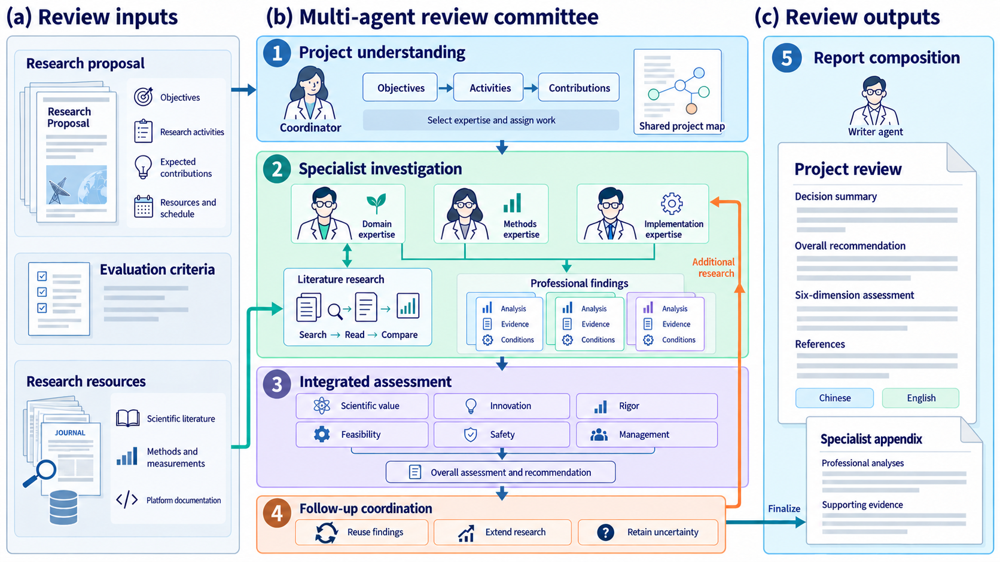

# SpaceBioReview: A Multi-Agent Review Committee for Scientific Research Proposals

## Abstract

Scientific project review requires an integrated understanding of research objectives, disciplinary knowledge, proposed methods, and implementation conditions. This understanding often spans several specialties and depends on information beyond the proposal itself. We present SpaceBioReview, a multi-agent framework that organizes project review through complementary specialist investigation and coordinated synthesis. The framework first develops a shared account of the proposed research and assembles a committee with relevant expertise. Specialists examine the original materials, investigate external knowledge, and produce evidence-supported analyses of assigned research topics. Their findings are integrated across six evaluation dimensions and then synthesized into an overall assessment. An adaptive research cycle connects emerging information needs to existing findings or additional specialist work. The final report combines the overall recommendation, dimension-specific assessments, and supporting professional analyses. SpaceBioReview brings project understanding, knowledge acquisition, professional evaluation, and report generation into a unified workflow, with space life science serving as its application domain.

## 1 Introduction

Scientific project review informs the allocation of research resources and the development of future scientific work. A proposal presents research that has yet to be carried out: questions to investigate, activities to undertake, and contributions that may follow. Reviewing it requires understanding both the scientific opportunity and the ability of the proposed work to pursue that opportunity. The resulting assessment must explain the project's significance, its relationship to existing research, the suitability of its methods, and the conditions supporting its execution.

This task is particularly demanding for interdisciplinary projects. In space life science, a single proposal may combine a biological hypothesis, a physical model, an imaging method, and an experimental platform. The scientific meaning of an observation depends on knowledge of the biological system, while its availability depends on measurement and operational capabilities. Relevant information is distributed across the proposal, disciplinary literature, method descriptions, and platform documentation. A useful review brings these sources together and explains their implications for the project as a whole.

Large language models provide opportunities to organize this work at greater depth and scale. Existing approaches include multi-agent feedback generation, simulations of peer review, and structured review processes with literature retrieval. MARG distributes paper content and review responsibilities across agents; AgentReview models interactions within peer review; and DeepReview organizes paper assessment through a sequence of specialized reasoning stages ([D'Arcy et al., 2024](https://arxiv.org/abs/2401.04259); [Jin et al., 2024](https://aclanthology.org/2024.emnlp-main.70/); [Zhu et al., 2025](https://aclanthology.org/2025.acl-long.1420/)). These developments provide useful foundations for automated scientific assessment.

Scientific project review calls for a framework that connects professional investigation with an integrated appraisal of planned research. Members need sufficient autonomy to study their specialties, obtain relevant external knowledge, and identify scientific value. Their findings must also remain connected to the same project. The organization of the review therefore matters at several levels: how the proposal is understood, how expertise is assigned, how knowledge is acquired and shared, and how professional analyses become a coherent final assessment.

We introduce **SpaceBioReview**, a multi-agent review committee organized around these activities. A coordinator develops a shared project representation and selects complementary expertise. Specialists read the original proposal and conduct professional investigations with access to literature and other scientific resources. Their findings are recorded with supporting evidence and integrated through dimension-level and project-level synthesis. When further information is needed, the coordinator reuses relevant findings or arranges additional research. The workflow concludes with a report containing the overall assessment, its supporting evaluations, and the underlying specialist analyses.

The framework connects two complementary organizational structures. Specialist work follows the scientific objects and methods of the project, while synthesis follows the dimensions of evaluation. A specialist may contribute to several dimensions, and a dimension may draw on several specialties. This arrangement gives professional investigation room to develop while supporting comprehensive assessment of scientific value, innovation, rigor, feasibility, safety, and management.

Our contributions are threefold:

1. We formulate scientific project review as a structured process of project understanding, professional investigation, integrated appraisal, and report composition.
2. We present a multi-agent committee architecture that combines project-specific expertise, direct access to proposal materials, and shared literature research within a coordinated review workflow.
3. We develop a synthesis and follow-up process that connects reusable specialist findings to dimension-specific evaluations and an overall project assessment, preserving the evidence and qualifications needed for the final report.

## 2 Related Works

### 2.1 Automated Scientific Review

Automated paper review has developed along several complementary directions. MARG distributes full-text reading across multiple language model instances and uses specialized groups to generate feedback on different aspects of a paper ([D'Arcy et al., 2024](https://arxiv.org/abs/2401.04259)). AgentReview represents peer review as interactions among agents and studies how reviewer behavior affects decisions ([Jin et al., 2024](https://aclanthology.org/2024.emnlp-main.70/)). DeepReview introduces a structured process comprising novelty verification, multidimensional review, and reliability verification, and uses the resulting intermediate analyses to construct training data for a review model ([Zhu et al., 2025](https://aclanthology.org/2025.acl-long.1420/)). Together, these approaches illustrate the use of distributed reading, role specialization, and staged processing in scientific assessment.

Proposal review introduces additional emphasis on future contributions and implementation conditions. AstroReview proposes a framework for telescope applications covering scientific merit, feasibility, and meta-review, alongside a proposal refinement loop. Its reported experiments focus on the final review stage using proposal abstracts ([Wang et al., 2025](https://arxiv.org/abs/2512.24754)). Thorne et al. compare single-pass, section-based, and persona-based grant review on six EPSRC proposals, finding that the organization of the review influences the quality and focus of the feedback ([Thorne et al., 2026](https://arxiv.org/abs/2603.08281)). SpaceBioReview addresses complete project materials through a committee whose professional investigations feed a shared, multidimensional assessment.

### 2.2 Knowledge Acquisition and Scientific Literature Research

External knowledge supports understanding of a project's scientific context, its closest precedents, and the capabilities of its proposed methods. STORM develops perspective-guided questions and gathers information before producing a structured article ([Shao et al., 2024](https://aclanthology.org/2024.naacl-long.347/)). Co-STORM extends knowledge exploration through agent conversations and a shared representation of the developing topic ([Jiang et al., 2024](https://aclanthology.org/2024.emnlp-main.554/)). These systems demonstrate ways to organize research before synthesis and to extend an initial understanding through multiple perspectives.

PaperQA2 treats scientific literature research as a sequence of search, evidence gathering, and answer generation actions, including citation-based exploration ([Skarlinski et al., 2024](https://arxiv.org/abs/2409.13740)). SpaceBioReview incorporates related capabilities into specialist work. Retrieved material is interpreted in relation to the proposal: differences in scientific objects, methods, conditions, and outputs inform the assessment of contribution and feasibility.

### 2.3 Multi-Agent Scientific Collaboration

Multi-agent scientific systems distribute research across roles with complementary responsibilities. The Virtual Lab combines scientific agents and coordinated meetings in a research workflow for nanobody design ([Swanson et al., 2025](https://www.nature.com/articles/s41586-025-09442-9)). ExtAgents distributes external knowledge across agents and progressively shares relevant information for downstream reasoning ([Liu et al., 2026](https://aclanthology.org/2026.acl-long.468/)). These works motivate architectures in which specialization is accompanied by mechanisms for knowledge integration.

SpaceBioReview adopts a committee structure in which coordination occurs through professional assignments, shared research products, and successive synthesis. The shared project representation relates specialist findings to the proposed research, while the synthesis process brings them into a common evaluation. Additional investigation is organized through the same committee as the assessment develops.

## 3 Task Formulation

Let \(P\) denote a scientific proposal together with its supporting materials, and let \(\Gamma\) denote the evaluation criteria and research mission. The review has access to an external knowledge environment \(\mathcal K\), including scientific literature, methodological resources, and technical documentation. The task is to produce a review report \(R\) and an overall recommendation \(\rho\).

We model this task as a structured process:

\[
(P,\Gamma)
\xrightarrow{\text{project understanding}} M
\xrightarrow[\mathcal K]{\text{professional investigation}} \mathcal F
\xrightarrow[\Gamma]{\text{integrated appraisal}} (V,\rho)
\xrightarrow{\text{report composition}} R.
\tag{1}
\]

Here, \(M\) is a shared account of the project, \(\mathcal F\) is the collection of professional findings, and \(V\) contains the dimension-specific and overall assessments. Each transition produces material used by the subsequent activity. Appraisal may also identify information needs that lead to further investigation.

**Project understanding.** The first activity establishes the scientific meaning and organization of the proposed work. It connects research objectives, planned activities, expected observations or artifacts, intended contributions, and relevant dependencies. The resulting representation provides a common reference for investigating different parts of the project.

**Professional investigation.** The second activity develops the knowledge needed to evaluate the project. It combines close reading of the proposal with disciplinary analysis and external research. Its products include explanations of the scientific background, comparisons with prior work, assessments of methods and resources, and interpretations of the project's potential value. Findings retain their supporting sources and relevant conditions.

**Integrated appraisal.** The third activity evaluates the proposed work using the professional findings and the criteria in \(\Gamma\). We organize appraisal through the set

\[
\mathcal D=\{
\text{scientific value},\text{innovation},\text{rigor},
\text{feasibility},\text{safety},\text{management}
\}.
\tag{2}
\]

Each dimension contributes a perspective on the same project. Scientific value concerns the significance of the knowledge or capability sought; innovation concerns its increment over prior work; rigor concerns the suitability of the research design and interpretation; feasibility concerns the ability to carry out the work; safety concerns relevant hazards and controls; and management concerns the organization of resources, responsibilities, and activities. The overall assessment relates these perspectives to the project's central aims and the research mission.

**Report composition.** The final activity presents the assessment in a form suitable for review and decision-making. The report contains an overall judgment, the principal reasons supporting it, dimension-specific analyses, and references. Supporting professional analyses provide additional depth where needed.

This process is iterative at the boundary between investigation and appraisal. Let \(\mathcal W_t\) denote the professional work scheduled in round \(t\). Findings from that work inform the current assessment, whose information needs may produce \(\mathcal W_{t+1}\). The accumulated analyses provide the basis for each new assessment. The review concludes when no further work is scheduled within the available research allowance, after which the selected assessment is used to compose the report.

## 4 Method

### 4.1 Framework Overview

SpaceBioReview implements the process in Equation (1) through a coordinated committee with specialized research and synthesis roles. Figure 1 presents the workflow. Preparation establishes the project representation and professional assignments. Specialists then investigate assigned topics, supported by shared access to the proposal and external knowledge. Synthesis integrates their findings first by evaluation dimension and then across the project. Follow-up coordination connects additional information needs to further research before the report is finalized.

*Figure 1. Overview of SpaceBioReview. (a) The proposal, evaluation criteria, and research resources provide the basis for review. (b) The committee develops a shared project understanding, conducts specialist investigations with literature support, and integrates professional findings into six evaluation dimensions and an overall assessment. Follow-up coordination reuses findings, arranges additional research, or retains unresolved uncertainty. The illustrated specialties represent configurable areas of expertise. (c) Report composition produces the main review in Chinese and English, together with a specialist appendix.*

The roles divide responsibility for organizing, researching, evaluating, and presenting the project:

| Role | Main responsibility | Main product |
|---|---|---|
| Coordinator | Develop the project representation, configure expertise, allocate professional work, and organize follow-up research | Project representation and research assignments |
| Specialist agents | Read the proposal, investigate relevant knowledge, and analyze the project from their professional perspectives | Evidence-supported professional findings |
| Literature research agent | Discover sources, read relevant material, and answer delegated scientific knowledge questions | Sourced knowledge synthesis |
| Synthesis agent | Integrate professional findings into dimension-specific and overall assessments | Integrated appraisal and recommendation |
| Reporting agent | Compose the decision summary and produce language-specific report text | Final review report |

The committee is supported by a shared store of proposal materials, external sources, and research products. Each task receives the project context and the materials relevant to its scope, while source-reading tools provide access to further detail. Professional and synthesis products retain references to the evidence and earlier analyses on which they depend. This organization allows findings to be reused across tasks and carried into the final report.

### 4.2 Structured Review Process

#### Stage 1: Project Understanding and Committee Formation

The coordinator begins by reading the proposal and its attachments in batches of complete passages. Reading notes preserve the goals, activities, anticipated outputs, scientific claims, and dependencies described in each part of the application. These notes are assembled into a project representation \(M\) whose main research paths connect

\[
\text{research objective}
\longrightarrow \text{planned activity}
\longrightarrow \text{observation or artifact}
\longrightarrow \text{intended contribution}.
\tag{3}
\]

Dependencies attach the paths to relevant experimental, methodological, and operational conditions. For example, a path may connect an in-orbit imaging activity to a dynamic dataset and then to a proposed characterization of a biological process. Another path may connect ground experiments to a complementary physical interpretation. Their relationship becomes part of the project context available to all specialists.

The coordinator selects professional profiles from an expertise catalogue. Each profile describes a field of expertise, the project objects to which it applies, and the analytical methods associated with it. Several related profiles may be combined within one specialist. Team composition follows the scientific and technical content of the proposal: a project involving biomolecular processes, cellular experiments, and in-orbit measurements may require expertise in biophysics, cell biology, experimental design, and space operations.

Selected specialists conduct an orientation pass over the original materials. They develop their professional understanding, identify corrections to the initial project account, and propose topics requiring investigation. This gives disciplinary knowledge a role in shaping the review before the main research phase.

The coordinator combines these contributions into professional assignments. An assignment specifies the scientific topic, the scope of analysis, the responsible specialist, and the evaluation dimensions it informs. Related topics can be grouped into a shared work unit, with distinct scopes for different specialists. The allocation also records external information needs and scientific uncertainties that remain relevant to the assessment. Coverage of the six dimensions guides the distribution of work across the committee.

#### Stage 2: Specialist Investigation and Knowledge Acquisition

Specialists carry out their assignments in separate working contexts. Each receives the shared project representation, its professional scope, relevant proposal sections, and available findings from related work. The specialist can read additional parts of the proposal, investigate external sources, and interpret the implications of the material for the project.

For specialist \(i\) assigned work \(w\) in round \(t\), the investigation is represented as

\[
F_{i,w}^{(t)}=
\operatorname{Investigate}_{i}
\left(P,M,w,\mathcal K_{i,w}^{(t)},
\mathcal F_{\mathrm{rel}}^{(t)}\right),
\tag{4}
\]

where \(\mathcal K_{i,w}^{(t)}\) is the external material obtained for the task and \(\mathcal F_{\mathrm{rel}}^{(t)}\) contains available related findings. The professional profile supplies the specialist's analytical perspective and methods. Independent assignments can proceed in parallel.

Investigation develops an account of the project's scientific position and research capability. A specialist examining innovation compares the proposal with representative prior work, considering differences in objects, environments, methods, scales, and outputs. A specialist examining a measurement studies how the proposed observations relate to the intended scientific interpretation. Implementation analysis connects the planned activities to available platform capabilities, resources, and operating conditions. The same investigation may contribute to several evaluation dimensions.

The literature capability supports both direct exploration by specialists and delegated research. Direct exploration includes source discovery, acquisition of full documents, passage retrieval, citation-based expansion, and inspection of figures. Retrieval combines lexical and semantic relevance, followed by model-based reranking when enabled. Relevant passages retain their surrounding context and source locations so that a specialist can examine methods and qualifications alongside a reported result.

For a delegated investigation, the literature agent receives a scientific question, its project context, and the information needed by the specialist. It develops complementary search queries, reads candidate sources, and returns a synthesis with references and an explanation of applicability. The specialist then incorporates that material into its own professional analysis. Acquired sources are retained in a common store for subsequent use.

Professional findings are written as complete analytical passages. Each passage explains a scientific point, its basis, relevant conditions, and its implications for the project. Findings can identify strengths, clarify a contribution, explain a methodological limitation, or characterize an unresolved scientific issue. Further information needs are submitted alongside the analysis. Specialists provide the professional basis for evaluation; the overall recommendation is formed during synthesis.

#### Stage 3: Multidimensional and Overall Synthesis

Synthesis connects the committee's professional work to the evaluation dimensions. Assignments establish which dimensions a finding informs, creating a many-to-many relationship between specialties and assessments. For each dimension \(d\in\mathcal D\), the synthesis agent receives the relevant collection \(\mathcal F_{t,d}\), the project representation, and the available coverage information:

\[
V_{t,d}=
\operatorname{Synthesize}_{d}
\left(M,\mathcal F_{t,d},\Gamma\right).
\tag{5}
\]

Here, \(\mathcal F_{t,d}\) includes the current professional results available at round \(t\). The agent combines overlapping findings, preserves distinct contributions, and explains differences between professional judgments through their evidence and scope. It can return to the original proposal or inspect earlier analyses when a relationship requires more detail.

The resulting dimension assessment explains the project's merits and limitations in connected prose. For scientific value, it relates the proposed outputs to meaningful advances in knowledge or capability. For innovation, it situates the work against relevant precedents. Rigor and feasibility connect methods and resources to the work they support, while safety and management address the corresponding conditions of execution.

When the professional material exceeds the synthesis context, the framework performs hierarchical synthesis over complete analytical passages. It first integrates groups of passages into intermediate accounts, then combines those accounts into one final assessment for the dimension. Intermediate accounts preserve the scientific qualifications and references needed for later integration. Original analyses remain accessible throughout the process. The same procedure supports overall synthesis when the combined dimension assessments are too large for a single context.

The overall assessment is then formed as

\[
(V_t^{\mathrm{overall}},\rho_t,\mathcal U_t)
=
\operatorname{Integrate}
\left(M,\{V_{t,d}\}_{d\in\mathcal D},\Gamma\right),
\tag{6}
\]

where \(\mathcal U_t\) denotes additional information needs identified during overall integration. Dimension-level information needs are carried forward to the same coordination stage.

Overall integration focuses on the significance of the main contributions, the relationship between project components, shared resources, and the importance of the identified limitations. It also considers useful contributions that may remain under partial achievement of the proposed aims. For example, a limitation affecting a downstream assay is interpreted in relation to that assay and the knowledge it supports, while the value of independently obtained observations is assessed separately.

The synthesis produces an overall recommendation of support, conditional support, revision, non-support, or insufficient basis. Conditions are distinguished by their role in the recommendation, including requirements preceding support and milestones during implementation. The accompanying explanation relates the recommendation to the project's scientific content and evaluation context.

#### Stage 4: Coordinated Follow-up Research

Information needs can emerge from both professional investigation and synthesis. The coordinator examines them together with the existing assignments and findings. Requests referring to the same scientific topic and conditions are grouped, allowing the committee to reuse work and direct additional effort to genuinely unresolved content.

For each information need, coordination selects an appropriate course of action: use an existing result, attach the need to pending work, revise a professional assignment, initiate new work, record an external dependency, or retain an unresolved uncertainty. Partial answers can be reused while the remaining scope receives further investigation. An external dependency may concern information that must come from the applicant or an operational organization; a retained uncertainty may concern the future scientific outcome of the project.

The next research round is expressed as

\[
\mathcal W_{t+1}=
\operatorname{Coordinate}
\left(\mathcal U_t^{\mathrm{all}},
\mathcal F_{\leq t},
\mathcal W_{\leq t}\right),
\tag{7}
\]

where \(\mathcal U_t^{\mathrm{all}}\) collects outstanding information needs from investigation and synthesis, and \(\mathcal F_{\leq t}\) contains the findings accumulated so far. Coordination takes the remaining research allowance into account when admitting additional work.

A further round uses the same specialist capabilities and shared materials. Updated findings replace the corresponding earlier results as inputs to the next assessment, while their earlier versions remain available as research records. This connects successive rounds through the knowledge already acquired and the scope that remains to be studied.

The research cycle is bounded by a configured allowance for rounds, model use, and elapsed time. Resources are reserved for completing active analyses, synthesis, and report generation. When no additional work is scheduled, the selected assessment and remaining information needs pass to report composition.

#### Stage 5: Report Composition

The final report is assembled from the overall assessment and the final assessment for each evaluation dimension. A reporting agent writes a concise decision summary based on the overall recommendation, its main reasons, relevant conditions, and the scope of the completed review. The dimension assessments form the substantive body of the report, and specialist analyses are retained in an appendix.

References are carried from professional findings through the synthesis products into the report. This preserves the connection between the final assessment and its scientific basis. The report presents unresolved conditions where they affect the interpretation of the project, alongside the contributions and supporting evidence established during the review.

SpaceBioReview produces Chinese and English report versions from the same finalized assessment. The English version is generated section by section, retaining the scientific content, numerical statements, references, and qualifications of the source report. Report composition concludes the committee workflow with a common assessment expressed for its intended readers.

## References

1. Mike D'Arcy, Tom Hope, Larry Birnbaum, and Doug Downey. 2024. [MARG: Multi-Agent Review Generation for Scientific Papers](https://arxiv.org/abs/2401.04259). arXiv:2401.04259.
2. Yiqiao Jin, Qinlin Zhao, Yiyang Wang, Hao Chen, Kaijie Zhu, Yijia Xiao, and Jindong Wang. 2024. [AgentReview: Exploring Peer Review Dynamics with LLM Agents](https://aclanthology.org/2024.emnlp-main.70/). *Proceedings of EMNLP*, 1208–1226.
3. Minjun Zhu, Yixuan Weng, Linyi Yang, and Yue Zhang. 2025. [DeepReview: Improving LLM-based Paper Review with Human-like Deep Thinking Process](https://aclanthology.org/2025.acl-long.1420/). *Proceedings of ACL, Volume 1: Long Papers*, 29330–29355.
4. Yutong Wang, Yunxiang Xiao, Yonglin Tian, Junyong Li, Jing Wang, and Yisheng Lv. 2025. [AstroReview: An LLM-driven Multi-Agent Framework for Telescope Proposal Peer Review and Refinement](https://arxiv.org/abs/2512.24754). arXiv:2512.24754.
5. William Thorne, Joseph James, Yang Wang, Chenghua Lin, and Diana Maynard. 2026. [Evaluating LLM-Based Grant Proposal Review via Structured Perturbations](https://arxiv.org/abs/2603.08281). arXiv:2603.08281.
6. Yijia Shao, Yucheng Jiang, Theodore Kanell, Peter Xu, Omar Khattab, and Monica Lam. 2024. [Assisting in Writing Wikipedia-like Articles From Scratch with Large Language Models](https://aclanthology.org/2024.naacl-long.347/). *Proceedings of NAACL-HLT, Volume 1: Long Papers*, 6252–6278.
7. Yucheng Jiang, Yijia Shao, Dekun Ma, Sina Semnani, and Monica Lam. 2024. [Into the Unknown Unknowns: Engaged Human Learning through Participation in Language Model Agent Conversations](https://aclanthology.org/2024.emnlp-main.554/). *Proceedings of EMNLP*, 9917–9955.
8. Michael D. Skarlinski, Sam Cox, Jon M. Laurent, James D. Braza, Michaela Hinks, Michael J. Hammerling, Manvitha Ponnapati, Samuel G. Rodriques, and Andrew D. White. 2024. [Language agents achieve superhuman synthesis of scientific knowledge](https://arxiv.org/abs/2409.13740). arXiv:2409.13740.
9. Kyle Swanson, Wesley Wu, Nash L. Bulaong, John E. Pak, and James Zou. 2025. [The Virtual Lab of AI agents designs new SARS-CoV-2 nanobodies](https://www.nature.com/articles/s41586-025-09442-9). *Nature*, 646, 716–723.
10. Zijun Liu, Zhennan Wan, Peng Li, Ming Yan, Fei Huang, and Yang Liu. 2026. [Scaling External Knowledge Input Beyond Context Windows of LLMs via Multi-Agent Collaboration](https://aclanthology.org/2026.acl-long.468/). *Proceedings of ACL, Volume 1: Long Papers*, 10284–10314.
