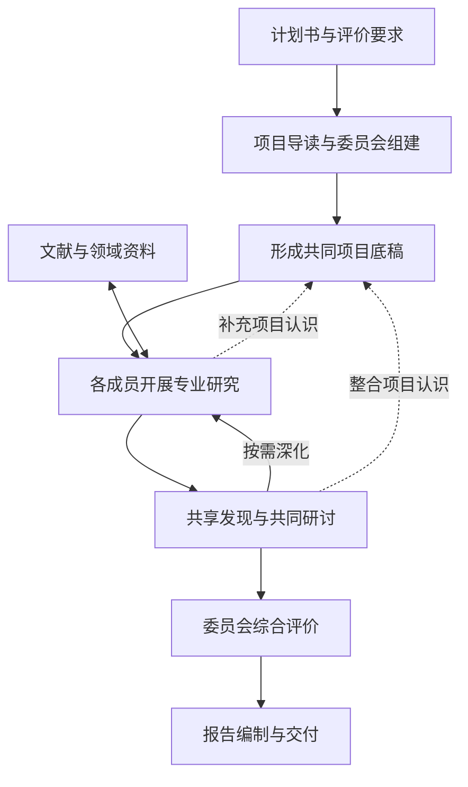

# Task Definition 与 Method：科学项目评审的多智能体工作框架

## 1. 总体构思

本文介绍 SpaceBioReview，一套面向科学项目评审的多智能体委员会框架。它将一次完整评审组织为团队工作：组建具有互补专长的委员会，共同理解计划书，开展专业研究，交流和整合知识，形成综合评价并交付报告。

框架的设计对象包括委员会的组织、共同工作的材料、成员的研究能力、协作方式，以及评审从启动到完成的全过程。专业分析、文献比较、知识发现和求证都在这一整体结构中发挥作用。

建议论文标题：

**SpaceBioReview: A Multi-Agent Review Committee for Scientific Research Proposals**

标题直接表达系统的组织形态与应用任务。论文主体围绕这套委员会如何工作展开。

框架的中心可以概括为：**以科学项目为共同对象，以专业研究为成员的主要工作，以知识共享和共同研讨连接专业认识，以综合评价形成委员会产出。**

## 2. Task Definition：一次完整的科学项目评审

### 2.1 任务范围

给定一份计划书及其附件、相应评价要求和可获得的外部资料，系统组织一次科学项目评审，形成对项目的专业认识与综合评价。

评审需要理解研究动机、科学背景、主要目标、研究内容、方法路线、预期贡献与实施安排。它还需要将这些内容放回相关领域，研究项目与已有知识的关系，并结合评价语境作出判断。

项目既可以是探索或机制研究，也可以是观测调查、方法开发或资源建设。复合项目可以同时包含多种研究活动。框架具有共同的组织方式，专业分工与研究内容则随项目而变化。

### 2.2 输入与产出

| 输入 | 在评审中的作用 |
|---|---|
| 计划书及附件 | 提供拟评审项目的科学内容、研究基础和实施安排 |
| 评价语境 | 说明资助目标、关注方面和所需的评价形式 |
| 外部知识资源 | 支持领域理解、已有工作比较、方法分析和实施条件研究 |

委员会最终交付一份完整评审，说明项目的领域位置、科学意义、主要贡献、研究方案和实施条件，并给出有依据的总体评价与建议。

科学价值、创新性、严谨性、可行性、安全性和管理构成报告的评价视角。各方面的具体内容取决于项目，彼此也存在联系。例如，一项平台能力既关系到实施可行性，也可能决定项目能够获得何种独特数据。

专业研究材料和引用为报告提供支撑。报告的组织围绕项目及其评价展开，详细研究记录可作为附录或查阅材料。

### 2.3 委员会的工作责任

成员有两种相互联系的责任：深入研究自己具有专长的内容，以及帮助委员会形成对整个项目的理解。专家可以重点关注某一研究对象或方法，同时保持对总体目标和其他工作路线的认识。

统筹者负责组织评审和形成整体判断。专业成员负责研究与专业评价。双方在工作中都可以提出新的研究重点，也都能根据获得的知识修正对项目的理解。

评审允许具有依据的不同判断。最终报告应说明主要取舍及其理由；任务完成不依赖全体成员意见一致。

## 3. 总体架构：委员会、共同材料与研究环境

框架由三个相互配合的部分构成。

### 3.1 委员会的组织

| 角色 | 持续承担的工作 | 与其他成员的关系 |
|---|---|---|
| 评审统筹者 | 理解整体项目，组织专长与分工，安排研讨，综合评价并确定报告重点 | 掌握各专业进展，连接其发现，组织必要的后续研究 |
| 专业评审成员 | 阅读计划书，调查领域知识，分析项目内容，形成专业评价 | 共享重要发现，吸收相关专业知识，参与共同研讨 |
| 研究支持角色 | 根据工作需要开展文献发现、原文阅读和资料整理 | 向专业成员和统筹者提供可使用的知识与出处 |
| 报告撰写角色 | 将委员会的综合评价组织成面向读者的报告 | 使用共同底稿和专业依据，落实表达与引用 |

统筹与专业评审构成委员会的主体。研究支持与报告撰写是配套能力，可以按工作量独立运行或由现有成员承担。

专业成员依据项目配置。例如，空间生命科学项目可能需要生物学、物理过程、实验与测量、空间任务实施等专长。专长决定成员从哪里深入研究、调用哪些知识和方法；共同项目则保证这些工作具有联系。

成员接受的是一项持续的专业评审职责，可以自行开展阅读、检索、比较和分析。具体问答或检索请求是这项工作中的行动，不构成成员全部的工作范围。

### 3.2 共同工作的材料

委员会围绕同一组可持续积累的材料工作：

- **原始项目材料**：所有成员均可访问，按专业需要深入阅读。
- **项目底稿**：组织研究背景、目标、主要工作、预期产物、贡献与实施条件，帮助成员理解局部工作在整体中的位置。
- **共同研究资料**：保存相关文献、专业发现和重要比较，供成员复用与继续研究。
- **综合评价稿**：在专业研究和共同研讨基础上，组织委员会对项目的整体判断。

这些材料构成不同层次的工作内容，可以采用普通文稿、表格和来源链接。无需为每个判断建立形式化命题、接受状态和置信数值。

项目底稿承担共同参照的作用。专业成员能够补充和修正其中的科学内容，统筹者负责将相关发现整合进去。初始底稿提供工作起点，后续研究使它逐渐丰富。

### 3.3 研究环境与专业能力

成员可以使用计划书阅读、文献检索、全文和图表阅读、领域资料查询等能力。适用时，也可以使用能够说明研究方法或设备能力的专业分析工具。

专业知识和方法指引帮助成员开展研究，例如如何理解探索性研究、怎样比较观测条件、如何分析测量方法和任务安排。它们为专业工作提供方法资源，不必扩展为常设的额外角色。

外部知识从评审开始就可获取，贯穿专业研究和共同研讨。既包括解释项目价值的背景与相关成果，也包括支持方法和实施条件的资料。知识获取的范围随专业研究展开。

## 4. 工作过程：从组建委员会到完成评审

框架具有明确的评审进程，同时给专业研究留出自主空间。

### 4.1 项目导读与委员会组建

统筹者通读材料，形成对项目的初步认识，选择所需专长并安排专业责任。成员随后阅读原文，建立各自的专业视角，并补充对研究内容、相关背景和工作安排的理解。

这一阶段共同明确项目是什么、各成员负责什么、哪些内容需要一起研究。专业分工可以覆盖多个评价方面，同一重要工作也可以得到不同专长的共同关注。

### 4.2 专业研究

各成员围绕承担的专业内容持续工作：阅读申请材料、了解领域进展、追踪代表性文献、比较相关研究、分析方法和条件，并形成对项目的专业认识。

研究既要理解申请人已经表达的内容，也要主动挖掘相关知识，发现计划书未充分阐明的科学意义。例如，一项研究可能具有独特的数据价值、方法价值或后续研究用途；是否成立，需要结合其实际设计和领域情况解释。

成员可以根据新发现调整自己的研究重点，向其他成员请求专业输入，或共享具有广泛作用的资料。统筹者维持整体工作方向，同时让专业成员有足够空间展开实质研究。

专业产物应能够说明相关领域如何看待这项研究、项目有什么特点、主要价值与局限在哪里，并提供必要依据。引用数量与疑点数量不代表研究深度。

### 4.3 共享发现与共同研讨

专业研究形成一定内容后，委员会交流各自对项目的认识。成员共享重要发现及其意义，其他成员据此补充自己的理解。共同研讨进一步连接研究背景、不同工作路线、方法能力和实施条件。

研讨内容由正在形成的项目认识决定。它既可以讨论重要科学主题，也可以围绕跨专业联系展开，必要时由少数相关成员深入研究。统筹者据此更新整体认识，并安排有限的后续工作。

一次共享能够产生多种作用：把某领域的重要进展带入其他成员的研究，发现不同工作之间的互补价值，解释一种技术能力的科学用途，或者明确某项局限影响哪些研究内容。这些都是正常的合作成果。

存在意见差异时，可以回到原材料或专业依据展开讨论；具有不同科学视角的判断也可以保留。交流的主要产物是更加丰富、连贯的项目认识。

### 4.4 委员会综合评价

统筹者结合专业研究与共同研讨，形成项目整体评价。综合首先抓住项目最重要的科学内容：它希望推进什么、相对已有研究能够增加什么、研究工作与目标是否相称、实施条件提供怎样的支撑。

随后从适用的评价方面展开，说明主要优势、局限及其相互关系。专业成员的判断通过其内容和依据进入综合，最终取舍由评价语境与项目整体情况共同决定。

前瞻性分析在这里按需使用。对于探索性研究，可以讨论未出现预期现象时仍可能获得的认识；对于多路线项目，可以说明各路线分别和共同具有的价值。它们是专业评价的一部分，不需要形成独立的结果枚举体系。

当主要研究内容得到充分讨论、适用评价方面具有实质依据时，委员会进入最终综合。有限资源下仍未完成的研究应如实反映，不能被包装成项目本身的缺陷。

### 4.5 报告编制与交付

报告以委员会的整体评价为基础，组织摘要、项目评价、主要依据与必要的专业说明。撰写者将研究材料提炼为有主次的内容，保持科学判断及其限定，不再启动新一轮独立评审。

报告应让读者理解项目的科学意义、具体贡献、研究能力和实施条件，并能够沿引用找到关键依据。各专业的详细工作可以保留供查阅，正文需要形成连贯的项目评价。

## 5. 贯穿全过程的知识工作

框架的知识工作具有一条连续的脉络：从计划书建立初始理解，通过专业研究扩展领域认识，经由成员交流连接知识，再将这些认识用于评价项目。

文献比较、专业问答、方法分析、可能结果讨论都是其中可使用的研究方式。它们根据项目需要组合使用。知识探索应保留一定开放性，允许成员发现原先没有意识到的重要关联和贡献。

同时，所有专业工作最终需要回到当前项目。领域背景帮助说明科学位置，方法知识帮助理解研究能力，平台资料帮助分析实施支持，跨领域联系帮助发现更完整的价值。委员会积累的是对项目有意义的知识。

基本求证融入这一过程：重要事实保留来源，比较已有工作时考虑对象和条件，专业判断说明与项目内容的联系。求证支撑研究质量，不另设一套以审查评语为中心的工作组织。

## 6. 一个完整评审过程的示例

以包含体外物理研究、细胞实验和在轨观测的项目为例。

委员会组建时，统筹者把三条研究路线放进整体目标中，配置物理、生物、测量和任务实施等专长。成员阅读相关原文，分别建立对材料体系、生物问题、观测安排和空间条件的认识。

专业研究随后并行展开。物理成员研究相关过程及已有实验；生物成员研究细胞系统和科学意义；测量成员分析拟获得的数据；任务成员研究平台能力与实验安排。各自都形成对项目价值与研究能力的评价，同时将有用资料放入共同研究材料。

共同研讨把这些发现连接起来。委员会理解特殊环境对研究的意义，讨论体外与细胞路线的联系，并结合测量及任务条件认识在轨观测的作用。新的领域发现可以促使成员补充研究，也可能让委员会重新理解项目最有价值的部分。

综合时，统筹者解释项目的主要贡献、各路线的独立价值与互补关系，以及方法和实施条件对这些贡献的影响，再形成完整的多方面评价。报告围绕这一整体认识展开。

这个案例展示同一框架如何承载多种专业工作。具体科学判断由材料和研究结果决定，框架负责组织这些工作及其联系。

## 7. 框架层面的探索与创新空间

创新需要从整套委员会的工作方式中体现。当前最值得深化的是以下相互关联的架构选择。

**委员会如何兼具稳定组织与项目适应性。** 框架保持统筹、专业研究、共享研讨和综合评价的基本组织，而专长组合、资料使用和研究重点随项目改变。值得研究的是如何形成有实际专业责任的成员组合，并维持整体评审能力。成员不必全部采用相同模型，专业差异也可以来自知识资源、研究方法和工具。

**专业自主性与共同项目认识如何相互促进。** 每个成员需要独立深入研究，委员会又需要共享正在积累的认识。框架应明确哪些内容由成员自主推进、何时共享重要发现、如何吸收其他专业的知识，以及怎样维护可供所有成员使用的项目底稿。这决定多智能体是否真正形成合作研究。

**研究与评价如何在完整流程中结合。** 专业研究持续形成局部评价，知识交流丰富对项目的整体认识，最终综合再结合评价语境作出取舍。框架需要把这种工作关系表达清楚，使知识探索、价值发现和多方面评价自然连接。

这些是同一框架内部的设计空间。论文可以给出一套明确选择，描述其完整运行方式，再通过实际任务分析效果。无需把每项选择各自包装为独立方法或单独证明的命题。

## 8. 相关工作的借鉴位置

| 相关工作 | 可借鉴内容 | 在框架中的位置 |
|---|---|---|
| [AstroReview](https://arxiv.org/html/2512.24754v1) | 科学申请评审的系统组织 | 用于比较应用范围、架构与完整评审流程 |
| [Virtual Lab](https://www.nature.com/articles/s41586-025-09442-9) | 专业角色、研究分工和团队会议 | 委员会组织与共同研讨 |
| [STORM](https://aclanthology.org/2024.naacl-long.347/) 与 [Co-STORM](https://aclanthology.org/2024.emnlp-main.554/) | 多视角知识探索与共享知识组织 | 专业研究及共同认识的积累 |
| [PaperQA2](https://arxiv.org/html/2409.13740v2) | 可迭代的文献检索、证据提取和回答生成 | 共用的文献研究能力 |
| [ExtAgents](https://aclanthology.org/2026.acl-long.468/) | 分担外部知识并共享相关信息 | 深入的局部研究与跨成员信息使用 |

这些工作为不同部分提供设计资源。SpaceBioReview 的论文主张落在面向科学项目评审的委员会架构、知识工作与全过程组织。相关工作比较应说明整体组织方式和适用任务的关系，并由实际评审展示系统能力。

## 9. Task Definition 与 Method 的论文组织

Task Definition 建议由三部分组成：评审对象与评价语境、输入和预期产出、完整评审的工作范围。用少量必要符号表达输入输出即可。

Method 建议按以下结构展开：

1. **Framework Overview**：给出完整架构图、成员关系、共同材料和主要信息流。
2. **Committee Composition and Responsibilities**：说明专长配置、成员职责与统筹方式。
3. **Shared Project Workspace and Research Resources**：说明共同工作材料、专业知识和工具的使用。
4. **Collaborative Review Process**：完整描述导读、专业研究、共享研讨、综合评价和报告交付。

贯穿案例帮助读者理解成员怎样工作，以及知识怎样进入最终评价。项目知识路径、文献比较和可能结果分析在相应位置介绍，不再分别作为论文的主轴。

贡献陈述围绕一套完整框架及其系统实现展开：提出科学项目评审的多智能体委员会组织，建立成员开展专业研究与共同评价的工作流程，并在完整计划书评审中展示其效果。

评估以整体框架的实用能力为中心，考察专业内容、价值认识、综合评价、覆盖与报告质量，并报告运行成本和完成情况。强单智能体与常规独立评审后综合的 MAS 可作为主要比较对象；必要的局部分析用于解释架构选择的作用。创新是否成立，最终需要体现在完整评审的产物和实际使用价值上。
