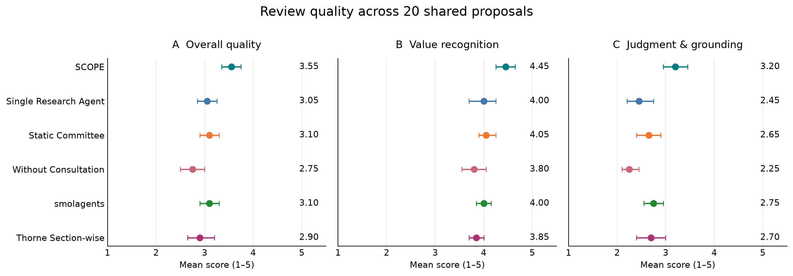
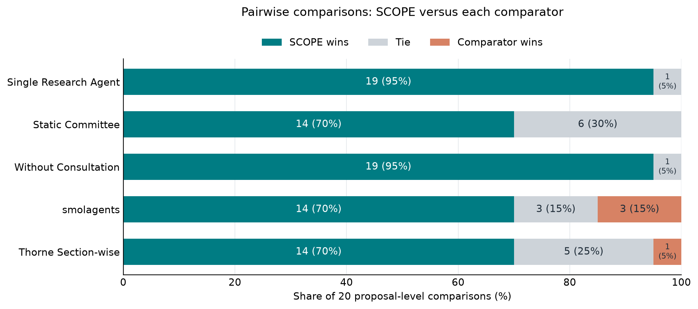
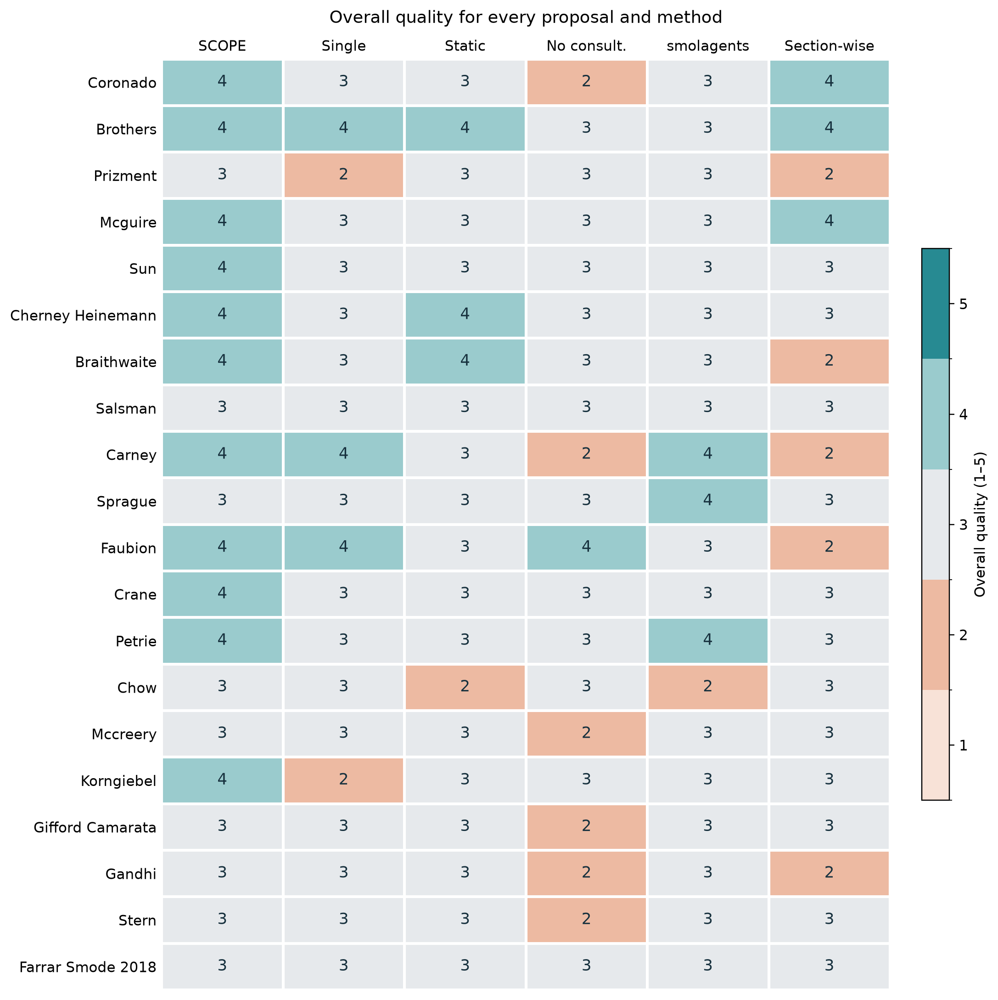
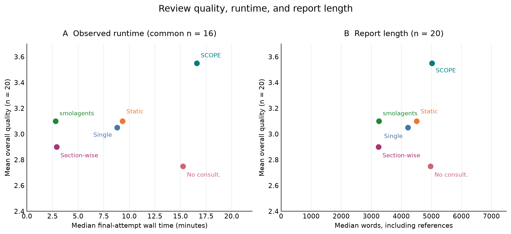
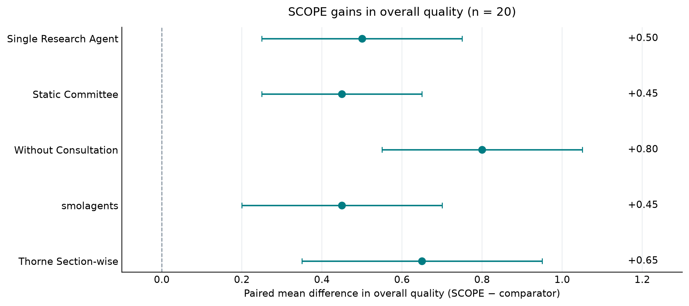

# Review quality results

SpaceBioReview achieves the highest mean score on all three quality dimensions across **20 proposals and 120 reports**. Its overall-quality score is **3.55/5**, exceeding the five comparators by **0.45–0.80 points**. All five paired 95% bootstrap intervals for these gains are above zero.

| Method | Overall quality | Value recognition | Judgment and grounding |
| --- | ---: | ---: | ---: |
| **SpaceBioReview** | **3.55** | **4.45** | **3.20** |
| Static Research Committee | 3.10 | 4.05 | 2.65 |
| smolagents | 3.10 | 4.00 | 2.75 |
| Single Research Agent | 3.05 | 4.00 | 2.45 |
| Thorne Section-wise | 2.90 | 3.85 | 2.70 |
| Without Consultation | 2.75 | 3.80 | 2.25 |

The evaluator was **ChatGPT Work (GPT-6 Astra Extra High)**. Evaluation date: October 30, 2026. The complete scoring procedure is in [protocol.md](protocol.md).

## Main findings

**Consultation produces the largest observed ablation gap.** Removing consultation lowers overall quality by 0.80 points and judgment and grounding by 0.95 points. The single-agent and static-committee variants also trail the full system in all three dimensions.

**Scientific value recognition is a strength; grounding remains the main opportunity for improvement.** SpaceBioReview scores 4.45 for value recognition and 3.20 for judgment and grounding. Recurring weaknesses include using a project's later outcomes to support its prospective feasibility, transferring findings across experimental conditions or populations, and drawing invalid conclusions from correctly quoted numbers.

**The full system delivers more consistently strong reports.** Eleven of its 20 reports receive an overall score of 4 and the remaining nine receive 3. Static Committee, Single Research Agent, smolagents, and Thorne Section-wise each have three reports scoring 4; Without Consultation has one.

**smolagents offers a strong runtime–quality trade-off.** It matches Static Committee's overall mean of 3.10 with a median runtime of 2.8 minutes, compared with 9.3 minutes for Static Committee and 16.6 minutes for SpaceBioReview. Runtime medians use the 16 proposals with records for every method.

## Figures

**Figure 1. Review quality.** Mean scores and 95% proposal-bootstrap intervals across 20 proposals.



**Figure 2. Pairwise comparisons.** SpaceBioReview's wins, ties, and losses against each comparator. Pairs are ranked by overall quality, then judgment and grounding, then value recognition.



**Figure 3. Proposal-level quality.** Overall-quality scores for every proposal and method.



**Figure 4. Runtime, report length, and quality.** Overall quality uses all 20 proposals. Runtime uses the 16 proposals with durations recorded for every method; report length uses all 20.



**Figure 5. Overall-quality gains.** Paired mean differences favor SpaceBioReview against all five comparators; whiskers show 95% bootstrap intervals.



## Representative findings

**S-MODE: scientific reasoning distinguishes reports with similar topic coverage.** Single Research Agent explains the value of partial success and identifies flux-proxy calibration and generalization issues. However, it equates a fitted regression coefficient h with pointwise h = w/D and concludes that every calibration point must be reproduced exactly. Without Consultation recognizes the distinction between point measurements and area averages, but incorrectly describes the Wave Glider as unable to hold station and confuses residual likelihood with consequence severity.

**Stern: evidence selection must preserve the proposal's actual responsibilities.** Single Research Agent identifies the 2018 and 2023 papers as later outputs of the project, yet repeatedly uses them to support the original plan's feasibility. It also assigns the current R21 responsibility for a parallel archive funded separately. These errors weaken an otherwise useful discussion of the project's value.

**Brothers: the full system explains what knowledge the project can produce.** SpaceBioReview connects different evidence conditions to attainable scientific insights and overall project value. It scores 4 for overall quality, 5 for value recognition, and 4 for judgment and grounding.

Project-level reasoning and source checks are recorded in [judgments.md](judgments.md).

## Data and files

- [table.md](table.md): quality scores, paired comparisons, score distributions, runtime, report length, and all individual results.
- [judgments.md](judgments.md): reference points, report-level rationales, and source checks.
- [scores.json](scores.json): report scores, paired outcomes, and raw run metadata.
- [summary.json](summary.json): aggregate scores, confidence intervals, paired differences, and resource summaries.
- [input_manifest.json](input_manifest.json): proposal and report paths, aliases, delivery records, telemetry, and file hashes.
- [reference_cards/](reference_cards/): proposal-specific scientific reference points.
- [judgments/](judgments/): individual evaluation records.
- [figures/](figures/): five figures, each available as PNG, PDF, and SVG.
- [validation.json](validation.json): record counts, input hashes, and plotting-library versions.

## Reproduce the results

Run from the repository root:

```powershell
uv run --no-project --with matplotlib==3.11.2 --with numpy==2.4.6 --python .venv/Scripts/python.exe python -B -X utf8 results2/scripts/summarize.py
```

The script aggregates the saved judgments and regenerates the tables, detailed rationales, and figures.
